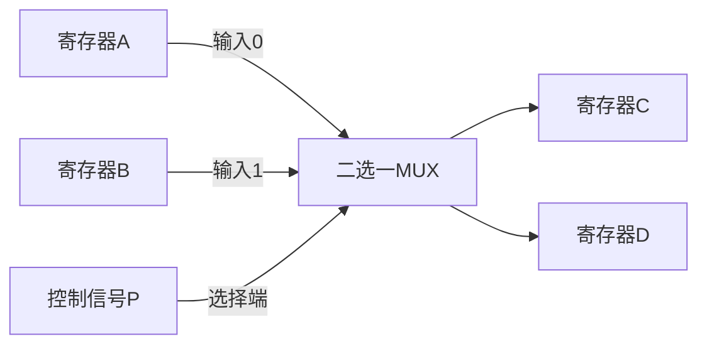

# 寄存器传输语言(RTL)描述的传输操作、算术操作、逻辑操作、移位操作及条件控制语句

---
requires: [数字电路与逻辑设计B/数据选择器, 数字电路与逻辑设计B/寄存器]
---

在数字系统设计中，我们不再只盯着单个门电路，而是要管理多个寄存器之间的数据流动。那么，如何用一种简洁、统一的方式来描述“谁把数据给了谁、做了什么运算、什么时候给”？这就是**寄存器传输语言（RTL）**要解决的问题。

> [!IMPORTANT]
> 一条 RTL 语句描述数字系统所处的一个状态；一组 RTL 语句可以定义一个完整的数字系统。状态框中的操作通常用 RTL 表示，若用助记符代替，则该助记符是控制器发出的控制命令。

## 传输操作：数据的搬运工

传输操作是最基础的 RTL 语句，表示将源寄存器的内容打入目标寄存器。

- **直接传输**：$R_2 \leftarrow R_1$，表示将 $R_1$ 的内容送入 $R_2$。
- **经多路选择器传输**：当有多个源寄存器时，需要数据选择器（MUX）来决定通路。

**课件例题**：设两个源寄存器 $A$、$B$，两个目标寄存器 $C$、$D$，通过一个二选一 MUX 实现如下传输：
$$P_1: C \leftarrow A$$
$$P_2: D \leftarrow B$$
其中 $P_1$、$P_2$ 为控制信号。

> [!TIP]
> 看到多个源寄存器共用一条总线或一个 MUX 时，立刻想到：**必须加控制条件来区分当前是谁在传输**。

## 算术、逻辑与移位操作

数据不仅能搬运，还能在传输过程中进行加工。这三类操作的符号与含义对比如下：

| 操作类型 | 典型 RTL 表达式 | 含义说明 |
| :--- | :--- | :--- |
| **算术操作** | $R_3 \leftarrow R_1 + R_2$ | 加法、减法、求补等，由 ALU 实现 |
| **逻辑操作** | $R_3 \leftarrow R_1 \land R_2$ | 按位与($\land$)、或($\lor$)、异或($\oplus$)、非($\overline{R}$) |
| **移位操作** | $R_1 \leftarrow sl\ R_1$ | $sl$ 左移，$sr$ 右移；分为逻辑移位和循环移位 |

注意，这些操作往往不是孤立存在的，而是和传输结合在一起。例如 $C \leftarrow A + B$ 意味着：先让 $A$ 和 $B$ 经过加法器算出结果，再将结果打入寄存器 $C$。

## 条件控制语句：系统的指挥棒

如果没有条件控制，系统只能死板地每一步都执行。引入条件控制后，RTL 才能表达分支逻辑。

格式通常为：
$$K_1: R_2 \leftarrow R_1$$
这里 $K_1$ 就是==控制条件==（布尔表达式）。只有当 $K_1 = 1$ 时，冒号后面的传输操作才会被执行；若 $K_1 = 0$，该语句不产生动作。

如果有互斥的多个条件，可以写成：
$$K_1: R_2 \leftarrow R_1,\quad K_2: R_3 \leftarrow R_1$$

> [!WARNING]
> 考试中最常见的坑：**混淆“控制条件”和“数据本身”**。控制条件 $K_1$ 决定的是“做不做”，而 $R_1$ 决定的是“传什么”。不要把控制变量写进箭头右侧的数据运算中。

## 综合示例：读懂一段 RTL

假设某状态下的 RTL 描述为：
$$P: C \leftarrow A \oplus B$$
$$\overline{P}: D \leftarrow sr\ A$$

这段代码定义了怎样的硬件行为？
1. 当控制信号 $P=1$ 时，寄存器 $A$ 和 $B$ 的内容经过**异或门**（逻辑操作），结果打入寄存器 $C$。
2. 当控制信号 $P=0$（即 $\overline{P}=1$）时，寄存器 $A$ 的内容**右移一位**（移位操作），结果打入寄存器 $D$。

> [!NOTE]
> 在算法状态机（ASM）图中，状态框内部写的正是这类 RTL 语句。如果状态框里只写了助记符（如 `ADD`），那它实际上是控制器发给数据通路的控制命令，底层依然对应着具体的 RTL 传输操作。
