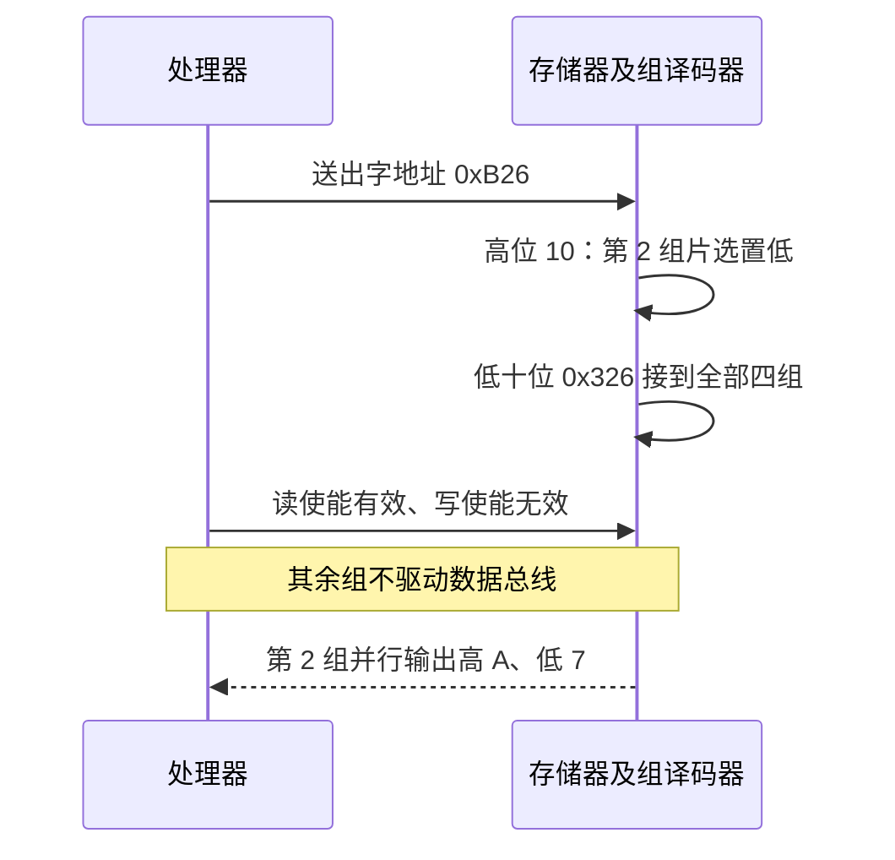

# 存储器的字扩展与位扩展

一片标成 $1\,\mathrm K\times4$ 的字寻址存储器，不是能独立寻址 4096 个位置：它有 $2^{10}$ 个地址，每个地址一次读写 4 位。要把几片芯片合起来，先问缺的是**地址位置**还是**每个位置能装的位数**。两种扩展都增加容量，但扩展的是不同维度。

- **位扩展**：同一个地址上的几片芯片同时工作，各处理数据字中互不重叠的位。地址线并接，片选与读写控制同步，数据线分组不短接。
- **字扩展**：每组保存不同地址范围；低位地址在组内定位，高位地址经译码选一组。各组可共用数据总线，但在经典三态接口上只能让被选组在读操作时驱动总线，写操作也只许更新被选组。

用 $1\,\mathrm K\times4$ 的芯片组成 $4\,\mathrm K\times8$：看到字数要变四倍、字长要变两倍，==先按字数定组数，再按字长定每组片数==：四组，每组两片。每组左片负责 $D_3\ldots D_0$，右片负责 $D_7\ldots D_4$；组内两片的 $A_9\ldots A_0$ 和片选并接。系统地址 $A_{11}A_{10}$ 送入二线—四线译码器，按下表选择一组。若芯片片选低有效，译码应使目标组的两片片选为低，其余组保持高。

| $A_{11}A_{10}$ | 被选组 | 系统字地址 |
| --- | ---: | --- |
| 00 | 0 | `000–3FF` |
| 01 | 1 | `400–7FF` |
| 10 | 2 | `800–BFF` |
| 11 | 3 | `C00–FFF` |

区间用十六进制表示。以 `B26` 为例，$A_{11}A_{10}=10_2$，组选 2，组内地址是 `326`。写入数据 `A7` 时，只在这组的两片分别存入低四位 `7`、高四位 `A`；读取时两片同时送出各自的四位，不会相互抢总线。下图追踪同一个地址上的一次读操作：低十位接到所有组，只有片选有效且读控制已有效的芯片才驱动数据总线。图按因果顺序展开，不表示引脚必须分时逐条变化。

> [!WARNING]
> 片选低有效不是“低电平表示地址低”。低电平决定哪组可以响应；低位地址决定组内哪一行。若误把所有组片选并接，`326`、`726`、`B26` 和 `F26` 的低十位完全一样，就不再是四个独立字。检查方案时，除了核对总容量 $8\times2^{10}\times4=2^{12}\times8$ 位，还要核对任意系统地址恰选一组、组内两片数据位互不重叠。
