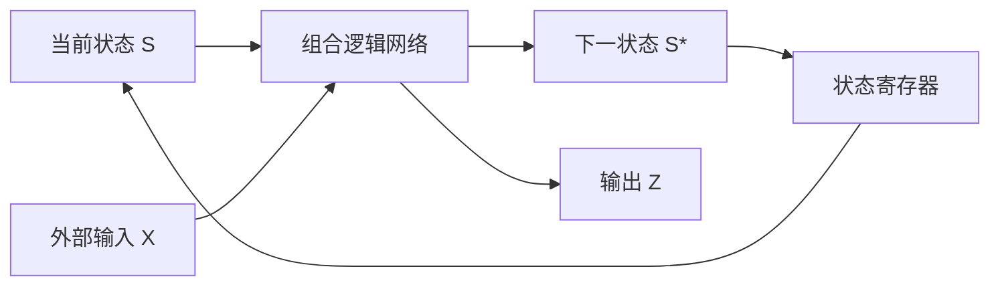
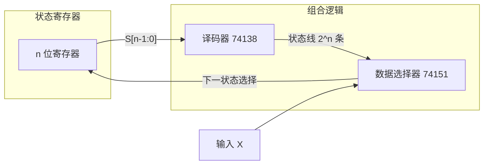

# 控制器的四种硬件实现方法：每态一触发器法(SSI)、MSI法(MUX+寄存器+译码器)、PLA法(LSI)及对比

## 控制器的四种硬件实现方法

控制器接收外部输入和当前状态，产生下一状态与输出信号。它是数字系统的心脏，但“心脏”怎么搭，直接决定电路的复杂度、可修改性和成本。理解四种实现方法，本质上是在回答同一个问题：**把“状态转移”这件抽象的事，用哪一级的硬件资源去落地？**

上图是控制器的一般模型。四种方法的差异，全在“组合逻辑网络”和“状态寄存器”这两块用**什么规模的器件**来搭。

---

## 每态一触发器法（SSI）

思路最直接：**给每个状态分配一个独立的 D 触发器**。电路处于状态 $S_i$ 时，只有第 $i$ 个触发器输出为 1，其余全为 0。

- **状态转移方程**：对于每个触发器 $Q_i$，
  $$
  Q_i^{n+1} = \sum_{j \to i} \left( Q_j^n \cdot X_{j \to i} \right)
  $$
  其中 $X_{j \to i}$ 是从状态 $j$ 跳转到状态 $i$ 所需的输入条件。
- **输出方程**：输出直接由当前状态（即对应触发器的 $Q$ 端）决定，Moore 型输出只需取对应触发器的输出；Mealy 型再与输入相与。

> [!TIP]
> 记忆口诀：**“一个状态一个触发器，跳转条件接到 D 端”**。从 ASM 图读状态转移时，每个指向 $S_i$ 的箭头，都对应 $Q_i$ 的 D 输入端一个与项，各与项最终或在一起。

> [!WARNING]
> 这个方法的坑在于：状态数多时，触发器数量线性增加，D 端输入的或项数目也随跳转密度增长。状态编码**无需另找**（天然独热码），但组合逻辑可能变得庞大。它适合**状态数少、跳转规则清晰**的小型控制器。

**例：** 若控制器有 4 个状态 $S_0 \sim S_3$，从 $S_0$ 在 $X=1$ 时跳转到 $S_2$，则
$$
Q_2^{n+1} = Q_0^n \cdot X + \cdots
$$
$S_2$ 对应的 D 触发器输入端接一个与门 $(Q_0 \cdot X)$，再与其他指向 $S_2$ 的路径相或。

---

## MSI 法（MUX + 寄存器 + 译码器）

当状态和输入的组合变多，纯 SSI 的连线会像蜘蛛网。MSI 法改用**中规模功能模块**搭组合逻辑：

- **状态编码**用 $n$ 位二进制码，存入 $n$ 位寄存器（如 74175）。
- **译码器**（如 74138）把当前状态 $n$ 位码译成 $2^n$ 个状态线。
- **数据选择器 MUX**（如 74151）根据输入控制变量，从多个“候选下一状态”中选出实际跳转目标。
- 输出逻辑另用译码器或门阵列实现。

> [!IMPORTANT]
> ==MSI 法的本质是“用模块化器件替代门级连线”==，状态编码是二进制的，所以触发器数量从每态一触发器的 $N$ 个降到 $\lceil \log_2 N \rceil$ 个，但需要额外的译码和选择电路。

它与每态一触发器法最关键的差异是：**每态一触发器法不用状态编码**，而 MSI 法**必须对状态做二进制编码**，编码方案影响译码器输出的使用方式。

---

## PLA 法（LSI）

MSI 法在“状态多、输入多”时仍然吃力——译码器输出的 $2^n$ 条状态线中，很多组合实际不会出现，造成浪费。PLA（可编程逻辑阵列）把问题转化为：**直接实现“与项—或项”两级逻辑**。

- PLA 的**与阵列**生成所需的乘积项（如 $Q_1^n \overline{Q_2^n} X_1$）。
- PLA 的**或阵列**把这些乘积项组合成各个 $Q_i^{n+1}$ 和输出 $Z_k$。
- 不需要译码器，也不需要完整最小项展开——==只生成真正需要的乘积项==。

用 PLA 实现上一节的 74138 多输出函数 $F_1, F_2, F_3$ 时，直接填写与阵列和或阵列的交叉点即可，多余的最小项只作为“不用”的列存在，不增加硬件。

> [!NOTE]
> PLA 和 ROM 的区别：ROM 是**全译码**的，$n$ 个输入产生全部 $2^n$ 个最小项；PLA 是**部分译码**的，只生成设计者指定的乘积项。因此在控制器的输入/状态组合稀疏时，PLA 面积远小于 ROM。

---

## 四种实现方法对比

| 方法 | 器件规模 | 状态编码 | 触发器数 | 组合逻辑 | 适用场景 |
| :---: | :---: | :---: | :---: | :---: | :---: |
| 每态一触发器 | SSI | 不需要（独热码） | $N$ | 门电路直接搭 | 状态少、跳转简单 |
| MSI 法 | MSI | 二进制编码 | $\lceil \log_2 N \rceil$ | 译码器 + MUX | 状态数中等、输入变量适中 |
| PLA 法 | LSI | 二进制编码 | $\lceil \log_2 N \rceil$ | PLA 与或阵列 | 状态多、输入多、组合稀疏 |
| 传统 SSI 法 | SSI | 二进制编码 | $\lceil \log_2 N \rceil$ | 门电路最简表达式 | 教学与小型设计 |

> [!CAUTION]
> 复习提纲中“传统设计方法（SSI）”与“每态一触发器法（SSI）”都写着 SSI，但两者**不是一回事**。传统 SSI 法先做状态化简、状态编码，再用卡诺图求最简激励方程，触发器数目少但设计流程长；每态一触发器法**跳过编码和最简化简**，触发器数目多但方程直接可读。考试常把二者放在一起考“选择哪一种及原因”。

> [!IMPORTANT]
> ==核心结论：状态数和输入变量数都多时，优先选 PLA（LSI）；状态少且追求设计直观时，选每态一触发器法。== 判断标准不是“哪种更高级”，而是==组合逻辑的稀疏程度==——越稀疏，PLA 的优势越明显。
