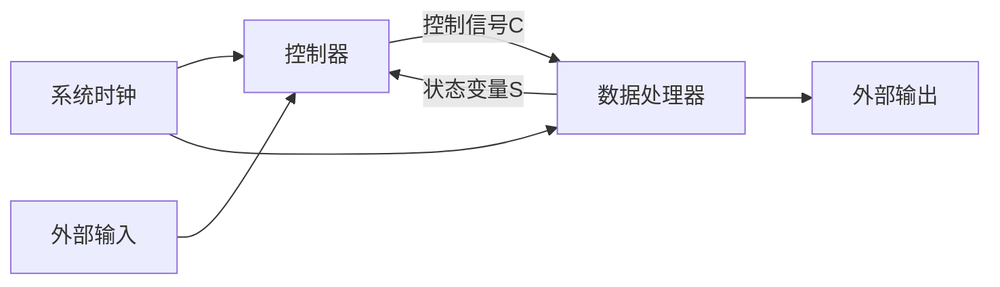
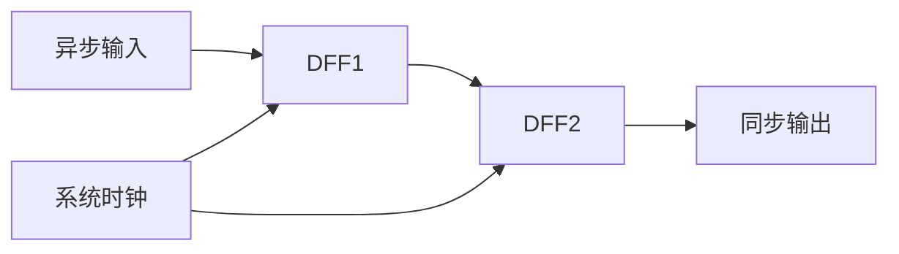

# 数字系统的基本模型（数据处理器与控制器）及对最小时钟周期、异步信号同步化的约定

> [!IMPORTANT]
> 数字系统的基本模型由==数据处理器==与==控制器==两部分组成。

一个加法器能算数，但它不是“系统”。为什么？因为它不知道该在什么时候算、算完之后干什么。把“算法步骤”规定下来的部件，就是控制器。**控制器是区别数字系统和简单功能部件的标志。**

## 基本模型：谁干活，谁指挥

数据处理器负责接受命令、加工存储信息、产生状态变量；控制器负责生成控制信号序列，决定算法步骤。两者由同一个系统时钟控制。

- **数据处理器**：用==操作表==（列出控制信号下应实现的操作）和==状态变量表==（定义输出的状态变量）描述。
- **控制器**：必须有记忆能力，本质是时序电路。用==状态转移图/表==或 ASM 图描述。

> [!NOTE]
> ASM 图与普通流程图的区别在于时间严格性：控制器处于某状态时执行对应操作，状态转换伴随操作时序进行。

控制器形成控制信号的逻辑为 $C = F(S, Q)$，其中 $S$ 为数据处理器产生的状态变量，$Q$ 为已更新的寄存器状态。

## 最小时钟周期的约定

系统只有一个时钟，那周期 $T_{clk}$ 能不能无限短？不能。在一个时钟周期内，信号必须跑完整个闭环：

1. 控制器触发器输出控制信号；
2. 信号经过组合逻辑到达数据处理器；
3. 数据处理器完成运算，产生新的状态变量 $S$；
4. $S$ 反馈回控制器输入端，并满足建立时间。

因此，最小时钟周期受限于关键路径延迟：

$$T_{min} = t_{cq} + t_{comb(max)} + t_{setup}$$

其中 $t_{cq}$ 为触发器时钟到输出延迟，$t_{comb(max)}$ 为最长组合逻辑延迟，$t_{setup}$ 为目的触发器的建立时间。若时钟过快，新状态尚未稳定就采样，系统将彻底错乱。

## 异步信号同步化

如果外部输入（如按键启动信号 `START`）不受系统时钟控制，直接接入控制器会怎样？它可能在时钟边沿附近跳变，导致触发器进入亚稳态。

> [!WARNING]
> 异步信号绝对不能直接作为时序电路的输入条件！

**怎么做？** 采用两级 D 触发器级联进行同步化：

第一级 DFF 可能因违反建立/保持时间而进入亚稳态，但经过一个完整时钟周期后，其输出极大概率已稳定为确定的 0 或 1；第二级 DFF 在下一个时钟沿正常采样，输出即为安全的同步信号。

> [!TIP]
> 同步化口诀：异步进系统，两级 DFF 保平安。

## 易混概念辨析

| 比较维度 | 数据处理器 | 控制器 |
| :--- | :--- | :--- |
| **核心任务** | 信息的加工、存储、检验 | 规定算法步骤，发命令 |
| **电路本质** | 组合逻辑 + 寄存器 | 时序电路（含存储器） |
| **描述方法** | 操作表、状态变量表 | ASM 图、状态转移图/表 |
| **设计依据** | 明确操作明细表 | 导出 ASM 图建状态转移表 |

> [!CAUTION]
> 常见坑：画 ASM 图推导控制器时，误将判断框中的条件（处理器的状态信号或外部输入）当成控制信号输出。记住：==判断框只影响控制器的走向，不发出操作命令==；操作命令写在状态框中。
