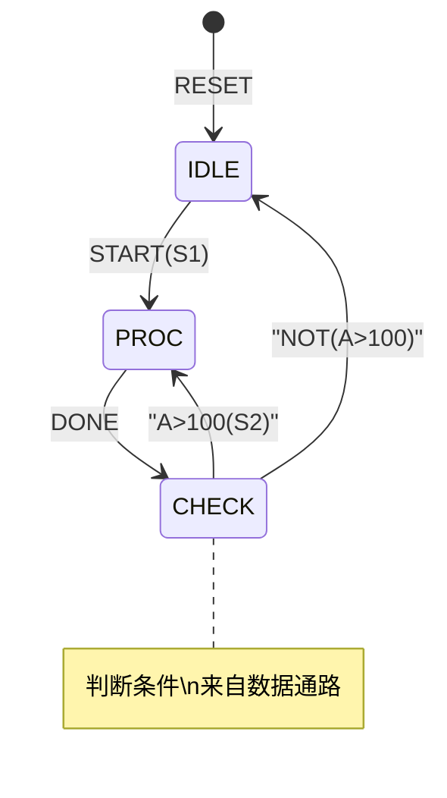

# 完整数字系统设计流程实例（如乘法器、交通灯管理系统的算法规律、处理器设计与控制器实现）

## 完整数字系统设计流程

数字系统设计不是单纯画门电路，而是将复杂功能分解为==数据处理器（Datapath）==与==控制器（Controller）==两大模块的协同工作。为什么要这样分？因为数据通路负责“算”和“存”，而控制器负责“何时算”和“下一步做什么”。这种分离使得设计可以模块化：先用算法状态机（ASM）图描述行为，再分别实现硬件。

> [!IMPORTANT]
> 核心设计范式是 **ASM 图驱动**。控制器根据外部输入和处理器反馈的状态信号（如 $A>100$），产生控制命令；处理器执行操作并回传状态，形成闭环。

## ASM 图到硬件的映射

如何将文字描述的算法转化为电路？关键在于建立**明细表（State Table）**。以课件中提到的系统为例，若处理器发出 `START` 和 `$A>100$` 作为状态信号 $S_1, S_2$，控制器需据此决定下一状态及输出。

[!TIP]
解题口诀：**状态定存储，条件定转移，输出定连线**。ASM 图中的每个状态框对应触发器的一个编码，菱形判断框对应数据比较器的输出，矩形输出框对应寄存器的使能或选择信号。

## 数据运算中的修正逻辑

在数据处理器设计中，纯二进制逻辑常需适配十进制规则。例如 8421BCD 码减法，直接按位相减可能得到非法码或错误结果，必须引入==修正算法==。这与普通二进制减法的区别在于：BCD 运算是“逢十借一”，而二进制是“逢二借一”。

> [!WARNING]
> BCD 减法修正易错点：当某位相减产生借位或结果 $>9$ 时，需对该位 ==减 6（即加 1010 取补）== 进行修正，而非简单的二进制调整。

**正确计算示例：** $843 - 348$
1.  按位相减：$(1000\ 0100\ 0011) - (0011\ 0100\ 1000) = 0100\ 1111\ 1011$
2.  检查修正：个位 $1011 > 9$，需减 $0110$；十位 $1111 > 9$，需减 $0110$
3.  修正后结果：$(0100\ 1001\ 0101)_{8421BCD} = 495$

## 组合逻辑与系统设计的辨析

考试中常混淆“独立组合电路设计”与“系统中的数据处理单元”。前者如三列火车发车控制、7485 判别电路，关注真值表化简与 MSI 芯片选型；后者则是 ASM 图中的一个子模块。

| 维度 | 组合逻辑设计 | 系统数据处理器 |
| :--- | :--- | :--- |
| 目标 | 单一函数最简实现 | 配合时序完成算法步骤 |
| 核心 | 卡诺图/MSI 应用 | 寄存器传输级(RTL)描述 |
| 约束 | 静态输入输出关系 | 受控于时钟与控制信号 |
| 典型题 | 优先级编码器、比较器 | BCD 运算单元、移位累加器 |

[!CAUTION]
切勿将系统设计题当成纯组合逻辑做！若题目出现“序列”、“状态”、“循环”等词，必须画 ASM 图或状态转换图，仅用组合电路无法通过考试。
