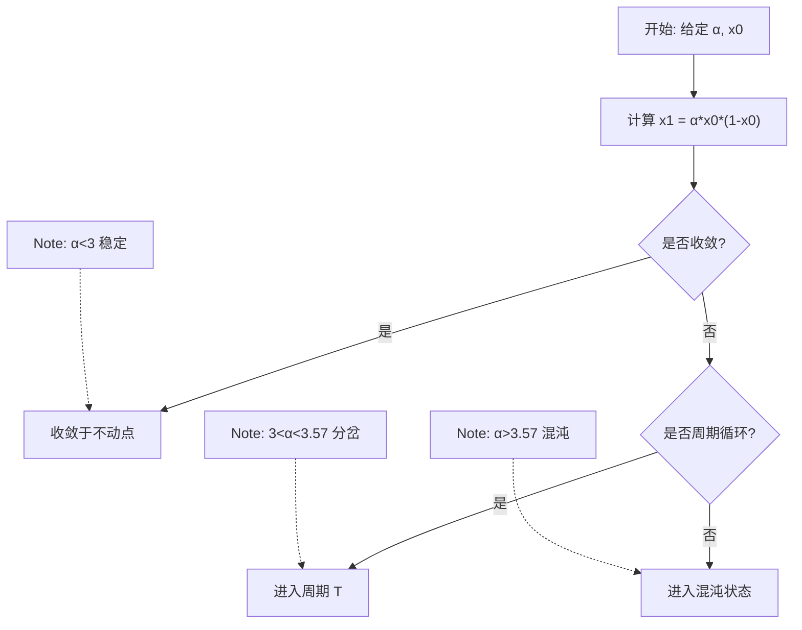

# Logistic映射与混沌现象

## Logistic 映射与混沌现象

Logistic 映射是一个简单的非线性迭代方程：
$$ x_{n+1} = f(x_n) = \alpha x_n (1 - x_n), \quad 0 \leq x_n \leq 1 $$
其中 $\alpha$ 为控制参数。它常用于模拟种群增长，但在数学实验中，它是观察**从有序到混沌**演变的经典模型。

> [!IMPORTANT]
> 核心结论：随着参数 $\alpha$ 增大，系统行为经历 **不动点 $\to$ 周期倍增 $\to$ 混沌** 的过程。

## 为什么需要研究它？

线性系统通常易于预测，但自然界大多是非线性的。Logistic 映射展示了**确定性系统**如何产生**随机性外观**的行为。理解它有助于掌握“初值敏感性”和“分岔”概念，这是混沌理论的基础。

## 怎么做：蜘蛛网图与迭代分析

在 MATLAB 中，通过循环计算迭代序列 $x_0, x_1, \dots, x_N$，并绘制“蜘蛛网”图（Cobweb Plot）来直观观察收敛性。

### 关键步骤
1.  **设定参数**：选择 $\alpha$ 和初值 $x_0$（通常取 0.5）。
2.  **迭代计算**：利用 `for` 循环生成序列。
3.  **观察图形**：
    *   若轨迹螺旋收缩至一点，则为**不动点**。
    *   若轨迹在几个点间跳跃，则为**周期运动**。
    *   若轨迹杂乱无章且不重复，则为**混沌**。

## 常见坑与辨析

| 概念 | 特征 | 判据 |
| :--- | :--- | :--- |
| **不动点** | 序列趋于常数 | $|f'(x^*)| < 1$ |
| **周期 T** | 序列每 T 步重复 | 出现 $T$ 个固定值循环 |
| **混沌** | 貌似随机，确定性强 | 对初值极度敏感，无周期 |

> [!WARNING]
> 易错点：**混沌不是随机**。混沌是由确定性方程产生的，只是长期不可预测。另外，$\alpha=3.568$ 时周期可能很大（如 $T=9$ 或更高），不要误判为混沌，需足够多的迭代次数才能看清。

> [!TIP]
> 记忆技巧：$\alpha$ 越大，系统越“乱”。3.0 是分岔起点，3.57 左右进入混沌区。

## 算对了的例子

以课件实验 2.4 为例，取 $x_0 = 0.5$：

*   当 $\alpha = 3.3$ 时：序列最终在两个值之间震荡，**周期 $T=2$**。
*   当 $\alpha = 3.5$ 时：序列在四个值之间循环，**周期 $T=4$**。
*   当 $\alpha = 3.6$ 时：序列不再呈现简单周期，点在 $[0,1]$ 区间内看似随机分布，进入**混沌**状态。

==核心高亮==：在 $\alpha=3.568$ 附近，系统处于周期倍增通向混沌的临界区，可能出现高阶周期（如 $T=9$ 或其他 $2^n$ 周期外的窗口），需仔细甄别。
