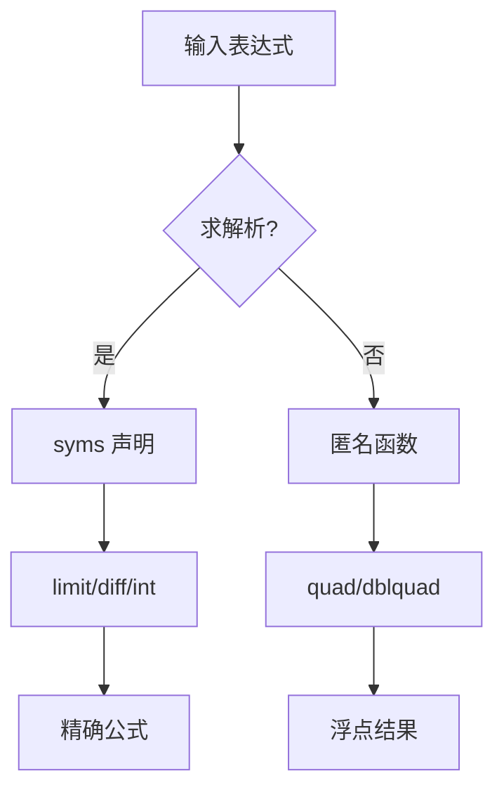

# MATLAB数值计算与表达式求值

MATLAB 不仅能做矩阵运算，还能把整个数学分析流程搬进命令行。 ==MATLAB 数值计算与表达式求值== 就是指：用符号对象（`syms`）描述变量，再调用内置函数对极限、导数、积分、级数等表达式直接求解或近似求值。它把"推公式"与"算结果"合并在同一脚本里，是《数学实验 B》后续所有建模与仿真的入口。

## 它是什么，为什么需要

手工推导 $\lim_{x \to 0}\frac{mx - \sin mx}{x^3}$ 要泰勒展开三次，既费时又容易丢项。MATLAB 提供两条路径：

- ==符号计算==：用 `syms x` 声明后，`limit`/`diff`/`int`/`taylor` 返回的是**精确表达式**，结果里保留分数与 $\arctan$ 等函数。
- ==数值计算==：用 `@(x,y)` 匿名函数、`dblquad`/`quad` 等，直接返回**浮点数**，适合无解析解或只需小数结果的场合。



## 怎么做：典型命令

| 任务 | 命令 | 返回 |
| --- | --- | --- |
| 极限 | `limit(f, x, 0)` / `limit(f, x, inf)` | 精确表达式 |
| 导数 | `diff(f, 2)`、`diff(f, 10)` | 高阶导函数 |
| 积分 | `int(f)`、`dblquad(@(x,y)…)` | 解析式 / 浮点值 |
| 泰勒展开 | `taylor(f, 'Order', 5)` | 截断多项式 |

`diff(f, n)` 中 $n$ 表示求 $n$ 阶导，==`'Order', 5` 表示保留到 $x^4$，共 5 项==，不是最高次幂为 5。

## 相近概念的区别

| | 符号计算 | 数值计算 |
| --- | --- | --- |
| 输入 | `syms x` 声明 | `@(x,y)` 匿名函数 |
| 典型函数 | `limit/diff/int/taylor` | `quad/dblquad/fzero` |
| 输出 | 公式（`sym`） | 浮点数（`double`） |
| 适用 | 需要通解、推导 | 只需数值、无解析解 |

## 常见的坑

> [!WARNING]
> - `dblquad` 的被积函数必须写成 `exp(x.^2+y.^2)`，用 `x^2` 在矩阵输入时会报维度错。
> - `diff(f, 2)` 中 `2` ==是阶数==；若写成 `diff(f, x, 2)` 反而会把 2 当作求导变量。
> - 泰勒展开默认在 $x=0$ 处展开，若要求 $x=a$ 处需另加参数。
> - 学号里的 $m$ 直接代入表达式即可，不必再定义变量，避免 `syms m` 造成符号冗余。

> [!TIP]
> 先 `syms x` 一次，后续所有符号命令都复用；命令窗口直接 `pretty(ans)` 可让长结果以分式排版，便于截图。

## 算对了的例子

求 $\lim_{x \to 0}\frac{1001x - \sin 1001x}{x^3}$ 与 $x \to \infty$ 的极限。

```matlab
syms x
limit((1001*x - sin(1001*x))/x^3, x, 0)
limit((1001*x - sin(1001*x))/x^3, x, inf)
```

结果分别为 $\dfrac{1003003001}{6}$ 与 $0$。可以看出：$x \to 0$ 时分子是 $O(x^3)$，极限为非零常数；$x \to \infty$ 时分母占优，极限为 0，==符号计算给出的是精确分数而非小数==。

> [!NOTE]
> 需要写回实验报告时，把 `limit` 的返回值用 `char(ans)` 或 `latex(ans)` 转换，可直接粘进 Word/LaTeX。
