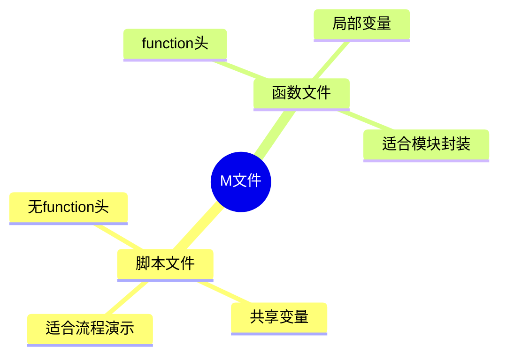

# M文件编程基础

# M文件编程基础

在 MATLAB 中，**M文件**是存储代码的文本文件（扩展名为 `.m`）。它是实现复杂算法、自定义函数和自动化计算的核心载体。相比于命令行窗口（Command Window）的即时执行，M文件允许代码保存、复用和结构化组织。

## 为什么需要 M 文件？

命令行适合单行测试，但面对多步逻辑（如迭代数列、分段函数）时显得力不从心。
- **可复用性**：一次编写，多次调用。
- **结构化**：支持循环、判断等控制流。
- **模块化**：通过函数文件封装功能，降低耦合。

==核心结论==：简单计算用命令行，复杂逻辑必须用 M 文件。

## M 文件的两种类型

| 特性 | 脚本文件 (Script) | 函数文件 (Function) |
| :--- | :--- | :--- |
| **定义关键字** | 无 | `function` |
| **变量作用域** | 全局工作区 | 局部工作区 |
| **输入/输出** | 无显式参数 | 有明确输入输出 |
| **文件名要求** | 任意合法名 | **必须**与函数名一致 |



> [!IMPORTANT]
> 函数文件名必须与 `function` 后定义的函数名完全一致，否则 MATLAB 无法正确调用。

## 怎么做：从定义到调用

### 1. 函数文件定义
以复习提纲中的分段函数为例，需处理逻辑判断。

```matlab
function y = f(x)
    % 注意：若x为向量，if判断可能失效，需用逻辑索引或arrayfun
    if 0 <= x && x <= 1/2
        y = 2.0 * x;
    else
        y = 2.0 * (1 - x);
    end
end
```

### 2. 调用方式
- **脚本中调用**：直接写 `y = f(0.3)`。
- **配合绘图**：使用函数句柄 `@f`。
  ```matlab
  fplot(@f, [0, 1]) % @符号创建函数句柄
  ```

> [!WARNING]
> `fplot` 要求函数能接受向量输入并返回向量输出。上述 `if-else` 结构仅适用于标量。若用于通用绘图，建议改用逻辑运算：
> `y = (2*x).*(x>=0 & x<=0.5) + (2*(1-x)).*(x>0.5 & x<=1);`

## 常见坑与辨析

1. **路径问题**：M 文件必须位于 MATLAB **当前文件夹**或**搜索路径**中，否则报错 "Undefined function"。
2. **变量冲突**：脚本修改变量会污染工作区；函数内部变量外部不可见，更安全。
3. **符号计算 vs 数值计算**：
   - 求导、积分等解析解用 `syms` + `diff`（如考题中选择2）。
   - 迭代、数值逼近用 M 文件循环（如实验2.1）。

## 算对了的例子：牛顿迭代法收敛性

**题目**：设 $x_{n+1} = (x_n + \frac{m}{x_n})/2$，$x_1=3, m=1000$，判断收敛值。

**思路**：这是一个典型的数值迭代过程，必须用 M 文件（或脚本）实现循环。

```matlab
% script_newton.m
m = 1000;
x = 3;
tol = 1e-8; % 精度要求
for k = 1:1000
    x_new = (x + m/x) / 2;
    if abs(x_new - x) < tol
        break;
    end
    x = x_new;
end
fprintf('收敛值: %.8f\n', x);
```

**结果**：运行后输出 `31.62277660`，即 $\sqrt{1000}$。此例展示了 M 文件在处理**重复性数值计算**时的优势，这是命令行难以优雅实现的。

> [!TIP]
> 考试中若遇“作图”题且函数分段，优先检查是否需用 M 文件定义函数句柄，再传入 `fplot` 或 `ezplot`。
