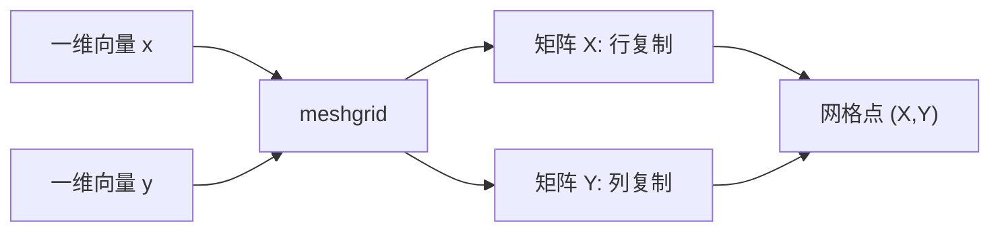
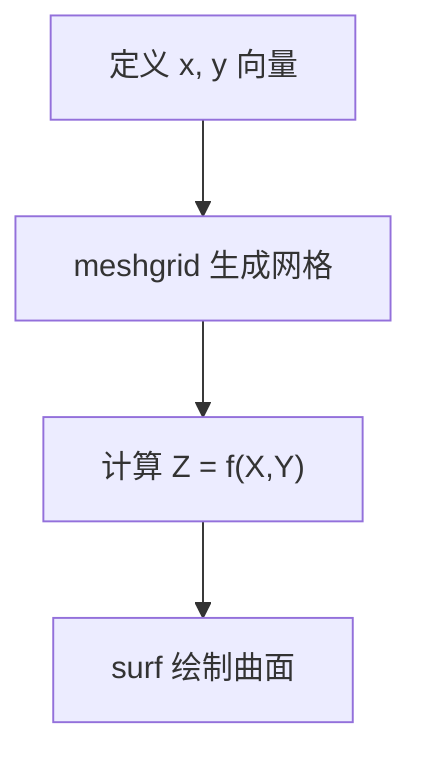

# 三维曲面绘图与网格生成（meshgrid/surf）

在 MATLAB 中，如果直接拿两个一维向量 `x`、`y` 去算 $z = f(x,y)$，能画出三维曲面吗？不能。因为曲面需要定义域内**每一个点** $(x_i, y_j)$ 的高度值，而两个独立向量无法自动组合出所有坐标对。这就引出了 `meshgrid` 与 `surf`。

## 网格生成：meshgrid

`meshgrid` 的作用是将两个一维向量“交叉相乘”，==生成覆盖整个矩形区域的二维网格矩阵==。



调用格式为 `[X, Y] = meshgrid(x, y)`。生成的 `X` 每一行都是向量 `x` 的复制，`Y` 每一列都是向量 `y` 的复制。这样 `X(i,j)` 和 `Y(i,j)` 就构成了平面上第 $(i,j)$ 个网格点的横纵坐标。

> [!IMPORTANT]
> `X` 和 `Y` 必须是同型矩阵，后续的函数运算才能逐点进行。

## 曲面绘制：surf

有了网格矩阵，代入函数表达式求出高度矩阵 `Z`，即可用 `surf(X, Y, Z)` 绘图。`surf` 会在相邻网格点之间填充颜色，画出一张==带颜色的连续三维曲面==。

完整的绘图流程如下：



## 完整示例

以考题中的 $z = 1000x^2 + y^4$ 为例，完整程序如下：

```matlab
x = -5:0.1:5;
y = -10:0.1:10;
[X, Y] = meshgrid(x, y);      % 生成网格矩阵
Z = 1000*X.^2 + Y.^4;         % 逐点计算高度（注意用 .^）
surf(X, Y, Z);                % 绘制三维曲面
```

图形呈现为一个开口向上的抛物面与四次曲面的组合。由于 $x$ 方向系数 $m=1000$ 极大，曲面沿 $x$ 轴方向上升极陡，而沿 $y$ 轴相对平缓。

## 相近概念辨析

| 函数 | 渲染方式 | 视觉效果 |
| :--- | :--- | :--- |
| `surf` | 面着色，填充网格面 | ==实体彩色曲面== |
| `mesh` | 线着色，仅画网格线 | 镂空网格图 |
| `plot3` | 逐点连线 | 三维空间曲线 |

> [!NOTE]
> 若要观察曲面内部结构或数据较密时防遮挡，可改用 `mesh`；若只画单条空间轨迹则用 `plot3`。

## 常见易错点

> [!WARNING]
> **忘记加“点”运算符。** 矩阵乘法 `*` 和矩阵幂 `^` 要求维度匹配。计算 $Z$ 时必须使用逐元素运算 `.*` 和 `.^`，例如 `X.^2`，否则 MATLAB 会报错“矩阵维度不一致”。

> [!CAUTION]
> **混淆 `x` 与 `y` 的对应关系。** `[X, Y] = meshgrid(x, y)` 中，`X` 的行数由 `y` 的长度决定，列数由 `x` 的长度决定。若后续作图发现坐标轴反了，通常是把 `X`、`Y` 写反了。

> [!TIP]
> 记忆口诀：**先定范围再铺网，点乘点幂算高度，最后 surf 画出来。** 步长（如 `0.1`）越小曲面越光滑，但计算量越大，需根据图形复杂度折中选择。
