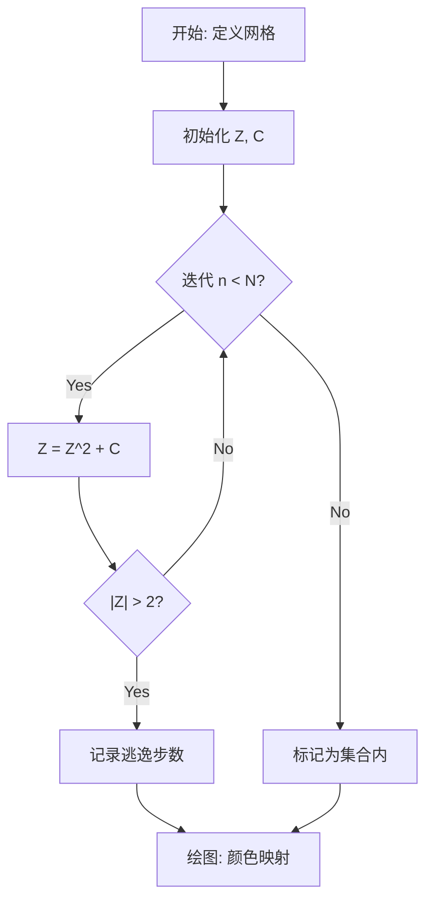

# 分形图形生成（Julia集/Mandelbrot集）

# 分形图形生成（Julia集/Mandelbrot集）

## 它是什么与为什么需要

分形（Fractal）是指具有==自相似性==的几何形状，即局部结构与整体结构在统计意义上相似。在《数学实验B》中，我们主要通过复平面上的非线性迭代来生成分形图。

为什么要学习它？
1. **直观理解混沌**：展示简单规则如何产生极度复杂的无序行为。
2. **算法实践**：掌握矩阵化运算与可视化技巧，避免低效循环。
3. **审美与科学**：连接数学之美与自然现象（如海岸线、云层）。

## 核心原理：迭代与逃逸时间

以经典的 Mandelbrot 集为例，其迭代公式为：
$$ z_{n+1} = z_n^2 + c $$
其中 $z_0 = 0$，$c$ 为复平面上的点。

> [!IMPORTANT]
> ==判定准则==：若迭代序列 $|z_n|$ 始终有界（通常设定阈值 $R=2$），则 $c$ 属于该集合；若在 $N$ 次迭代内 $|z_n| > R$，则视为“逃逸”。

**Julia 集**与 Mandelbrot 集的区别在于参数固定方式：
- **Mandelbrot**：固定 $z_0=0$，遍历改变 $c$。
- **Julia**：固定常数 $c$，遍历改变初始值 $z_0$。

## Martin 迭代：另一种分形生成

除了复数迭代，课件中还介绍了 Martin 迭代（基于实数平面的离散动力系统）：
$$
\begin{cases}
x_{n+1} = y_n - \text{sgn}(x_n) |b x_n - c|^{1/2} \\
y_{n+1} = a - x_n
\end{cases}
$$
通过调整参数 $a, b, c$，可生成类似羽毛、螺旋或云团的图案。

> [!TIP]
> 参数敏感性极高。微小的参数变化会导致图形结构剧烈改变，这正是==混沌==的特征。

## 常见坑与实现技巧

| 常见误区 | 正确做法 |
| :--- | :--- |
| 使用 `for` 循环逐点计算 | 利用 MATLAB/Octave 的==矩阵并行运算== |
| 迭代次数 $N$ 过小 | $N$ 需足够大（如 1000+）以区分边界 |
| 颜色映射单一 | 使用 `colormap` 根据逃逸速度着色 |

> [!WARNING]
> 在 Martin 迭代中，注意 `sgn` 函数在 $x=0$ 处的定义，以及开方运算对负数的处理（需取绝对值或限制定义域）。

## 算对了的例子：Martin 迭代实验

参考实验 2.5，取 $m=10000$，迭代 $N=20000$ 次。

**案例**：参数 $a=-10000, b=10, c=-10000$。
调用 `Martin(-10000, 10, -10000, 20000)`。

**结果分析**：
由于 $b$ 较小且 $a,c$ 为大负数，迭代点在相空间中形成==稀疏的螺旋状吸引子==。若将 $b$ 增大，图形会变得更加致密甚至充满区域。

> [!NOTE]
> 不同参数组合对应不同的动力学行为：周期、准周期或混沌。观察图形是否“填满”某区域，可辅助判断其性质。
