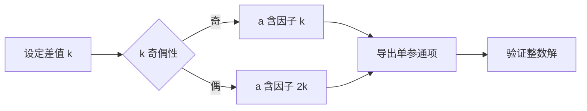

# 勾股数理论推导与通项公式
在《数学实验B》中，我们不仅要会用软件“跑”出勾股数，更要理解其背后的代数结构。当面对 $c-b=k$ 这类约束时，盲目遍历效率极低。能否将数值规律转化为解析表达式？这要求我们从方程 $a^2+b^2=c^2$ 出发，结合差值条件进行==参数化推导==。

### 从差分约束到通项公式

若已知斜边与直角边之差 $c-b=k$，如何避免双重循环搜索？

将 $c=b+k$ 代入勾股方程 $a^2+b^2=(b+k)^2$，展开整理得：
$$
a^2 = 2bk + k^2 \implies b = \frac{a^2 - k^2}{2k}
$$
为保证 $b$ 为整数，$a^2-k^2$ 必须能被 $2k$ 整除。此时引入参数 $u$，可将 $a,b,c$ 表示为 $u$ 的函数。以考题中 $c-b=4$ 为例，令 $a=4(u+1)$（$u \geq 0$），代入上式即可推导出完整通项：
$$
\{a,b,c\}=\{4(u+1),\ 2(u^2+2u),\ 2(u^2+2u+2)\}
$$

> [!IMPORTANT]
> ==通项公式的本质是单参数化==。它将二维搜索降维为一维枚举，是解决特定差值勾股数问题的核心工具。

### 不同差值的公式对比

$k$ 取不同值时，通项形式呈现明显奇偶差异。下表总结了实验中常见的几种情况：

| 差值 $k=c-b$ | 参数 $u$ 范围 | 通项公式 $\{a, b, c\}$ | 备注 |
| :--- | :--- | :--- | :--- |
| 1 | $u \geq 1$ | $\{2u+1,\ 2u(u+1),\ 2u(u+1)+1\}$ | 本原勾股数 |
| 2 | $u \geq 1$ | $\{4u,\ 4u^2-1,\ 4u^2+1\}$ | $a$ 恒为4倍数 |
| 4 | $u \geq 0$ | $\{4(u+1),\ 2(u^2+2u),\ 2(u^2+2u+2)\}$ | 非本原 |
| 5 | $u \geq 0$ | $\{5(2u+1),\ 5(2u^2+2u),\ 5(2u^2+2u+1)\}$ | 含公因子5 |

### 实验验证与易错辨析

以 $c-b=4, u=2$ 为例验证通项正确性：
$$
a=4(2+1)=12,\quad b=2(4+4)=16,\quad c=2(4+4+2)=20
$$
检验：$12^2+16^2=144+256=400=20^2$，且 $20-16=4$，结果正确。这与课件中列出的 $\{12,16,20\}$ 完全吻合。

> [!WARNING]
> 参数 $u$ 的起始值随 $k$ 变化。例如 $k=4$ 时 $u$ 从 $0$ 开始（对应最小解 $\{8,6,10\}$），而 $k=1$ 时 $u$ 必须从 $1$ 开始，否则会产生 $b=0$ 的无效解。编程实现时务必注意==边界条件==。

> [!TIP]
> 区分“通项公式”与“欧几里得公式”。后者生成所有本原勾股数 $(m^2-n^2, 2mn, m^2+n^2)$，但不保证满足特定 $c-b=k$；前者是针对固定差值的==特化解族==，两者适用场景不同，切勿混淆。

在MATLAB或Python实验中，建议先用小范围循环观察数据规律，再尝试拟合或推导通项，最后用大数验证。这种“实验观察—理论推导—程序验证”的闭环，正是本课程的核心方法论。
