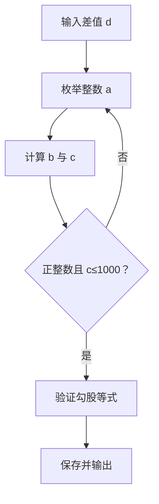

# 勾股数编程求解（c-b=2/4/5/6等）

## 它是什么

勾股数指满足 $a^2+b^2=c^2$ 的正整数三元组 $(a,b,c)$，其中 $c$ 为斜边。本知识点研究附加条件 $c-b=d$（$d=2,4,5,6,7$ 等）及 $c\le 1000$ 时，如何用 MATLAB 枚举全部解，并把结果整理成通项公式。

> [!IMPORTANT]
> ==先穷举验证，再观察规律，最后代数证明==。程序负责“找全”，公式负责“说清解之间的关系”。

## 为什么要加 $c-b=d$

直接三重循环枚举 $a,b,c$ 效率低，也没有利用条件。由
$$
a^2=c^2-b^2=(c-b)(c+b)=d(2b+d),
$$
可得
$$
b=\frac{a^2-d^2}{2d},\qquad c=b+d.
$$
因此只需枚举一个变量，再检查 $b,c$ 是否为正整数以及 $c\le1000$。这也解释了不同 $d$ 的解为什么会呈现不同的数列结构。

## 编程求解流程



一种稳妥的 MATLAB 写法如下，避免把平方根取整误差当作整数判断：

```matlab
d = 4;                 % 可改为 2、5、6、7
N = 1000;
R = [];
for a = 1:N-1
    t = a^2 - d^2;
    if t > 0 && mod(t,2*d) == 0
        b = t/(2*d);
        c = b + d;
        if c <= N && a^2 + b^2 == c^2
            R = [R; a,b,c];
        end
    end
end
disp(R)
```

若沿用课件“`for b=1:998`”处理 $d=2$，可令 $c=b+2$，由 $a^2=4b+4$ 求 $a$，再用 `a==fix(a)` 检查整数性；上界 $998$ 正是由 $c=b+2\le1000$ 得到。

## 从结果归纳通项

以 $d=4$ 为例，程序得到 $(8,6,10),(12,16,20),(16,30,34),\ldots$。令 $u=1,2,3,\ldots$，可写成
$$
(a,b,c)=\bigl(4(u+1),\,2(u^2+2u),\,2(u^2+2u+2)\bigr).
$$
代入即得 $c-b=4$，且
$$
a^2+b^2=4(u^2+2u)(u^2+2u+4)+4(u^2+2u)^2=c^2.
$$
取 $u=1$，有 $(a,b,c)=(8,6,10)$，验证 $8^2+6^2=100=10^2$，且 $10-6=4$，结果正确。

类似地，$d=5$ 时可观察出
$$
(a,b,c)=\bigl(5(2u+1),\,5(2u^2+2u),\,5(2u^2+2u+1)\bigr);
$$
$d=6$ 时可写成
$$
(a,b,c)=\bigl(6(u+1),\,3(u^2+2u),\,3(u^2+2u+2)\bigr).
$$
公式中的 $u$ 还要受 $c\le1000$ 限制，不能无限代入。

> [!NOTE]
> 勾股数不要求 $a<b$，所以 $(8,6,10)$ 与 $(12,9,15)$ 都合法。本原勾股数还要求 $\gcd(a,b,c)=1$；例如 $(8,6,10)$ 是 $2(4,3,5)$，并非本原解。

## 常见坑

| 易错点 | 正确处理 |
|---|---|
| 只输出 $a<b$ 的解 | 按题意保留所有正整数解 |
| 忘记 $c\le1000$ | 每次同时检查 $b,c$ 与范围 |
| 把 $d=2$ 的公式套给所有 $d$ | 分别枚举、观察并验证 |
| 用 `sqrt` 后不取整判断 | 检查整数性，并回代等式 |
| 通项正确却漏解 | 用程序结果逐项核对 |

> [!WARNING]
> 由若干组数据猜出的通项只是猜想；==必须代数验证，并确认没有漏解==。比较 $d=1,2,4,5,6,7$ 时，重点看首项、相邻项差及是否都是某个基本勾股数的倍数。
