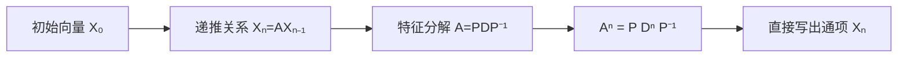

# 数列与线性代数综合应用
### 从“找规律”到“用矩阵”

很多数列问题，表面上是整数递推，实际上藏着线性代数的结构。比如著名的 Pythagorean 三元组问题：

> [!NOTE]
> 求所有正整数 $a,b,c$，满足 $a^2+b^2=c^2$ 且 $c-b=6$。

直接枚举当然能做，但一旦数据范围变大，暴力搜索就不现实了。更聪明的做法是：**先猜出递推关系，再用矩阵验证并推广**。

设第 $n$ 组解为 $(a_n, b_n, c_n)$，题目给出的若干组解满足：

$$
\{a,b,c\}=\{6(u+1),\ 3(u^2+2u),\ 3(u^2+2u+2)\},\quad u=1,2,\dots
$$

从表中相邻两组解之间，可以“观察”出递推关系。比如：

$$
p_{n-1}+q_{n-1}=p_n-q_n,\qquad q_n=p_{n-1}+2q_{n-1}
$$

整理后得到二维线性递推：

$$
\begin{cases}
p_n = 2p_{n-1}+3q_{n-1} \\[4pt]
q_n = p_{n-1}+2q_{n-1}
\end{cases}
$$

---

### 矩阵形式的威力

把上面这组递推写成矩阵：

$$
X_n =
\begin{pmatrix} p_n \\ q_n \end{pmatrix}
,\qquad
A =
\begin{pmatrix} 2 & 3 \\ 1 & 2 \end{pmatrix}
$$

那么：

$$
X_n = A X_{n-1} = A^n X_0
$$

于是问题转化为 **计算矩阵的幂 $A^n$**。这正是矩阵特征值分解的用武之地。

> [!IMPORTANT]
> ==线性递推问题一旦写成矩阵形式，求解 $n$ 项通项就变成求矩阵 $n$ 次幂==，特征值分解是最主要的工具。

---

### 具体怎么做

以另一个常见例子说明：

$$
B = \frac{1}{10}A =
\begin{pmatrix}
2/5 & 1/5 \\[2pt]
1/10 & 3/10
\end{pmatrix}
$$

先求特征值与特征向量：

$$
\operatorname{eig}(B)
=
\left\{
\lambda_1 = \frac12,\ \lambda_2 = \frac15
\right\}
$$

对应特征向量矩阵：

$$
P =
\begin{pmatrix} 2 & -1 \\ 1 & 1 \end{pmatrix}
$$

于是：

$$
B = P
\begin{pmatrix}
1/2 & 0 \\ 0 & 1/5
\end{pmatrix}
P^{-1}
$$

因此：

$$
B^n = P
\begin{pmatrix}
(1/2)^n & 0 \\ 0 & (1/5)^n
\end{pmatrix}
P^{-1}
$$

若初始条件为 $X_0 = (1,2)^T$，则：

$$
X_n = B^n X_0
= P D^n P^{-1} X_0
$$

> [!TIP]
> 特征值为互异实数时，$D^n$ 只是对角元分别 $n$ 次方，计算量从 $O(n)$ 次矩阵乘法降到 $O(\log n)$ 甚至直接写出闭式。

---

### 和“找规律”的区别

| 方法 | 适用性 | 局限 |
|------|--------|------|
| 观察表格找递推 | 数值简单、规律明显 | 容易看错、无法证明 |
| 矩阵特征值法 | 线性递推通用 | 非线性不适用 |

> [!WARNING]
> 不是所有数列都能写成 **一次** 线性递推。若递推含 $p_{n-1}^2$、$p_n q_n$ 等非线性项，矩阵方法不再直接适用。

---

### 一个算对了的例子

验证 $A=\begin{pmatrix}2&3\\1&2\end{pmatrix}$ 的递推：

取初值 $(p_0,q_0)=(3,1)$，递推得：

$$
(p_1,q_1)=(9,5),\quad
(p_2,q_2)=(33,19),\quad
(p_3,q_3)=(123,71)
$$

特征分解：

$$
A = P
\begin{pmatrix}2+\sqrt3 & 0 \\ 0 & 2-\sqrt3\end{pmatrix}
P^{-1},
\qquad
P=
\begin{pmatrix}
\sqrt3 & -\sqrt3 \\
1 & 1
\end{pmatrix}
$$

所以通项：

$$
p_n = \frac{(2+\sqrt3)^n(3+\sqrt3)+(2-\sqrt3)^n(3-\sqrt3)}{2}
$$

代入 $n=3$，得 $p_3=123$，与递推结果一致。
