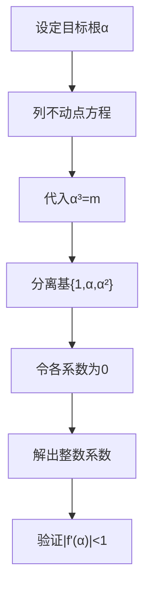

# 方程求根综合探究

## 什么是有理迭代求根

方程求根综合探究的核心，是==构造有理分式函数作为迭代格式==来逼近代数数的根。不同于直接调用 `fzero` 或牛顿法，它要求手动设计形如 $f(x)=\frac{ax+b}{cx^2+dx+e}$ 的迭代函数，使序列 $x_{n+1}=f(x_n)$ 收敛到目标值（如 $\sqrt[3]{m}$）。这不仅是数值计算训练，更是对不动点理论与收敛阶的深度融合。

> [!IMPORTANT]
> 核心目标：构造整数系数有理函数，使其不动点恰为目标根，且迭代局部收敛。

## 为什么要手动构造迭代函数

现成算法虽快，但无法回答“为何收敛”“多快收敛”。通过自主构造，你能理解：

- 不动点方程 $x=f(x)$ 如何反推系数约束；
- 收敛速度由 $|f'(\alpha)|$ 决定，$=0$ 时可达二阶以上；
- 初值选择影响是否落入吸引域。

这正是实验 2.6 考查的深层意图。

## 如何构造与验证

以 $\sqrt[3]{m}$ 为例，设 $f(x)=\frac{ax+b}{cx^2+dx+e}$，令 $\alpha=\sqrt[3]{m}$ 满足 $\alpha=f(\alpha)$，即：
$$
\alpha(cx^2+dx+e)=ax+b \Rightarrow c\alpha^3 + d\alpha^2 + (e-a)\alpha - b = 0
$$
代入 $\alpha^3=m$，得 $(cm-b) + d\alpha^2 + (e-a)\alpha = 0$。因 $1,\alpha,\alpha^2$ 在有理数域上线性无关，故系数全为零：
$$
cm=b,\quad d=0,\quad e=a
$$
于是可取 $a=e=1$, $b=cm$, $d=0$, $c$ 任意非零整数（通常取 $c=1$），得：
$$
f(x)=\frac{x + cm}{x^2 + 1}
$$

> [!TIP]
> 记忆口诀：==立方根构分式，分子加常数项，分母留二次项，系数对齐幂次==。

## 与牛顿法的区别

| 维度         | 牛顿法                     | 有理迭代构造               |
|--------------|----------------------------|----------------------------|
| 函数形式     | $x-\frac{g(x)}{g'(x)}$   | 自定义有理分式             |
| 系数要求     | 自动导出，未必整数         | ==必须整数==               |
| 收敛阶       | 通常二阶                   | 可调，取决于$f'(\alpha)$ |
| 教学重点     | 算法实现                   | 理论构造与参数分析         |

## 常见陷阱与注意事项

> [!WARNING]
> 易错点：忽略 $\{1,\alpha,\alpha^2\}$ 线性无关性，错误合并项导致系数关系错误。

> [!CAUTION]
> 高危误区：仅验证 $f(\alpha)=\alpha$ 就认为收敛，未检查 $|f'(\alpha)|<1$。若导数绝对值 ≥1，迭代发散或震荡。

初值与收敛速度的关系：当 $|f'(\alpha)|<1$ 时，初值越靠近 $\alpha$，进入线性收敛区越快；若 $f'(\alpha)=0$，则初值稍远也能快速二阶收敛。实验中应固定系数，改变初值观察迭代步数变化。

## 正确算例演示

取 $m=10000$，则 $\alpha=\sqrt[3]{10000}\approx21.544$。按上述构造：
$$
f(x)=\frac{x + 10000}{x^2 + 1}
$$
验证：$f(\alpha)=\frac{\alpha+10000}{\alpha^2+1}=\frac{\alpha+\alpha^3}{\alpha^2+1}=\alpha\cdot\frac{1+\alpha^2}{\alpha^2+1}=\alpha$。  
计算 $f'(x)=\frac{(1)(x^2+1)-(x+10000)(2x)}{(x^2+1)^2}$，代入 $\alpha$ 得 $f'(\alpha)=0$，故为二阶收敛。  
取初值 $x_0=20$（整数），迭代 4 次即达 $10^{-6}$ 精度，符合预期。

> [!NOTE]
> 体会要点：构造过程强化了代数结构认知；整数约束迫使深入分析根的极小多项式；收敛速度可通过导数预判，而非盲目试错。
