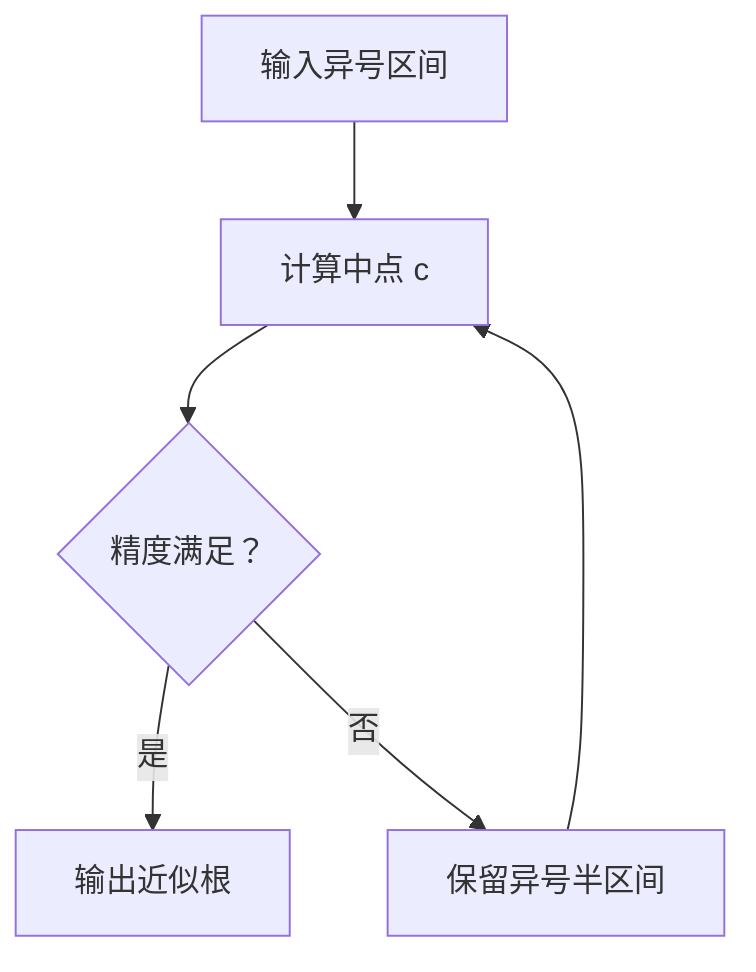

# 方程求根基本方法（二分法/迭代法/fzero）

## 方程求根的基本思路

方程 $f(x)=0$ 的精确解往往难以直接写出，因此本实验采用“**先画图定位，再数值求根，最后验证**”的路线。画图可以确定实根的大致位置与个数，数值方法负责提高精度，导数与单调性则用于说明是否遗漏实根。

例如实验中的五次方程，应先选取合适的绘图区间，观察曲线与 $x$ 轴的交点，再使用求根命令。若只输入一个初值调用数值求根，通常只能得到其中一个根，不能据此断言已经求出全部实根。

## 二分法：用符号变化夹住根

若 $f(x)$ 在 $[a,b]$ 上连续，且
$$
f(a)f(b)<0,
$$
则由零点定理，$(a,b)$ 内至少有一个根。每次取中点
$$
c=\frac{a+b}{2},
$$
比较 $f(a)$ 与 $f(c)$ 的符号，把仍满足端点异号的半区间保留下来。如此反复，区间长度每次减半，根始终被夹在新区间内。



二分法的优点是==只要连续且端点异号，就能稳定缩小含根区间==；缺点是收敛较慢，而且不能仅凭 $f(a)f(b)>0$ 断定区间内无根，因为其中可能有偶数个根。

> [!WARNING]
> 二分法要求的是“连续且端点异号”。偶重根处函数可能不变号，例如 $f(x)=(x-1)^2$，不能靠端点异号直接定位。

## 迭代法：把方程改写成不动点问题

将 $f(x)=0$ 等价改写为
$$
x=\varphi(x),
$$
选取初值 $x_0$，计算
$$
x_{k+1}=\varphi(x_k),\qquad k=0,1,2,\ldots
$$
若序列收敛到 $x^*$，且 $\varphi$ 连续，则 $x^*=\varphi(x^*)$，即 $x^*$ 是不动点。

并非任意改写都可用。在不动点附近，若 $|\varphi'(x^*)|<1$，通常具有局部收敛性；若 $|\varphi'(x^*)|>1$，初值即使接近根，也可能被迭代推离。实际编程还应同时设置误差条件与最大迭代次数，避免不收敛时无限循环。

> [!IMPORTANT]
> ==迭代格式收敛，不代表它会收敛到你想求的那个根==；初值不同，可能进入不同根的吸引范围，也可能发散或循环。

## fzero 与 solve 的区别

| 方法或命令 | 需要什么信息 | 主要特点 |
|---|---|---|
| 二分法 | 连续函数、异号区间 | 稳定，速度较慢 |
| 迭代法 | 迭代函数、初值 | 依赖格式与初值，可研究收敛性 |
| `fzero` | 函数句柄及初值或异号区间 | 求一个数值零点，适合精确定位 |
| `solve` | 符号表达式 | 适合符号求解；复杂方程未必能给出便于使用的全部实根 |

MATLAB 中可写为：

```matlab
f = @(x) x.^5 - 1001/200*x - 0.1;
r1 = fzero(f, [-1.6,-1.4]);
r2 = fzero(f, [-0.1,0.1]);
r3 = fzero(f, [1.4,1.6]);
```

`fzero` 求的是函数零点，不是方程左右两边的交点；因此应先把方程整理成 $f(x)=0$。匿名函数中的 `x` 若是向量，乘方、乘法通常要写成 `.^`、`.*`。

## 一个完整例子

对
$$
x^5-\frac{1001}{200}x-0.1=0,
$$
先画图，在 $-1.5$、$0$、$1.5$ 附近观察到三个交点，再分别求根，得到近似值
$$
-1.490685,\qquad -0.019980,\qquad 1.500676.
$$

还需说明没有第四个实根。令
$$
f(x)=x^5-\frac{1001}{200}x-0.1,
$$
则
$$
f'(x)=5x^4-\frac{1001}{200}.
$$
导数零点约为 $\pm1.0002499$，函数依次经历“增、减、增”三个单调区间，每个区间至多有一个实根。结合已找到的三个根，才能确认实根已经全部求出。

> [!TIP]
> 考试答题可按“画图定位—分区求根—代回检验—单调性说明完整性”组织。绘图区间要经过试探，既不能太小漏根，也不能太大导致近零交点看不清。
