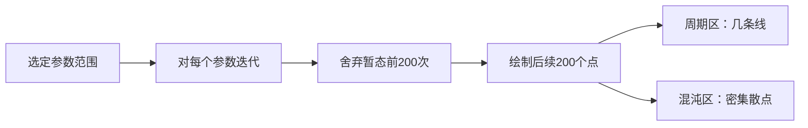

# 迭代与混沌判断（Lyapunov指数/分岔图）

## 迭代与混沌判断

### 为什么要研究混沌

对于确定性动力学系统 $x_{n+1} = f(x_n)$，我们关心：从两个几乎相同的初值出发，迭代轨迹是会始终接近，还是会迅速“分道扬镳”？如果是后者，系统就表现出**长期不可预测性**——这就是**混沌**。

在数值实验中，我们无法仅靠“看着乱”来判定混沌，必须用可计算的指标：**Lyapunov 指数**用来定量判断，**分岔图**用来观察系统随参数变化的整体行为。

### Lyapunov 指数的直观理解

假设我们从 $x_0$ 和 $x_0 + \delta_0$ 两个初值出发，每步都施加同一个映射 $f$。一步之后，距离大约放大为：

$$
|\delta_1| \approx |f'(x_0)| \cdot |\delta_0|
$$

经过 $n$ 次迭代，平均每一步的**指数分离速率**为：

$$
\lambda \approx \frac{1}{n} \sum_{k=0}^{n-1} \ln|f'(x_k)|
$$

取 $n \to \infty$ 的极限，就得到 **Lyapunov 指数** $\lambda$：
- $\lambda > 0$：相邻轨道指数分离，==系统处于混沌状态==
- $\lambda < 0$：相邻轨道收敛，系统稳定
- $\lambda = 0$：临界状态（如周期分岔点）

[!IMPORTANT]
> 只要 Lyapunov 指数为正，无论初值多接近，长期行为都将截然不同——这就是“蝴蝶效应”的数学描述。

### 分岔图：看参数如何驱动系统走向混沌

很多系统含有可调参数（例如 Logistic 映射 $x_{n+1} = r x_n(1-x_n)$ 中的 $r$）。**分岔图**的做法是：
1. 对每个参数值，舍弃前几百次迭代（消除暂态）
2. 把后续若干次迭代值全部画在同一竖线上

- 当图上只看到有限几条线，系统处于**周期状态**
- 当图上某参数区间内点密密麻麻铺满一片，就是**混沌区**

[!TIP]
> 判读分岔图的口诀：“线条清晰是周期，云雾弥漫是混沌”。遇到分岔点（一条线分为两条），说明周期在加倍，这是走向混沌的前兆。

### 一个算对了的例子

考虑分段线性映射（也是上面考过的题）：

$$
f(x) = \begin{cases}
2x, & 0 \leq x \leq \frac{1}{2} \\[4pt]
2(1-x), & \frac{1}{2} < x \leq 1
\end{cases}
$$

我们分析它是否会混沌。对几乎所有 $x$，导数的绝对值恒为 2：

$$
|f'(x)| = 2 \quad \text{（除了 } x = \tfrac{1}{2} \text{ 不可导，但一个点不影响积分）}
$$

因此 Lyapunov 指数：

$$
\lambda = \ln 2 \approx 0.693 > 0
$$

==指数为正，所以该映射的迭代必然产生混沌。==

为直观验证，可画蜘蛛网图：取任意初值（比如 $x_0 = 0.2$），迭代点会在 $[0,1]$ 区间内无规律地跳跃，长期无法预测。

### 常见误区

| 误区 | 正确理解 |
|------|----------|
| “图看起来乱就是混沌” | 随机噪声也可能显得乱，必须用 $\lambda > 0$ 或分岔图验证 |
| “周期加倍到头才混沌” | 周期加倍是通往混沌的常见路径，但不是唯一路径 |
| “$\lambda > 0$ 就一定发散” | Lyapunov 指数描述**相邻轨道**的分离，系统整体仍可有界（如 $[0,1]$ 内） |
| “分岔图中散点意味着计算错误” | 混沌区的散点恰恰是确定性混沌的正常表现 |

[!WARNING]
> 计算 Lyapunov 指数时，若直接取两个临近点模拟分离，必须定期**重归一化**，否则轨迹分离到全局尺度后，局部增长率被低估。实用中常改用沿一条轨道对 $|f'|$ 取对数平均的公式。

### 如何辨别周期与混沌

一个实用的实验流程：
1. 画迭代轨迹（时序图）：若看到有限个值循环，是周期；若永不重复，疑似混沌
2. 计算 Lyapunov 指数：正者必为混沌
3. 扫描参数画分岔图：看到“点到片”的过渡，确认混沌发生

结合这三步，就能在实验中可靠地判断一个确定性迭代是否进入了混沌状态。
