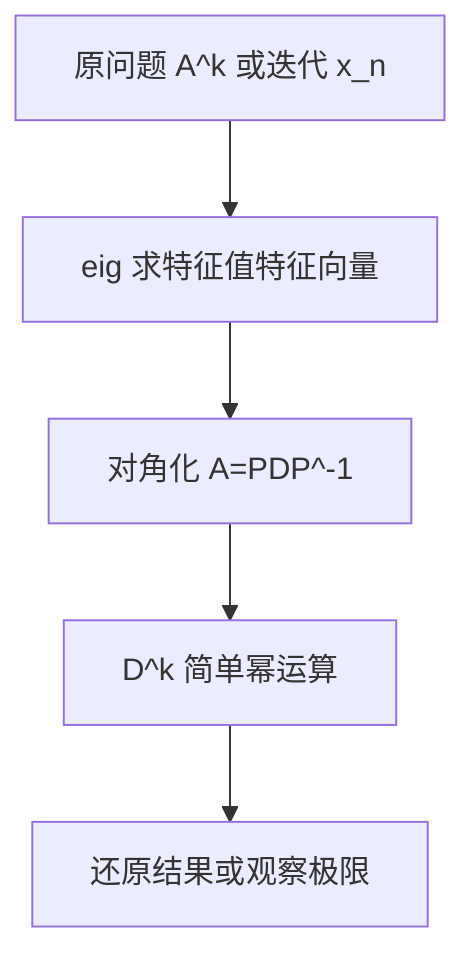

# 矩阵特征值与特征向量计算（eig）

## 什么是特征值与特征向量

对 $n$ 阶方阵 $A$，若存在数 $\lambda$ 和非零向量 $x$ 使

$$Ax=\lambda x$$

则 $\lambda$ 称为 $A$ 的**特征值**，$x$ 称为对应 $\lambda$ 的**特征向量**。几何上看，$A$ 作用在 $x$ 上只把它"拉长/压短或反向"，不改变方向。求特征值等价于解特征方程 $|A-\lambda I|=0$。

> [!IMPORTANT]
> ==`eig` 是 MATLAB 求特征值与特征向量的核心命令==：`d=eig(A)` 返回全部特征值；`[P,D]=eig(A)` 返回对角阵 $D$（特征值在对角线上）和矩阵 $P$（各列是对应特征向量），满足 $A=PDP^{-1}$。

## 为什么需要它

矩阵高次幂、递推数列、马尔可夫链（如天气模型）直接算会爆炸。若 $A$ 可对角化，则

$$A^k=PD^kP^{-1}$$

$D^k$ 只需对角元各自 $k$ 次方，计算量骤降。长期趋势由**绝对值最大的特征值**（主特征值）主导，稳态向量就是对应的特征向量。



## eig 的用法与区别

| 命令 | 返回 | 用途 |
|---|---|---|
| `eig(A)` | 特征值列向量 | 只看特征值 |
| `[P,D]=eig(A)` | $P$、$D$ | 对角化、求 $A^k$ |
| `eigs(A,k)` | 最大的 $k$ 个 | 稀疏矩阵、幂迭代 |

> [!WARNING]
> `eig` 输出的是**数值近似**，且特征向量都归一化（模长为 1）。若题目要求精确值或特定比例（如概率向量各分量之和为 1），需用 `sym` 或手动缩放。复特征值成共轭对出现，属正常现象。

## 算例

对 $A=\begin{pmatrix}4&2\\1&3\end{pmatrix}$：

```matlab
A = [4 2; 1 3];
[P, D] = eig(A)
```

得 $\lambda_1=5,\ \lambda_2=2$。于是

$$A^n=PD^nP^{-1},\quad x_n=A^nx_0$$

通项由 $5^n$ 与 $2^n$ 的线性组合构成，$n\to\infty$ 时比值 $x_2^{(n)}/x_1^{(n)}$ 趋于主特征值 5 对应的特征向量方向。

## 常见坑

> [!CAUTION]
> ==不是每个矩阵都能对角化==。`[P,D]=eig(A)` 总能给出输出，但若 $A$ 有重特征值且几何重数不足，$P$ 不可逆，此时 $PDP^{-1}\ne A$。检验方法：`rank(P)` 是否等于阶数，或 `det(P)` 是否接近零。

> [!TIP]
> 验证对角化结果，用 `A*P - P*D` 应接近零矩阵；求 $A^6$ 用 `P*D^6*inv(P)` 比直接 `A^6` 更稳，也能手算核对。
