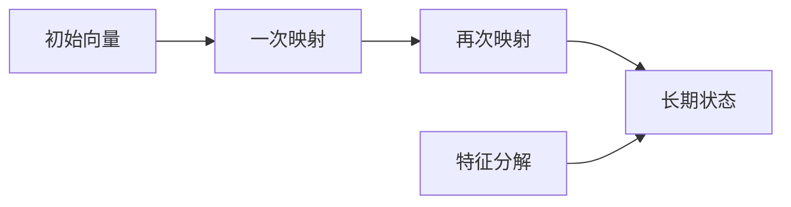

# 矩阵运算与线性映射基础

## 为什么要把矩阵放进“迭代、混沌与分形”

迭代系统的核心问题是：已知当前状态 $\boldsymbol{x}^{(k)}$，如何得到下一状态？若满足
$$
\boldsymbol{x}^{(k+1)}=A\boldsymbol{x}^{(k)},\qquad
\boldsymbol{x}^{(k)}=A^k\boldsymbol{x}^{(0)},
$$
那么 $A$ 就是**线性映射**：它把向量 $\boldsymbol{x}$ 变为 $A\boldsymbol{x}$。矩阵乘法对应映射的复合，矩阵幂对应反复迭代。研究长期变化时，关键不是机械地计算很多次 $A^k$，而是寻找 $A$ 的特征方向。

## 矩阵运算与特征分解

若存在非零向量 $\boldsymbol{v}$ 和数 $\lambda$，使
$$
A\boldsymbol{v}=\lambda\boldsymbol{v},
$$
则 $\lambda$ 是特征值，$\boldsymbol{v}$ 是特征向量。沿该方向迭代，向量只按倍数 $\lambda$ 伸缩。

若有 $n$ 个线性无关的特征向量，将它们作为列组成 $P$，则
$$
A=PDP^{-1},\qquad
D=\operatorname{diag}(\lambda_1,\ldots,\lambda_n),
$$
从而
$$
A^k=PD^kP^{-1},\qquad
D^k=\operatorname{diag}(\lambda_1^k,\ldots,\lambda_n^k).
$$
==求迭代通项的主线是：特征分解、展开初始向量、分别乘特征值的幂。==

MATLAB 中常用命令如下：

| 目的 | 命令 | 注意事项 |
|---|---|---|
| 行列式、逆矩阵 | `det(A)`、`inv(A)` | 奇异矩阵不能求逆 |
| 特征分解 | `[P,D]=eig(A)` | `P` 的列为特征向量 |
| 矩阵乘法、矩阵幂 | `A*B`、`A^k` | 遵循矩阵运算规则 |
| 对应元素相乘 | `A.*B` | 不是线性映射的复合 |
| 转置 | `A.'` | `A'` 对复矩阵还会共轭 |

> [!WARNING]
> `A*B` 与 `A.*B` 完全不同；`A^2` 是 $AA$，不是各元素平方。解线性方程组 $A\boldsymbol{x}=\boldsymbol{b}$ 通常写 `A\b`，不必显式计算 `inv(A)*b`。

## 一个算对的迭代例子

取
$$
A=\begin{pmatrix}4&2\\1&3\end{pmatrix},\qquad
\boldsymbol{x}^{(0)}=\begin{pmatrix}1\\2\end{pmatrix}.
$$
由
$$
\det(\lambda I-A)=(\lambda-2)(\lambda-5)
$$
得特征值 $2,5$，对应特征向量可取
$$
\boldsymbol{v}_1=\begin{pmatrix}-1\\1\end{pmatrix},\qquad
\boldsymbol{v}_2=\begin{pmatrix}2\\1\end{pmatrix}.
$$
将初始向量展开：
$$
\boldsymbol{x}^{(0)}
=\frac13\boldsymbol{v}_1+\frac56\boldsymbol{v}_2.
$$
因此
$$
\boxed{
\boldsymbol{x}^{(n)}
=\frac13\,2^n\begin{pmatrix}-1\\1\end{pmatrix}
+\frac56\,5^n\begin{pmatrix}2\\1\end{pmatrix}
}
$$
即
$$
x_1^{(n)}=-\frac13 2^n+\frac53 5^n,\qquad
x_2^{(n)}=\frac13 2^n+\frac56 5^n.
$$
检验 $n=0$ 得 $(1,2)^T$，$n=1$ 得 $(8,7)^T=A\boldsymbol{x}^{(0)}$，结果正确。

> [!TIP]
> 算完先代回 $n=0,1$ 检验。若 $B=A/10$，其特征值也除以 $10$，所以长期迭代会衰减；这正是特征值判断迭代趋势的作用。
