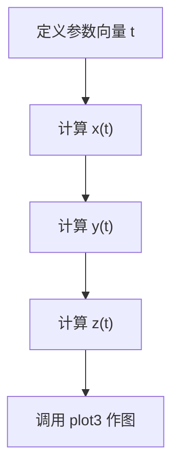

# 空间曲线作图（plot3）

## 空间曲线作图（plot3）

**它是什么**：`plot3` 是 MATLAB 中绘制三维空间曲线的基本命令，它把一组参数 $t$ 对应的点 $(x(t), y(t), z(t))$ 依次用线段连接起来，形成空间中的曲线。

**为什么需要**：在数学实验中，我们常常需要可视化空间几何对象，比如螺旋线、交线、轨迹等。`plot3` 让我们能直观地观察曲线的形状、位置关系以及随参数的变化规律。

## 基本语法

`plot3` 的调用格式与二维的 `plot` 非常类似：

```matlab
plot3(x, y, z)
plot3(x, y, z, '颜色线型')
```

其中 `x`、`y`、`z` 是三个同维数的向量（或矩阵），分别对应曲线上各点的三个坐标。`'颜色线型'` 是一个可选的字符串，用来指定曲线的颜色和线型，比如 `'r'` 表示红色实线，`'k--'` 表示黑色虚线。

> [!TIP]
> 记忆口诀：二维 `plot` 画平面，三维 `plot3` 画空间，参数方程是桥梁。

## 绘制步骤

用 `plot3` 画空间曲线的一般步骤如下：



- **定义参数向量**：`t = a:step:b`，`step` 越小曲线越光滑。
- **计算坐标**：根据参数方程，用数组运算逐点算出 `x`、`y`、`z`。
- **调用 `plot3`**：传入三个坐标向量即可。

## 典型例题

在同一坐标系下作出下面两条空间曲线（要求两条曲线用不同的颜色表示）：

(1) $\begin{cases} x = \cos t \\ y = \sin t \\ z = t \end{cases}$

(2) $\begin{cases} x = 2\cos t \\ y = 2\sin t \\ z = t \end{cases}$

**参考程序**：

```matlab
t = -10:0.01:10;          % 定义参数 t

x1 = cos(t);  y1 = sin(t);  z1 = t;
plot3(x1, y1, z1, 'k');   % 黑色螺旋线
hold on                     % 保持图形，继续叠加

x2 = 2*cos(t);  y2 = 2*sin(t);  z2 = t;
plot3(x2, y2, z2, 'r');   % 红色螺旋线
hold off                    % 结束叠加
```

**图形说明**：黑色曲线是半径为 1 的圆柱螺旋线，红色曲线是半径为 2 的圆柱螺旋线，二者都沿 $z$ 轴方向上升。

> [!IMPORTANT]
> 要在同一坐标系下画多条曲线，必须使用 `hold on` / `hold off`，否则后画的曲线会覆盖先画的曲线。

## 常见易错点

> [!WARNING]
> 1. **忘记 `hold on`**：导致只显示最后一条曲线。
> 2. **参数步长过大**：曲线看起来是折线而非光滑曲线，应减小步长（如 `0.01`）。
> 3. **颜色设置错误**：`'k'` 是黑色，`'r'` 是红色，不要混淆。

## 与相近概念的区别

| 命令 | 适用对象 | 维度 |
|------|----------|------|
| `plot` | 平面曲线 $y=f(x)$ | 二维 |
| `plot3` | 空间曲线 $(x(t),y(t),z(t))$ | 三维 |
| `mesh` / `surf` | 空间曲面 $z=f(x,y)$ | 三维 |

> [!NOTE]
> `plot3` 画的是曲线，`mesh` 和 `surf` 画的是曲面，注意区分。
