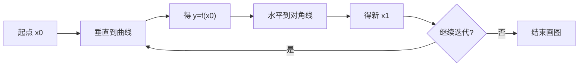

# 蜘蛛网图（cobweb plot）与迭代可视化

---
requires: [不动点迭代, MATLAB绘图基础]
---

给定一个迭代 $x_{n+1} = f(x_n)$，如果不写程序算几百步，你能一眼看出序列是收敛、发散还是进入周期循环吗？如果迭代结果看起来毫无规律，它到底是“真的随机”还是“确定性混沌”？

蜘蛛网图（cobweb plot）正是把抽象的迭代过程变成直观几何轨迹的工具。

## 它是什么与为什么需要

蜘蛛网图是在同一坐标系中画出 $y=f(x)$ 和 $y=x$ 两条曲线，通过交替作==水平线==和==垂直线==来追踪迭代过程的图形。

> [!IMPORTANT]
> 核心作用：直观判断不动点的稳定性、发现周期轨道（如 T=2, T=4）以及识别混沌现象。

其几何逻辑如下：



## 怎么做：MATLAB 实现步骤

画蜘蛛网图的本质是构造折线的顶点坐标数组 `x` 和 `y`。假设当前点为 $(x_k, y_k)$，下一步要走到曲线上再走到对角线上：

1. **垂直到曲线**：横坐标不变，纵坐标变为函数值，即 $(x_k, f(x_k))$。
2. **水平到对角线**：纵坐标不变，横坐标等于纵坐标，即 $(f(x_k), f(x_k))$。

以实验 2.3 的分段函数为例：

$$
f (x) = \begin{cases} 2x & 0 \leq x \leq \frac{1}{2} \\ 2(1-x) & \frac{1}{2} < x \leq 1 \end{cases}
$$

标准代码结构如下：

```matlab
% 定义初值
x(1) = 0.1; y(1) = 0; 
% 迭代生成蜘蛛网坐标
for i = 1:100
    % 垂直线段：从对角线到曲线
    x(1+2*i) = y(2*i);       % 横坐标继承上一步
    y(1+2*i) = f(x(1+2*i));  % 纵坐标代入函数
    
    % 水平线段：从曲线到对角线
    x(2+2*i) = x(1+2*i);     % 横坐标不变
    y(2+2*i) = y(1+2*i);     % 纵坐标赋给x，回到y=x
end
% 绘制蜘蛛网
plot(x, y, 'r'); hold on;
% 绘制基准线和对角线
fplot(@(x) f(x), [0, 1]);
fplot(@(x) x, [0, 1], 'k--');
axis([0 1 0 1]); hold off;
```

> [!TIP]
> 考试技巧：观察图形时，若蛛网向中心收缩则收敛；若在两个或多个点之间形成封闭矩形/多边形，即为==周期循环==（如实验 2.4 中 $\alpha=3.3$ 对应 T=2）；若线条布满整个区域不重复，则为混沌。

## 实验 2.4 典型结论

对 Logistic 映射 $f(x) = \alpha x(1-x)$，取 $x_0=0.5$，不同 $\alpha$ 值的蜘蛛网表现：

| $\alpha$ | 蛛网形态 | 序列状态 |
| :--- | :--- | :--- |
| 3.3 | 在两点间跳动的矩形 | 周期 T=2 |
| 3.5 | 在四点间跳动 | 周期 T=4 |
| 3.568 | 密集多层矩形 | 周期 T=9 |
| 3.6 | 杂乱无章填满区间 | ==混沌== |

## 相近概念辨析与常见坑

| 对比项 | 蜘蛛网图 | 时序图（时间序列） |
| :--- | :--- | :--- |
| 横轴含义 | 状态变量 $x_n$ | 迭代步数 $n$ |
| 核心用途 | 看相空间轨迹、不动点稳定性 | 看随时间的变化趋势 |
| 周期识别 | 形成封闭几何图形 | 波形重复 |

> [!WARNING]
> 易错坑：构造 `x` 和 `y` 数组时，下标极易错位。记住口诀：“==先垂后平，奇垂偶平==”。垂直段改变的是 `y`（奇数索引更新），水平段改变的是 `x`（偶数索引更新）。

> [!CAUTION]
> 高危误区：不要混淆不动点方程 $f(x)=x$ 的代数求解与蜘蛛网图的几何观察。实验 2.6 中求分式函数收敛到 $\sqrt[3]{m}$，必须先令 $\sqrt[3]{m}$ 为不动点解出参数（如提示中 $b=2c, d=a$），再用蜘蛛网图验证其收敛速度，而非盲目试凑。
