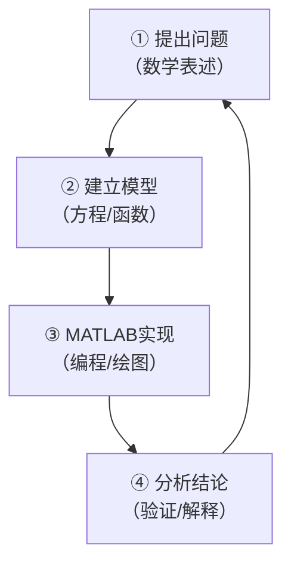

# 数学实验课程简介与实验方法

## 数学实验课程简介

### 这门课在做什么

数学实验，不是“用纸笔做数学证明”，而是**以计算机为工具，用数值计算、符号推导、图形可视化等方法，对数学问题进行建模、求解与验证**。

你可以把它理解为一座桥梁：


> [!IMPORTANT]
> 本课程的核心目标是：==把“看得懂的数学”变成“算得出的代码”==，再用计算结果反过来加深对数学的理解。

### 为什么需要数学实验

很多数学问题，压根没有漂亮的手工解：

- 五次及以上多项式方程，没有求根公式；
- 大部分微分方程无法解析求解；
- 大量数据拟合、统计分析，手工根本无法完成。

数学实验就派上了用场——用数值方法求出近似解，用图形直观展示规律，用符号推演完成繁琐计算。

### 实验方法的基本框架

南邮《数学实验 B》的实验流程可以概括为四步：



> [!TIP]
> 实验不是“写完代码就结束”，最后一步“分析结论”往往决定了实验质量的高低。

**第一步：把实际问题翻译成数学语言。** 比如“路灯照明范围” → 照度与距离平方成反比 → $E = I / d^2$。

**第二步：选择适合的数学工具。** 是求积分？求极值？解方程组？还是拟合参数？

**第三步：用 MATLAB 实现。** 这是本课程第一学期的主要内容，包括：
- 基本运算与矩阵操作
- 符号计算（`syms`, `solve`, `diff`）
- 数值计算（`fzero`, `quad`, `ode45`）
- 绘图（`plot`, `mesh`, `fplot`）

**第四步：解释结果，判断是否合理。** 如果结果错误或精度不够，需要回头调整模型或算法。

### 这门课与“纯理论课”的区别

| 对比维度 | 高等数学/线代 | 数学实验 B |
|---------|------------|----------|
| 主要工具 | 纸、笔、公式 | 计算机、MATLAB |
| 问题特征 | 有精确解为标准 | 大量问题只有近似解 |
| 核心能力 | 推导证明 | 建模 + 编程 + 分析 |
| 容错方式 | 公式错一步，全错 | 代码可调试、迭代 |

> [!WARNING]
> 初学者常见误区：直接对着题目写代码，不先做数学建模。**没有清晰的数学模型，代码写得再长也是白费。**

### 一个算对的例子

**问题**：求方程 $x^3 - 2x - 5 = 0$ 在 $[2, 3]$ 区间内的实根。

**建模**：这是一个非线性方程求根问题，手工无法写出精确解，应选用数值方法。

**MATLAB 实现与结果**：

```matlab
f = @(x) x.^3 - 2*x - 5;   % 定义函数
x0 = fzero(f, [2, 3]);      % 在区间内求根
disp(x0)
% 输出：2.0946
```

**验证**：将 $x_0$ 代回原方程：

```matlab
f(x0)
% 输出：-8.8818e-16 （约等于 0，符合精度要求）
```

这个例子完整走完了“建模 → 选方法 → MATLAB 实现 → 验证”四步。

> [!NOTE]
> 选区间的原则：区间端点函数值异号，即 $f(2) = -1 < 0$，$f(3) = 16 > 0$，确保根存在。

### 上机实验的实用建议

> [!CAUTION]
> 把 MATLAB 当计算器用，一条条敲指令——效率极低。建议学会使用 **`.m` 脚本文件** 和 **自定义函数**。

- 每次实验前，先在纸上写好数学推导与算法思路；
- 实验过程中，善用 `help` 命令和官方文档；
- 结束前，保存并整理 `.m` 文件，加上注释；
- 不理解的结果，用 `plot` 画图辅助分析。

==数学实验的关键不是“记住函数名”，而是遇到新问题时，能快速定位该用哪类方法，并写出可靠可调试的代码。==
