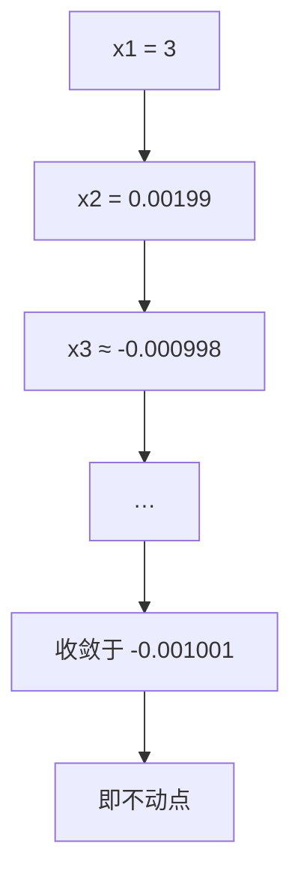

# 数列生成与迭代序列实验

## 数列生成与迭代序列实验

### 它是什么

给定一个**递推关系** $x_{n+1} = f(x_n)$（或更高阶的 $x_{n+1}=f(x_n,x_{n-1},\dots)$）和**初始值** $x_1$（或 $x_1,x_2$），按 $n=1,2,3,\dots$ 依次计算出的序列 $\{x_n\}$ 就叫迭代序列。用 MATLAB 把这一串数生成出来，观察它“跑向哪里”，就是本实验要做的事。


### 为什么需要

很多方程没有解析解，比如 $\sqrt{m}$ 的精确值、方程 $x=f(x)$ 的根。但如果我们能构造一个迭代公式，让数列**逐步逼近**目标值，就能用计算机“算”出足够精确的近似解。迭代的核心问题只有两个：

1. 数列是否**收敛**？
2. 若收敛，**极限值**是多少？

### 怎么做

**一阶迭代**的一般形式：

$$
x_{n+1} = f(x_n), \quad x_1 \text{ 给定}
$$

MATLAB 基本套路：

```matlab
x = zeros(1, N);      % 预分配向量
x(1) = 初始值;
for n = 1:N-1
    x(n+1) = f(x(n)); % 递推
end
disp(x)
```

> [!TIP]
> 迭代次数 $N$ 可以先取小一点（如 20）观察趋势，再增大到 50、100 判断是否稳定。

**高阶迭代**（如 Fibonacci 数列，依赖前两项）：

$$
x_n = x_{n-1}+x_{n-2}, \quad x_1=1,\ x_2=1
$$

```matlab
x = zeros(1, 20);
x(1) = 1;  x(2) = 1;
for n = 3:20
    x(n) = x(n-1) + x(n-2);
end
disp(x)
```

前 20 项：`1, 1, 2, 3, 5, 8, 13, 21, 34, 55, 89, 144, 233, 377, 610, 987, 1597, 2584, 4181, 6765`

### 与“不动点”的关系

若迭代公式为 $x_{n+1}=f(x_n)$，且数列收敛于 $L$，在等式两边取极限得：

$$
L = f(L)
$$

即极限值 $L$ 是方程 $x=f(x)$ 的根，称为 $f$ 的**不动点**。

> [!IMPORTANT]
> ==收敛的迭代序列，其极限必然是某个不动点==。但不动点不一定“吸得住”迭代序列——不动点附近 $|f'(x)|<1$ 时才吸引，$|f'(x)|>1$ 时排斥。

### 实例：求 $\sqrt{1000}$

迭代公式（牛顿法）：
$$
x_{n+1} = \frac{1}{2}\left(x_n + \frac{1000}{x_n}\right), \quad x_1=3
$$

```matlab
x = 3;
for n = 1:20
    x = (x + 1000/x) / 2;
end
fprintf('%.8f\n', x)
```

运行结果：`31.62277660`，即 $\sqrt{1000}$，数列收敛。

### 实例：分式线性函数的迭代

$f(x)=\dfrac{x-1}{x+1000}$，取 $x_1=3$：

```matlab
x = 3;
for n = 1:50
    x = (x - 1) / (x + 1000);
end
fprintf('%.6f\n', x)
```

结果为 $-0.001001$，正是方程 $x = (x-1)/(x+1000)$ 的解，即不动点。



### 常见坑

| 坑 | 说明 |
| :--- | :--- |
| 忘记预分配 | `x(n)` 在循环中动态扩容会拖慢速度，大迭代必须 `zeros` 预分配 |
| 不动点检验不彻底 | 看到“好像稳定了”就下结论，应继续迭代更多步并检查相邻项的差 |
| 误判发散 | 迭代初期可能震荡较大，但后期收敛，需观察足够长序列 |
| 初值敏感 | 同一迭代公式，不同初值可能收敛到**不同**不动点 |

> [!CAUTION]
> 迭代序列停止时，要区分“收敛”和“算到机器精度不再变化”。判断收敛可看 $|x_{n+1}-x_n|$ 是否持续小于某个阈值（如 $10^{-10}$）。

### 思考：怎样“看”出收敛？

一个实用技巧：输出数列的**最后几项**，若相邻项之差越来越小并趋于 0，则很可能收敛；若差值不缩小甚至增大，则发散或震荡。试改进上面的循环，让程序自动在 $|x_{n+1}-x_n|<10^{-12}$ 时停止，并报告迭代步数。
