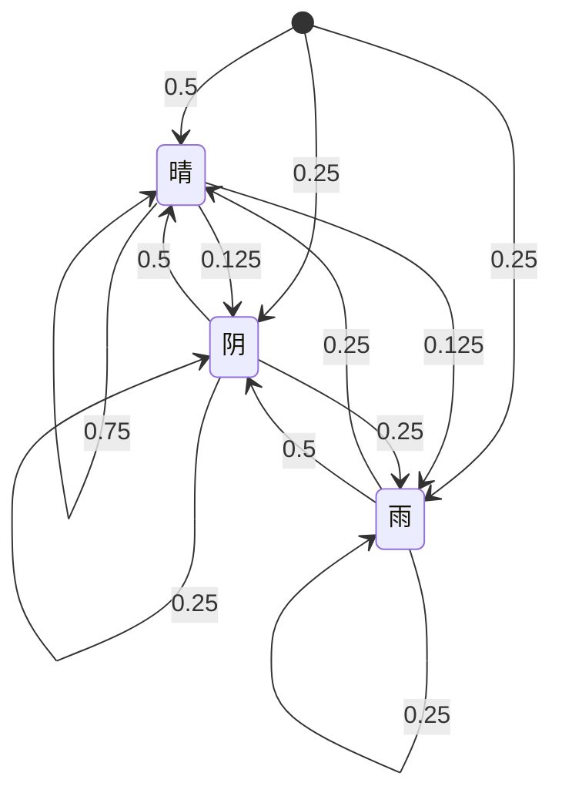

# 马尔可夫链与状态转移矩阵

## 从天气问题说起

某地每天天气只有三种状态：晴、阴、雨。根据历史统计，若今天是晴天，明天晴、阴、雨的概率分别为 $\frac34,\frac18,\frac18$；若今天是阴天，明天三种天气的概率为 $\frac12,\frac14,\frac14$；若今天是雨天，则为 $\frac14,\frac12,\frac14$。

把状态按（晴，阴，雨）编号，则"明天状态只依赖于今天状态"这一特性称为**无后效性**，具有无后效性的随机序列就是 ==马尔可夫链==。把转移概率按"行=今天、列=明天"排成矩阵：

$$A_2=\begin{pmatrix} \frac34 & \frac12 & \frac14\\[2pt] \frac18 & \frac14 & \frac12\\[2pt] \frac18 & \frac14 & \frac14 \end{pmatrix}$$

每行元素之和为 $1$，这样的矩阵称为 **状态转移矩阵**。若第 $n$ 天处于各状态的概率向量为 $p^{(n)}=(p_1^{(n)},p_2^{(n)},p_3^{(n)})^T$，则

$$p^{(n+1)}=A_2\,p^{(n)},\qquad p^{(n)}=A_2^n\,p^{(0)}$$



> [!IMPORTANT]
> 马尔可夫链的递推 $p^{(n)}=A^np^{(0)}$ 与线性映射 $x_{n+1}=Ax_n$ 完全同构：状态向量被矩阵反复作用，长期行为由 $A$ 的**特征值与特征向量**决定。

## 为什么稳态向量就是特征向量

设初始 $p^{(0)}=(0.5,0.25,0.25)^T$，用 MATLAB 迭代：

```matlab
A2 = [3/4,1/2,1/4; 1/8,1/4,1/2; 1/8,1/4,1/4];
P = [0.5;0.25;0.25];
for i = 1:20, P = A2*P; end
```

约 9 天后 $P$ 稳定在 $P^*=(0.6087,\,0.2174,\,0.1739)^T$。注意此时 $A_2P^*\approx P^*$——稳态向量满足

$$AP^*=1\cdot P^*$$

即 $P^*$ 是 $A$ 属于特征值 $\lambda=1$ 的**特征向量**，且三分量之和为 $1$（概率归一）。

> [!TIP]
> 求稳态分布的两种方法：① 迭代 $p^{(n+1)}=Ap^{(n)}$ 直到不变；② 解 $(A-I)p=0$ 并归一化。考试常要求两者互相验证。

## 通项公式：把初始向量按特征向量分解

以练习 3.1 为例，$A=\begin{pmatrix}4&2\\1&3\end{pmatrix}$，$x^{(0)}=(1,2)^T$。求特征值 $\lambda_1=5,\lambda_2=2$ 及对应特征向量 $p_1,p_2$。把初始向量展开：

$$x^{(0)}=u\,p_1+\nu\,p_2$$

则第 $n$ 项为

$$x^{(n)}=A^nx^{(0)}=u\lambda_1^n p_1+\nu\lambda_2^n p_2$$

这就是 $\{x_n\}$ 的**通项**。当 $|\lambda_1|>|\lambda_2|$ 时，$\lambda_2^n\to0$，长期趋势由 $\lambda_1$ 的特征向量主导，故 $\dfrac{x_2^{(n)}}{x_1^{(n)}}\to$ 特征向量分量之比（练习 3.2 中极限为 $0.5$）。

## 常见误区对照

| 易错点 | 正确处理 |
|---|---|
| 转移矩阵行列方向写反 | 本课程约定 $p^{(n+1)}=Ap^{(n)}$，行和为 1 |
| 忘记概率向量归一化 | 特征向量可乘任意 $k$，须令各分量之和为 1 |
| 把 $A^n$ 逐个元素硬算 | 先对角化 $A=P\Lambda P^{-1}$，再算 $P\Lambda^nP^{-1}$ |
| 符号矩阵直接数值迭代 | 用 `sym` 保留分数精度，避免舍入误差 |

> [!WARNING]
> 稳态向量必须满足"分量非负且和为 1"。若解 $(A-I)p=0$ 得到负分量，说明特征向量取错或矩阵不是转移矩阵。

> [!NOTE]
> 练习 3.5 中幂迭代 $m(x_n)=\dfrac{\|x_{n+1}\|}{\|x_n\|}$ 的极限恰为 $A$ 的模最大特征值，其对应特征向量与迭代序列极限方向一致——这正是"特征值思想解决实际问题"的精髓。
