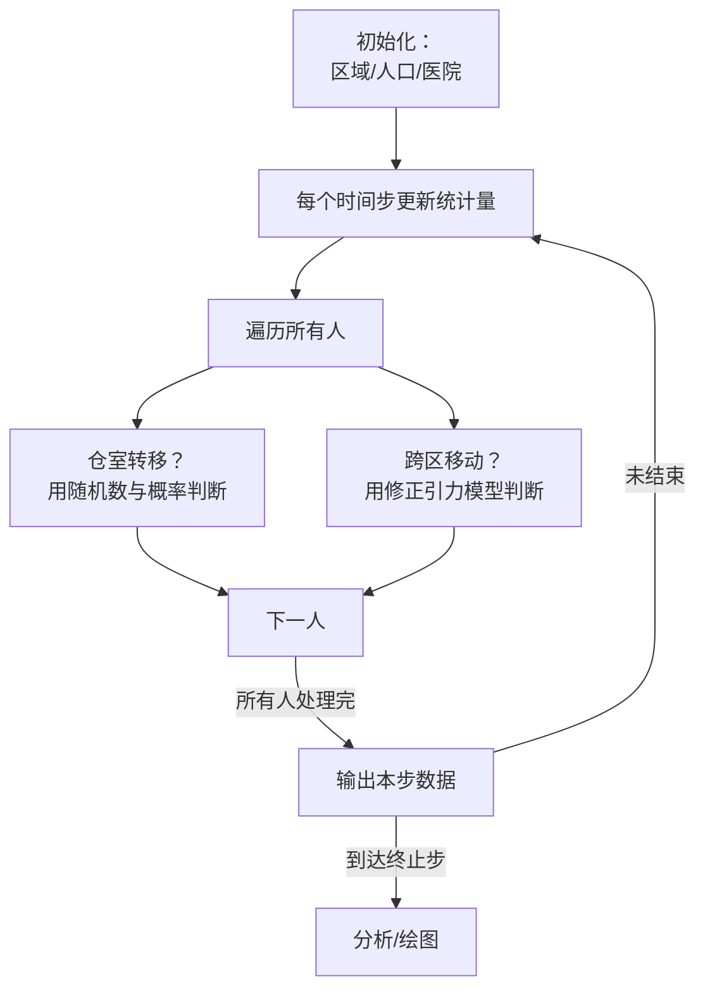

# GLEAM 模拟器（全球流行病与移动性模型）

## 什么是 GLEAM 模拟器

GLEAM（Global Epidemic and Mobility Model，全球流行病与移动性模型）是一个==高保真度的流行病传播模拟框架==。它不像 SIR 那样把人群看作均质混合的大池子，而是将世界划分为真实地理区域，在每一块里用**仓室模型**（Compartmental Model）刻画疾病进展，同时在区域之间引入基于真实交通数据的**流动模型**，让“人”可以跨区域移动。

> [!IMPORTANT]
> GLEAM 的核心思想：把“疾病在人体内的状态转移”和“人在空间中的移动”拆成两层建模，然后耦合在一起——这本质上是一种**元种群模型（Metapopulation Model）**的工程化实现。

## 为什么需要 GLEAM

经典 SEIR 类模型假设所有人均匀混合，无法回答“哪个城市会先暴发”“航空管制有多大用”这类问题。现实中有三层结构缺一不可：

- **个体层**：一个人从易感 → 潜伏 → 传染 → 康复（或死亡）的状态序列  
- **区域层**：每个地区的医院床位、人口密度、当地干预政策  
- **移动层**：两地之间的人口流动强度（航空、通勤等）

GLEAM 把这三层缝合在一起，所以被 WHO 等机构用于真实疫情预测。

> [!TIP]
> 记忆口诀：“一人一城一条路，三层耦合才靠谱”——仓室 + 区域 + 移动。

## 基本建模思路

GLEAM 的做法可以用以下流程概括：

- **区内传播**：在单个区域内部，按潜伏期、传染期等参数，用随机过程决定多少人从易感到潜伏、从潜伏到传染……
- **区间移动**：用**引力模型（Gravity Model）** 或真实交通流量计算两地之间的流动概率，每个时间步让一部分个体尝试迁移到其他区域。

## 它与自己写模型的关键区别

考试材料里提到，GLEAM 的数据和网络虽然精度很高，但它“封闭源码、难以修改”，很多基础参数被当作黑箱（医院与感染者交互方式、药物生产分配、底层模拟逻辑）。这意味着：

| 对比维度 | GLEAM 官方 | 自己实现 GLEAM 风格模型 |
|---------|-----------|----------------------|
| 数据精度 | 极高（真实交通、人口） | 可自由替换玩具数据或真实数据 |
| 可修改性 | 弱（闭源、参数固定） | 强（每一层都可定制） |
| 适用场景 | 快速预警、政策参考 | 研究特定参数的影响 |

考题中团队的做法是“受 GLEAM 启发，自己用 Python 实现一个类似框架”，这样既保留了双层耦合结构，又能自由添加医院、药物等参数。

## 一个简化版实现的结构

试卷节选的实现思路很清晰，刚好可以当作“怎么做”的范本：

> [!WARNING]
> 常见坑：每个时间步内，**先完成所有人的状态转移判断，再统一执行移动**，还是**在遍历中一并处理**？二者会导致不同的传播速度。文中采用的是先算区域统计量、再遍历每个人依概率转移——这样用当前步初的统计信息决定所有人的命运，避免了循环中数据污染。

## 算对了的例子（取自考试题）

题目中描述了一个可验证的简化设置：

- 定义 3 个区域 $R_1, R_2, R_3$，人口分别为 1000、2000、1500  
- 初始只在 $R_1$ 放 10 个潜伏期感染者，其余人健康  
- 每个区域各配 1 所医院，床位固定  
- 仓室转移概率和跨区移动概率预先赋值  
- 每个时间步用 Mersenne Twister 生成随机数判断转移

运行若干步后，你会观察到：

1. **区域内部**曲线近似 SEIR，但由于跨区移动，$R_2$ 和 $R_3$ 会在延迟若干时间步后相继出现病例  
2. **医院床位**一旦占满，致死率迅速上升——这正是 GLEAM 风格模型才能捕捉的“资源约束”效应  
3. 当模型从玩具数据切换到真实经纬度和流量矩阵时，代码无需改写，==只需替换输入文件即可扩容到真实场景==

这种“先在小数据上调通流程，再用真实数据跑结果”的方式，是数学建模竞赛中非常实用的策略。

> [!CAUTION]
> 引力模型里的距离指数、人口权重指数不能随便拍脑袋定。试卷里用了“修正引力移动模型”，说明需要根据真实流量拟合参数，否则会高估短途或长途移动，导致疫情扩散速度严重失真。
