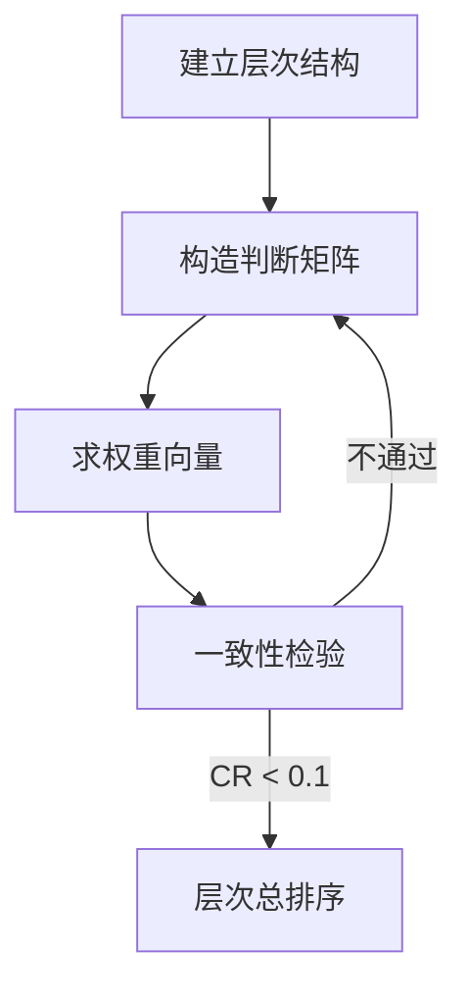

# 层次分析法 AHP（Analytic Hierarchy Process）用于综合评价

层次分析法（AHP，Analytic Hierarchy Process）是一种将复杂决策问题分解为目标、准则、方案等层次，通过两两比较确定权重，再进行综合评价的方法。它特别适合指标难以直接量化、需要融合专家经验的场景，如大坝维护方案选择、可持续发展指数构建等。

## 为什么需要 AHP

面对多指标评价，直接加权平均面临两个难题：权重如何定？定性指标如何量化？AHP 的回答是：把"哪个更重要"拆解成一系列两两比较，用 1–9 标度（1 同等重要，9 极端重要）构造判断矩阵，再从矩阵中提取权重。这样主观判断有了数学载体，且可通过一致性检验剔除自相矛盾的判断。

## 怎么做

**构造判断矩阵**：对某准则下 $n$ 个指标，$a_{ij}$ 表示 $i$ 相对 $j$ 的重要度，满足 $a_{ji}=1/a_{ij}$，$a_{ii}=1$。

**求权重**：用特征向量法 $A\boldsymbol{w}=\lambda_{\max}\boldsymbol{w}$，或近似的和积法——先按列归一化，再按行求平均。

**一致性检验**：
$$CI=\frac{\lambda_{\max}-n}{n-1},\qquad CR=\frac{CI}{RI}$$
其中 $RI$ 为随机一致性指标（查表）。==$CR<0.1$ 才认为判断矩阵可接受==，否则需重新调整两两比较。

**层次总排序**：方案总得分 $=\sum_j w_j^{\text{准则}}\cdot s_{ij}$，得分最高者为最优。

## 一个算对的例子

设三准则判断矩阵为
$$A=\begin{pmatrix}1&2&4\\1/2&1&2\\1/4&1/2&1\end{pmatrix}$$
该矩阵完全一致（$a_{ik}=a_{ij}a_{jk}$），$\lambda_{\max}=3$，$CI=0$，$CR=0<0.1$。用和积法：各列和分别为 $1.75,3.5,7$，归一化后每行均为 $(4/7,2/7,1/7)$，故 $\boldsymbol{w}=(0.5714,0.2857,0.1429)^T$。若三方案在准则下得分分别为 $(80,90,70)$、$(60,85,75)$、$(90,70,80)$，则综合得分：
$$S_1=0.5714\times80+0.2857\times90+0.1429\times70\approx81.43$$
同理 $S_2\approx69.29$，$S_3\approx82.86$，选方案 3——正如 Kariba 大坝题中 AHP 确定成本与收益权重后得出 option 3 最优。

## 与相近方法的区别

| 方法 | 权重来源 | 特点 |
|---|---|---|
| AHP | 专家两两比较 | 主观，可检验一致性，能处理定性指标 |
| 熵权法 | 数据离散程度 | 客观，但缺乏专业解释力 |
| 主成分法 | 数据方差结构 | 降维，权重含义不直观 |
| 主客观组合（如 CRITIC+熵权） | 数据与专家融合 | 兼顾两者，考过其相对 AHP 的优势 |

> [!NOTE]
> 简答题常考：AHP 等传统方法"要么过于客观难以用专业背景解释，要么过于主观缺乏说服力"，而主客观组合赋权同时考虑两类因素并有专业背景支撑。

## 常见的坑

> [!WARNING]
> - 忘记一致性检验，或 $CR\ge0.1$ 仍直接使用权重；
> - 判断矩阵不满足 $a_{ji}=1/a_{ij}$；
> - 负向指标（如二氧化碳排放）未先正向化就参与加权；
> - 把 AHP 当客观方法——它本质是主观赋权，结论依赖专家判断。

> [!TIP]
> 记忆主线：**分层 → 比较 → 求权 → 检验 → 合成**。答题时先画层次结构图，再写矩阵与 $CR$，最后给总排序，步骤完整即得分。
