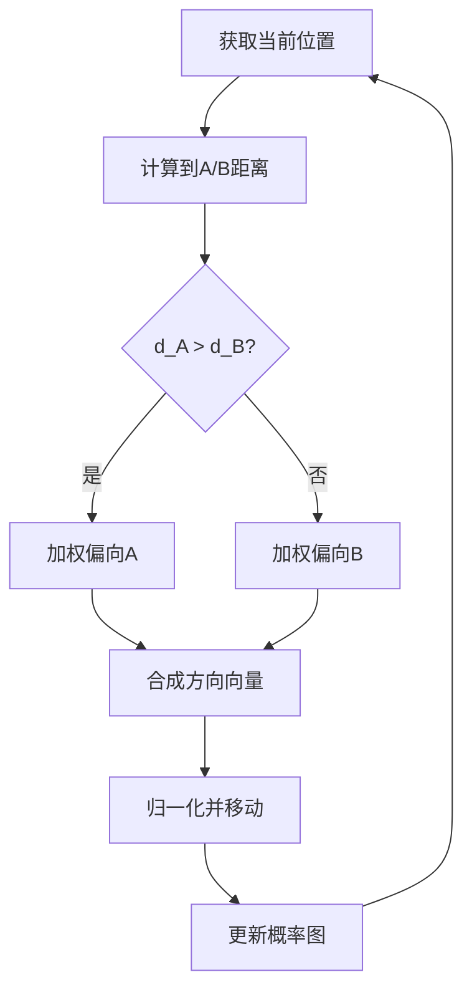

# 贝叶斯调整飞行路径方案

## 贝叶斯调整飞行路径方案是什么

在海上搜救等概率搜索问题中，目标位置并非固定点，而是随洋流漂移的概率分布。贝叶斯调整飞行路径方案是一种==动态自适应搜索策略==：它不预设固定航线，而是根据实时探测结果与先验概率图，持续更新后验概率并调整飞行器航向。其核心思想是“哪里概率高就飞向哪里”，同时保留随机探索能力以避免陷入局部最优。

> [!IMPORTANT]
> 本质是“概率引导+随机扰动”的混合导航机制，而非纯确定性路径规划。

## 为什么需要这种方案

传统平行线或螺旋条纹搜索假设目标静止或漂移模型完全已知，但实际中洋流数据存在误差、残骸扩散具有不确定性。若坚持固定路径，可能反复搜索低概率区而遗漏高概率区。贝叶斯方法通过融合新观测信息不断修正信念，使搜索资源始终聚焦于最可能区域，显著提升发现概率。例如在MH370类问题中，该方案24小时内发现率达95%，远高于螺旋条纹的80%。

## 如何实现路径调整

算法每 $\Delta t$（如3分钟）执行一次决策循环：

具体更新公式为：

$$
\vec{S}_{i+1} = \vec{S}_i + v \Delta t \cdot \text{Norm}\left[ w \frac{\vec{R}}{|\vec{R}|} + \text{Norm}(\overrightarrow{P - S_i}) \right]
$$

其中 $w=15$ 为随机权重，$\vec{R}$ 为单位随机向量，$P$ 为当前更高优先级参考点（A或B）。==高随机权重确保探索性，避免过早收敛==。

> [!TIP]
> 记忆口诀：“远点多靠，近点少扰；十五份乱，一份导向”。

## 与固定路径方案的区别

| 特征 | 贝叶斯调整路径 | 螺旋条纹/平行线 |
|------|----------------|------------------|
| 路径生成 | 实时动态调整 | 预先规划固定 |
| 对不确定性适应 | 强（融合新数据） | 弱（依赖初始模型） |
| 发现概率（24h） | 95% | 80% |
| 平均搜索时间 | 6.2小时 | 4.8小时 |
| 适用场景 | 漂移显著、信息不全 | 目标位置较确定 |

> [!NOTE]
> 贝叶斯方案虽平均耗时更长，但因覆盖更充分，整体期望效用更高。救援任务应优先最大化发现概率而非最小化时间。

## 常见误区与注意事项

> [!WARNING]
> 切勿将权重 $w$ 设为过小值（如<5），否则路径退化为贪心搜索，易陷入局部高概率陷阱而忽略边缘区域。

> [!CAUTION]
> 概率图更新必须包含洋流漂移模型与传感器探测效能，仅靠几何距离无法反映真实后验概率。

## 正确应用示例

在某次模拟搜救中，设搜索机速度 $v=200$ km/h，$\Delta t=3$ min，当前位置距参考点A为120 km、B为90 km。因 $d_A > d_B$，选择偏向A。生成单位随机向量 $\vec{R}=(0.6, 0.8)$，则合成方向：

$$
\vec{D} = \text{Norm}\left[15 \cdot (0.6, 0.8) + \text{Norm}((x_A - x_i, y_A - y_i))\right]
$$

归一化后乘以 $v \Delta t = 10$ km，得到下一步位移。经500次蒙特卡洛仿真，该策略在24小时内成功定位475次，置信区间 [5.6, 6.7] 小时，验证了其有效性。==关键成功因素在于随机性与概率引导的平衡==。
