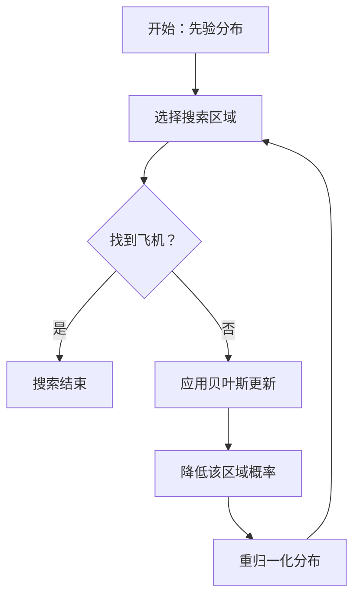

# 贝叶斯定理在搜索中的应用（Bayes' Theorem）

## 贝叶斯定理：让搜索"越搜越聪明"

想象你正在茫茫大海上搜寻一架失联飞机。搜索前，你根据飞机的最后位置、航向、滑翔比画出了一张"概率地图"——每个区域都有一个"飞机在这里"的概率。现在问题来了：**搜索了某片区域却没找到，接下来该怎么办？**

直觉告诉我们：这片区域的概率应该降低，其他区域的概率应该相应提高。但具体怎么调？调多少？这就是贝叶斯定理要解决的问题。

> [!IMPORTANT]
> 贝叶斯定理的核心思想：**用新证据（搜索结果）不断更新对未知量的信念（概率分布）**。搜索没找到飞机，本身就是一条重要信息。

## 贝叶斯定理是什么

贝叶斯定理描述的是条件概率的"反向"关系。设 $A$ 表示"飞机在区域 $i$"，$B$ 表示"在区域 $i$ 搜索但未找到飞机"，则：

$$
P(A \mid B) = \frac{P(B \mid A) \cdot P(A)}{P(B)}
$$

在搜索问题中，各项有明确的物理含义：

| 符号 | 含义 | 在搜索中的解释 |
|------|------|----------------|
| $P(A)$ | 先验概率 | 搜索前，飞机在区域 $i$ 的概率 |
| $P(B \mid A)$ | 似然 | 飞机在区域 $i$，但搜索漏掉的概率 |
| $P(B)$ | 证据 | 无论飞机在哪，"在区域 $i$ 没找到"的总概率 |
| $P(A \mid B)$ | 后验概率 | 搜索未果后，飞机仍在区域 $i$ 的概率 |

## 搜索中的贝叶斯更新流程

课件中的模型将海域离散为网格，每个格子有一个概率值。每次搜索一个格子后，执行以下更新：

具体地，设区域 $i$ 的先验概率为 $p_i$，该区域的**探测成功率**（conditional probability of detection）为 $q_i$。若搜索后**未发现**飞机，则更新为：

$$
p_i^{\text{new}} = \frac{p_i \cdot (1 - q_i)}{\sum_{j \neq i} p_j + p_i \cdot (1 - q_i)} = \frac{p_i(1-q_i)}{1 - p_i q_i}
$$

对于所有未搜索区域 $j \neq i$：

$$
p_j^{\text{new}} = \frac{p_j}{1 - p_i q_i}
$$

> [!TIP]
> 记忆要点：**分子乘"漏检率"$(1-q_i)$，分母统一除"归一化因子"$(1 - p_i q_i)$**。这样所有概率之和始终为 1。

## 一个算对了的例子

设某海域被划分为 4 个等概率区域，初始 $p_i = 0.25$。区域 1 的探测成功率 $q_1 = 0.8$（即漏检率 $1 - q_1 = 0.2$）。

**搜索区域 1，未找到。更新：**

区域 1：
$$
p_1^{\text{new}} = \frac{0.25 \times 0.2}{1 - 0.25 \times 0.8} = \frac{0.05}{0.8} = 0.0625
$$

区域 2、3、4（每个）：
$$
p_j^{\text{new}} = \frac{0.25}{0.8} = 0.3125
$$

验证：$0.0625 + 3 \times 0.3125 = 1$ ✓

| 区域 | 搜索前 | 搜索后 | 变化 |
|------|--------|--------|------|
| 1（已搜） | 0.2500 | 0.0625 | ↓ 大幅降低 |
| 2（未搜） | 0.2500 | 0.3125 | ↑ 小幅提升 |
| 3（未搜） | 0.2500 | 0.3125 | ↑ 小幅提升 |
| 4（未搜） | 0.2500 | 0.3125 | ↑ 小幅提升 |

> [!WARNING]
> 常见错误：只把已搜区域的概率"砍掉"，却忘记给未搜区域**重新归一化**。概率分布必须总和为 1，否则后续搜索决策会系统性偏差。

## 与相近概念的区别

| 概念 | 解决的问题 | 是否随搜索更新 |
|------|-----------|----------------|
| 先验概率 $P(A)$ | 基于初始信息，飞机可能在哪 | 否，搜索前确定 |
| 后验概率 $P(A \mid B)$ | 结合搜索结果，飞机更可能在哪 | 是，每次搜索后更新 |
| 探测成功率 $q$ | 飞机在这，能找到吗 | 否，由搜索工具/环境决定 |

> [!NOTE]
> $q$ 与 $p$ 是两个独立的量。$q$ 反映"搜索能力"（如雷达精度、能见度），$p$ 反映"位置信念"。贝叶斯更新将二者结合：即使某区域 $p$ 很高，若 $q$ 也很低，搜索未果后 $p$ 的下降幅度会较小——因为"没找到"可能只是因为"没看清"。

## 为什么这很重要

贝叶斯更新使搜索从"静态计划"变为"动态优化"。每次搜索未果，模型都更精确地缩小范围，将资源重新分配到概率最高的区域。这正是课件中"矩形平行扫描"等搜索模式能高效定位失联飞机的关键——它们不仅覆盖面积大，而且能与贝叶斯更新配合，实现**自适应的路径调整**。
