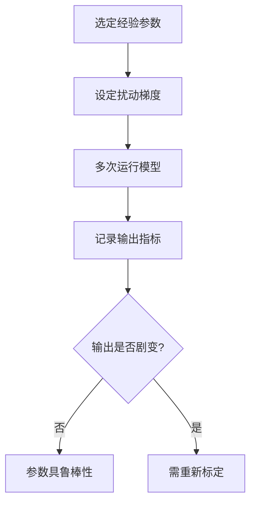

# 随机模拟产生的不确定效应与主观系数效应分析

当你用蒙特卡洛方法跑完模型，得出的预测值真的可信吗？如果换个随机种子，结果会不会天差地别？如果某个凭经验拍脑袋定的参数稍微变一点，结论会不会直接反转？这两个问题，分别对应着模型检验中必须回答的两件事：==随机模拟产生的不确定效应==与==主观系数效应==。

## 它是什么与为什么需要

在数学建模中，我们常面临两类“不完美”：一是算法本身带随机性（如蒙特卡洛模拟），二是部分参数缺乏数据只能靠经验赋值。

- **随机不确定效应**：因随机数生成导致的输出波动。即使输入完全相同，每次运行结果也略有差异。
- **主观系数效应**：人为设定的经验参数偏离真实值时，对最终输出的影响程度。

> [!IMPORTANT]
> 核心目的：证明你的模型是==鲁棒（robust）==的——即随机波动足够小、经验参数足够稳，结论不会因微小扰动而崩塌。

如果不做这两项分析，评委或决策者完全有理由质疑：“你的预测只是某次运气好的随机结果”或“你调了参数才凑出这个结论”。

## 怎么做

### 量化随机误差

不要只跑一次模拟！通常需重复运行 $n$ 次（如6次或10次），通过统计量衡量波动。一种直观的估算公式为：

$$
w = \frac{(a_1 + a_2 + a_3) - (a_4 + a_5 + a_6)}{3}
$$

其中 $a_i$ 为各次模拟的输出值，$w$ 代表随机误差。若 $w$ 极小（如小于0.015），即可认为随机效应可控。更规范的做法是计算均值、标准差和95%置信区间。

### 单因素敏感性分析

挑出最“心虚”的经验系数，在其附近取一组微小变化的值，观察输出变化幅度。

## 算对了的例子

以MCM优秀论文中的HR模型为例：

**1. 随机效应检验**：将工作率作为输出，同等条件下跑6次模拟，代入上述公式算得最大误差 $w < 0.015$。结论：随机误差在有限范围内，不影响输出。

**2. 主观系数检验**：员工晋升失败导致效率下降的衰减系数，凭经验设为0.95。将其改为0.90, 0.93, 0.95, 0.97后发现：当该值 $\ge 0.93$ 时，公司绩效无明显变化。这证明了取值0.95处于稳定区间。

> [!TIP]
> 写作模板：“我们将系数从 $x_1$ 调至 $x_n$，发现当其在 $[a, b]$ 范围内时，输出波动不超过 $y\%$，因此原设定值是合理且稳健的。”

## 与相近概念的区别

| 维度 | 随机不确定效应分析 | 主观系数敏感性分析 | 全局敏感性分析 |
| :--- | :--- | :--- | :--- |
| **扰动来源** | 算法内部随机数 | 人为设定的参数值 | 多个参数同时变化 |
| **操作方式** | 同参数多次重跑 | 改参数单次/多次跑 | 正交实验/方差分解 |
| **验证目标** | 算法收敛性与稳定性 | 经验取值的合理性 | 找出主导输出的关键因子 |

## 常见的坑

> [!WARNING]
> 1. **模拟次数太少**：只跑两三次就宣称“结果稳定”，毫无统计学意义。建议至少10次以上，最好给出置信区间。
> 2. **扰动步长太大**：把经验系数0.95直接改成0.5去测敏感性，脱离了“微小扰动”的前提，变成了场景假设而非敏感性分析。
> 3. **只看均值不看分布**：如课件案例中，均值37.5小时但标准差高达55.4小时，说明存在极端长尾情况。仅报均值会掩盖巨大的不确定性风险。

> [!CAUTION]
> 切忌得出“参数怎么变结果都不变”的结论后沾沾自喜——这可能意味着你的模型根本没捕捉到该参数的物理意义，是个无效模型。
