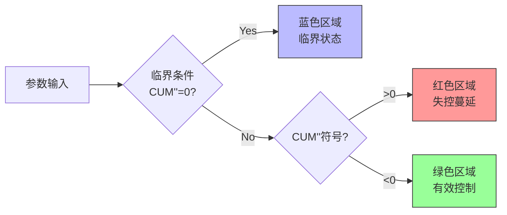

# 参数合理性验证

# 参数合理性验证

在数学建模中，求出模型参数只是第一步，**验证参数的物理意义与逻辑合理性**才是模型可信的关键。如果参数取值违背常识或导致模型行为异常（如人口负增长、病毒无限扩散），则模型失效。

## 什么是参数合理性验证？

它是指通过**量纲分析**、**边界值测试**、**敏感性分析**及**实际数据拟合**，判断参数取值是否在现实可行域内，以及模型输出是否符合客观规律的过程。

> [!IMPORTANT]
> 核心目标：确保参数不仅“算得出来”，而且“用得正确”。==合理参数 $\neq$ 最优参数==，首先必须满足物理/生物/社会约束。

## 为什么需要验证？

1. **避免“垃圾进，垃圾出”**：错误的参数会导致预测结果荒谬。
2. **识别关键因子**：通过敏感性分析，找出对结果影响最大的参数，指导实际决策。
3. **界定有效区域**：明确参数在什么范围内模型成立，超出范围需修正模型。

## 怎么做：四步验证法

### 1. 量纲与范围检查
检查参数单位是否一致，数值是否符合常识。例如，概率必须在 $[0,1]$ 之间，速率必须为正数。

### 2. 临界条件分析（边界测试）
考察参数取极值或临界值时，模型状态是否发生质变。

以埃博拉控制模型为例，定义控制条件为累计病例 $CUM$ 的二阶导数非正：
$$
\left\{ \begin{array}{l} CUM'' \leq 0 \\ CUM' \neq 0 \end{array} \right.
$$
当 $CUM'' = 0$ 时，处于**临界状态**。通过变动参数 $\alpha$（隔离率）、$\kappa$（追踪强度），可划分出“失控”、“临界”、“有效控制”三个区域。

### 3. 敏感性分析
改变参数微小量 $\Delta p$，观察输出变化 $\Delta y$。若 $\frac{\Delta y}{\Delta p}$ 极大，则该参数为**敏感参数**。

> [!WARNING]
> 敏感参数需高精度估计。如埃博拉模型中，传播率 $\beta_i$ 仅在 $0.30-0.32$ 窄区间内合理，稍偏即落入“灰色不可达区域”，导致预测失效。

### 4. 数据拟合反推
将历史数据代入模型，反解参数，看残差是否最小且参数值稳定。

## 常见坑与辨析

| 概念 | 区别点 | 注意事项 |
| :--- | :--- | :--- |
| **合理性验证** | 关注“对不对” | 参数是否符合物理/生物限制 |
| **敏感性分析** | 关注“稳不稳” | 参数扰动对结果的影响程度 |
| **最优参数** | 关注“好不好” | 在合理范围内使误差最小的值 |

> [!TIP]
> 记忆口诀：**先看量纲正负号，再找临界分界桥，敏感参数要精调，拟合残差不能飘。**

## 算例：埃博拉参数验证

在 MCM 2015 特等奖论文中，针对参数 $\alpha$（隔离率）：
1. **范围验证**：$\alpha \in [0.25, 0.40]$。
2. **临界判定**：当 $\alpha \approx 0.32$ 时，$CUM''=0$，为临界值。
3. **合理性结论**：
   - 若 $\alpha < 0.31$（红色区），$CUM'' > 0$，疫情失控，参数不合理（对于控制目标而言）。
   - 若 $\alpha > 0.33$（绿色区），$CUM'' < 0$，疫情受控，参数合理。
   - **敏感点**：$\beta_i$ 的合理窗口极窄（$0.30-0.32$），说明该参数对模型稳定性至关重要，需重点核实数据来源。

通过此过程，我们不仅确定了参数值，更明确了**防控措施的阈值**：只有当隔离率 $\alpha$ 超过临界值 $0.32$ 时，控制策略才在数学上有效。
