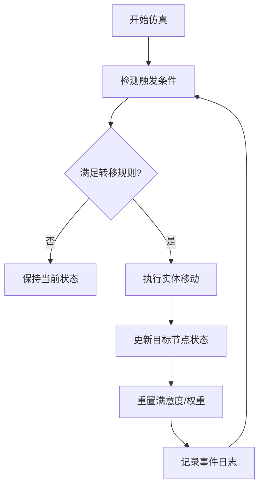

# 调动事件（Transfer Event）算法

## 什么是调动事件算法

在复杂系统仿真（如人员流动、物流调度）中，**调动事件（Transfer Event）**是指实体从一个节点（位置/状态）转移到另一个节点的离散动作。它不同于连续的时间步进，而是由特定条件触发的状态跃迁。

> [!IMPORTANT]
> 核心定义：调动事件是驱动网络模型动态演化的关键机制，其本质是==基于规则的实体迁移与属性更新==。

为什么需要它？传统静态模型无法反映资源随时间的重新分配。通过引入调动事件，我们可以模拟“人岗匹配”、“数据包路由”等动态过程，从而评估系统的效率与稳定性。

## 算法执行流程

调动事件的处理通常遵循“触发-判断-执行-更新”的逻辑闭环。

具体步骤如下：
1. **触发检测**：在每个时间步或事件队列中，检查是否有实体满足转移条件（如满意度低于阈值）。
2. **路径选择**：根据优化算法（如最短路径、最大收益）确定目标节点。
3. **状态更新**：这是最关键的一步。实体移动后，必须同步更新原节点和目标节点的属性。

> [!TIP]
> 记忆技巧：调动不仅是“动”，更是“变”。移动的是实体，改变的是全局状态矩阵。

## 与相近概念的区别

| 特性 | 调动事件 (Transfer) | 普通状态变更 (State Change) |
| :--- | :--- | :--- |
| **空间维度** | 涉及节点间的物理/逻辑位移 | 仅在当前节点内属性变化 |
| **影响范围** | 影响源节点和目标节点 | 通常只影响自身 |
| **触发频率** | 相对较低，依赖特定条件 | 可能每个时间步都发生 |

## 常见陷阱与初始化细节

在实现调动算法时，最容易忽略的是**初始状态的合理性**。如果初始参数设置不当，会导致仿真初期出现剧烈震荡或死锁。

> [!WARNING]
> 易错点：勿将占位符（Placeholder）当作真实实体处理。空位置的属性应设为中性或零值，避免干扰统计结果。

以课件中的案例为例，在初始化模型时，我们需要区分“真实人员”与“空位”：

*   **真实人员**：赋予默认满意度 $S = 0.5$，表示初始中立状态。
*   **占位符**：代表空职位，其满意度强制设为 $S = 0$，不参与调动决策的计算分母。

若未做此区分，计算平均满意度时，空位的 $0$ 值会拉低整体指标，导致优化算法误判系统性能。

## 算例演示

假设某部门有 3 个职位，初始化如下：
1.  Person A (在职): $S_A = 0.5$
2.  Person B (在职): $S_B = 0.5$
3.  Placeholder (空位): $S_P = 0$

当发生一次调动事件，Person A 离职（变为空位），新人 C 入职：
1.  A 的位置变为 Placeholder，$S$ 重置为 $0$。
2.  C 进入该位置，初始化 $S_C = 0.5$。
3.  系统总满意度从 $0.5+0.5+0=1.0$ 变为 $0.5+0.5+0=1.0$（数值不变，但实体已更替）。

==核心结论==：正确的初始化与事件后的状态重置，是保证仿真数据可信度的前提。
