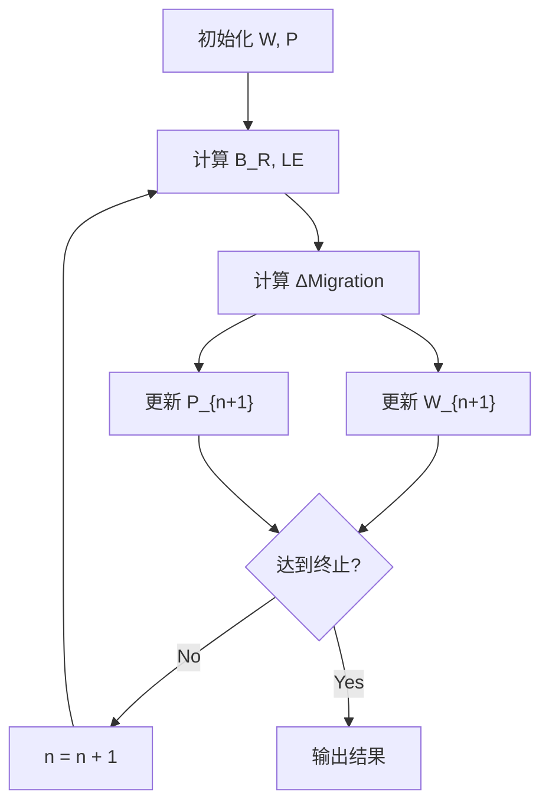

# 迭代函数映射（Iterative Function Map）

# 迭代函数映射（Iterative Function Map）

在数学建模中，当我们面对复杂系统（如社会经济、生态演化）时，往往难以直接求出解析解。**迭代函数映射**通过将连续时间的微分方程离散化，构建状态变量随时间步长演化的递推关系，是连接微观机制与宏观现象的桥梁。

## 它是什么与为什么需要

迭代函数映射本质上是差分方程组 $X_{n+1} = f(X_n)$ 的空间或逻辑扩展。在元胞自动机（CA）或基于主体的模型（ABM）中，系统下一时刻的状态仅取决于当前时刻的状态及邻居影响。

> [!IMPORTANT]
> 核心定义：将 $\frac{d}{dt}$ 近似为 $\frac{\Delta}{\Delta t}$（通常设 $\Delta t=1$），把微分动力学转化为**离散迭代步骤**，便于计算机模拟非线性演化。

为何使用它？
1. **处理非线性**：如人口增长率依赖财富，财富扩散依赖邻居，这种耦合关系难以积分求解。
2. **空间异质性**：结合网格（Grid），可模拟资源在地理空间上的不均匀分布与流动。

## 怎么做：从微分到迭代

以南邮课件中赞比亚发展模型为例，构建财富 $W$ 和人口 $P$ 的迭代系统：

1. **离散化微分项**：
   $$ \frac{dW}{dt} \approx W_{n+1} - W_n $$
2. **定义演化规则**：
   - **财富更新**：考虑自身留存与邻居扩散。
     $$ W_{n+1} = (1 - 8\epsilon) W_n + \epsilon \sum_{i \in \text{neighbors}} W_{n,i} $$
     其中 $\epsilon$ 为就业/扩散系数。
   - **人口更新**：考虑自然增长（出生-死亡）与迁移。
     $$ P_{n+1} = P_n + P_n \left(B_R(W_n) - \frac{1}{LE(W_n)}\right) + \Delta \text{Migration} $$

## 与相近概念的区别

| 特性 | 迭代函数映射 | 传统优化算法 (如GA) |
| :--- | :--- | :--- |
| **目的** | 模拟系统**演化过程** | 寻找目标函数**极值** |
| **输入** | 初始状态 + 演化规则 | 决策变量 + 目标函数 |
| **输出** | 时间序列/空间分布 | 最优解向量 |

> [!NOTE]
> 在本题中，迭代映射用于**生成**社会经济状态数据，而遗传算法等用于在映射基础上**优化**资金分配。两者常结合使用：先迭代模拟，后优化决策。

## 常见的坑

> [!WARNING]
> **稳定性陷阱**：若步长 $\Delta t$ 过大或系数 $\epsilon$ 选择不当，迭代可能发散（数值爆炸）。需确保 $0 < \epsilon < 1/8$ 以保证财富守恒或非负。

> [!TIP]
> **边界处理**：在求和 $\sum W_{n,i}$ 时，务必明确边界元胞的邻居定义（如周期性边界或零填充），否则边缘效应会扭曲结果。

## 算例演示

假设某元胞当前财富 $W_n=100$，有4个邻居财富均为 $50$，$\epsilon=0.1$。忽略其他项，仅看财富扩散：
$$ W_{n+1} = (1 - 8 \times 0.1) \times 100 + 0.1 \times (50+50+50+50) $$
$$ W_{n+1} = 0.2 \times 100 + 0.1 \times 200 = 20 + 20 = 40 $$
==核心结论==：财富向低密度区扩散，导致原中心财富下降，体现了“均衡化”趋势，但若配合人口迁移项，可能加剧不平等。
