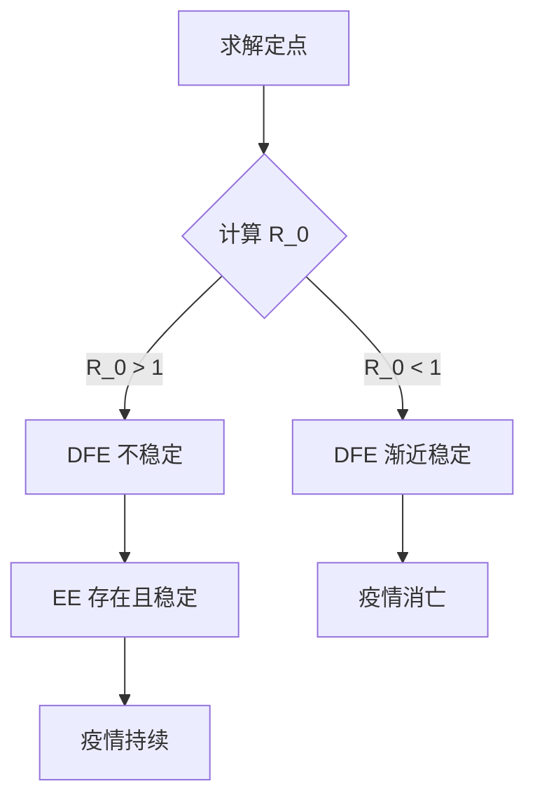

# 确定模型的定点与稳定性分析

传染病模型建好后，如何判断疫情最终会消亡还是持续蔓延？这就需要分析模型的==定点（平衡点）==及其==稳定性==。

## 什么是定点与稳定性

**定点**是指系统中各仓室人数不再随时间变化的状态，即对所有变量满足 $\partial_t X(t) = 0$。在 SEIHCR 等传染病模型中，通常存在两类定点：

- **无病定点（DFE）**：感染者相关仓室全为 $0$，如 $(S^*, E^*, I^*, H^*, C^*, R^*) = (N, 0, 0, 0, 0, 0)$。
- **地方病定点（EE）**：感染者维持非零常数，疾病长期存在。

**稳定性**决定了系统受微小扰动后的走向：若偏离定点后能自动回归，则稳定；若被不断放大，则不稳定。

> [!IMPORTANT]
> ==基本再生数 $R_0$ 是决定定点稳定性的核心阈值==。$R_0 < 1$ 时无病定点稳定；$R_0 > 1$ 时地方病定点稳定。

## 为什么需要它

仅靠数值仿真无法给出一般性结论。例如课件中提到，改变初始感染人数会影响初期峰值大小，但“the net behavior of the outbreak is similar”。稳定性分析从数学上严格证明了这种定性行为不依赖于初值，只取决于 $R_0$ 是否越过阈值。

## 怎么做：用下一代矩阵法求 $R_0$

对于多仓室模型，直接求雅可比矩阵特征值非常繁琐，通常采用 van den Driessche 等人的**下一代矩阵法**。步骤如下：

1. **写出感染子系统**：将微分方程拆分为新感染项 $F$ 和转移项 $V$，使得 $\dot{x} = F - V$，其中 $x$ 仅包含受感染的仓室（如 $E, I, H, C$）。
2. **在无病定点处求雅可比矩阵**：分别对 $F$ 和 $V$ 关于感染变量求偏导，代入 DFE，得到矩阵 $F$ 和 $V$。
3. **计算谱半径**：
$$
R_0 = \rho(F V^{-1})
$$
其中 $\rho(A)$ 表示矩阵 $A$ 的最大特征值模长（谱半径）。

以考题中的 SEIHCR(CT) 模型为例，$F$ 的第一行对应易感者减少的负项（实际计算中常提取出新增暴露者的正项构成感染子系统的 $F$ 矩阵），而 $V$ 包含了潜伏期转出 $\sigma E$、隔离转入 $\alpha I$、治愈 $\gamma_I I$ 及死亡 $\nu_I I$ 等所有非新感染的转移速率。通过计算 $\rho(F V^{-1})$ 即可估计 $R_0$。

## 概念辨析

| 对比维度 | 雅可比矩阵特征值法 | 下一代矩阵法 ($\rho(FV^{-1})$) |
| :--- | :--- | :--- |
| **适用对象** | 任意动力系统 | 专用于传染病/种群模型 |
| **操作难度** | 需对整个系统求导，维数高 | 仅对感染子系统操作，维数低 |
| **物理意义** | 纯数学局部线性化 | $F$ 为新感染速率，$V$ 为转移速率 |

> [!TIP]
> 记忆口诀：“==F 管生，V 管走，逆乘之后求谱半==”。$F$ 记录新感染怎么来，$V$ 记录感染者怎么走（康复/死亡/转仓室）。

## 常见的坑

> [!WARNING]
> 构造 $V$ 向量时，必须保证 $\dot{x} = F - V$ 成立，且 $V$ 代表的是“移出”减去“移入”。符号写反会导致 $V^{-1}$ 出现负特征值，算出的 $R_0$ 完全错误。

> [!CAUTION]
> 谱半径 $\rho$ 取的是特征值的==最大绝对值==，而不是最大实部！很多同学在这里与稳定性判据（看实部是否为负）混淆。求 $R_0$ 看模长，判稳定性看实部。

> [!NOTE]
> 课件附录 B 的微分方程组中，$\partial_t S(t)$ 只有负项没有正项，说明该模型未考虑出生率补充。这意味着总人口不恒定，无病定点的形式需根据具体守恒量重新推导，不能盲目套用 $(N,0,\dots,0)$。
