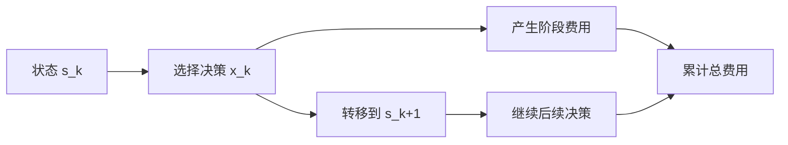

# 动态规划求解（状态变量、决策变量、状态转移函数、值函数）

## 它是什么

动态规划用于求解**多阶段决策问题**：系统随时间或阶段变化，每一阶段都要作出决策，当前决策不仅影响眼前收益，还会影响后续状态。其核心是把“一次求出全部决策”转化为“逐阶段比较最优决策”。

例如，物流配送中的车辆调度、水库逐月放水、搜索区域随洋流漂移后的逐日调整，都不能只看当前一步。若当前状态已经确定，则后续最优方案只取决于当前状态，与此前如何到达该状态无关，这就是**最优性原理**。

> [!IMPORTANT]
> 动态规划的四个基本要素是：==状态变量、决策变量、状态转移函数和值函数==。状态描述“现在怎样”，决策表示“现在做什么”，转移函数描述“做完后到哪里”，值函数衡量“从现在起还能取得多好的结果”。

## 四个要素怎么写

设阶段为 $k$，通常可建立：

| 要素 | 常用记号 | 含义 |
|---|---|---|
| 状态变量 | $s_k$ | 第 $k$ 阶段开始时的系统状况，如位置、库存量、剩余水量 |
| 决策变量 | $x_k$ | 在该状态下采取的行动，如配送量、放水量、搜索方向 |
| 状态转移函数 | $s_{k+1}=T_k(s_k,x_k)$ | 决策实施后，系统进入的下一状态 |
| 值函数 | $V_k(s_k)$ | 从状态 $s_k$ 出发，后续阶段的最优总收益或最小总费用 |

若第 $k$ 阶段的直接费用为 $c_k(s_k,x_k)$，最小化问题的 Bellman 递推式为

$$
V_k(s_k)=\min_{x_k\in X_k(s_k)}
\left\{c_k(s_k,x_k)+V_{k+1}\!\left(T_k(s_k,x_k)\right)\right\}.
$$

其中 $X_k(s_k)$ 是可行决策集合。终端条件常写为 $V_{K+1}(s)=0$，也可按终端剩余价值设定。

## 怎么做

先划分阶段，再选择足以预测未来的状态；随后列出可行决策、转移关系和阶段费用，最后从终端向前递推，并从初始状态正向恢复最优决策。

以求最小费用为例：

1. 写终端值函数；
2. 对每个 $s_k$，枚举所有可行 $x_k$；
3. 计算“当前费用＋后续最优费用”；
4. 保存最小值及取得最小值的决策；
5. 回到 $k=1$，按最优决策逐步推出完整方案。

> [!TIP]
> 建模时可按“阶段—状态—决策—转移—费用—递推”的顺序检查。只写出递推公式而未说明变量含义，通常不算完整建模。

## 一个算对的例子

某配送任务分两个阶段，每阶段可选配送量 $x_k\in\{0,1,2\}$，两阶段总配送量必须为 $2$。阶段费用为 $c_k(x_k)=x_k^2$，无其他费用，则

$$
V_3(s_3)=0,\qquad
V_k(s_k)=\min_{x_k}\left[x_k^2+V_{k+1}(s_k-x_k)\right],
$$

其中状态 $s_k$ 表示尚需配送的数量。

第二阶段必须完成剩余任务，因此 $V_2(0)=0$、$V_2(1)=1$、$V_2(2)=4$。第一阶段 $s_1=2$：

| $x_1$ | 当前费用 | 后续最优费用 | 总费用 |
|---:|---:|---:|---:|
| $0$ | $0$ | $4$ | $4$ |
| $1$ | $1$ | $1$ | $\mathbf{2}$ |
| $2$ | $4$ | $0$ | $4$ |

故最优方案为 $x_1=x_2=1$，最小总费用为 $\boxed{2}$。这说明平均分配在本例中优于把任务集中到某一阶段。

## 和相近方法的区别

| 方法 | 主要特点 | 与动态规划的区别 |
|---|---|---|
| 贪心算法 | 每步只选当前最好 | 不保证全局最优；动态规划比较当前选择与后续影响 |
| 穷举法 | 检查所有完整方案 | 动态规划保存子问题最优值，避免重复计算 |
| 线性规划 | 用线性约束和目标函数统一求解 | 不要求按阶段递推；动态规划可处理非线性及序贯决策 |
| 仿真 | 按规则运行系统并观察结果 | 仿真侧重评价方案，动态规划侧重寻找最优策略 |

## 常见的坑

> [!WARNING]
> 状态信息不足是最常见错误。例如水库调度只记录时间而不记录当前蓄水量，就无法确定后续可行决策；但若把已无关的历史全部放入状态，又会造成状态数量激增。

其他易错点包括：把决策变量当成状态变量；漏写决策约束；转移方程与费用下标不一致；最大化、最小化方向混用；只得到 $V_1(s_1)$ 却没有恢复最优路径。此外，动态规划给出的是**最优策略**：每个状态对应一个决策，而不只是预先固定的一串行动。
