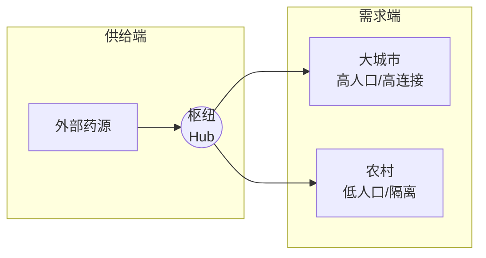

# 多目标优化模型（药物相对充足阶段的配送策略）
在疫情应急物流中，当药物从“极度短缺”进入“相对充足”阶段后，决策的核心不再仅仅是“有没有药”，而是==如何在多个相互冲突的目标之间找到折中最优解==。这就引出了多目标优化。

### 为什么需要多目标优化？

在单一目标优化中，我们可能只追求“感染人数最少”。但在实际配送中，资源总是有限的。在药物相对充足时，你往往同时希望：
1.  **控制疫情**：最小化最终感染总人数
2.  **缩短周期**：最大化疫情结束速度
3.  **覆盖公平**：偏远低密度人口区和高密度爆发区同样重要

> [!WARNING]
> 这些目标往往是相互矛盾的：把药全堆在人口密集的大城市能最快压平曲线，但可能导致偏远农村形成顽固传染源；反之，为了公平而过度分散运力，又会使大城市里本可挽救的人得不到治疗。所以需要多目标优化。

### 这个模型怎么运作？

结合考题中的“Hub-and-Spoke”（轴辐式系统），我们一步步来看：

**第一步：定义物流与疾病双层网络**
画一个简单的轴辐式网络，药品从外界先空运到枢纽（Hub），再从枢纽经陆路分发到各辐点（Spoke）。疾病也在这个网络上传播。

**第二步：识别待优化的冲突目标**
在这里，存在一个正在发生的“两难权衡”：将枢纽设在最稠密城市，能最快治疗大量病患；而将其设在高连接地带，能最有效地截断传染路径，防止向更多城市扩散。

**第三步：建立概率与损耗规则**
药品在枢纽再生，并遵循特定的“运输规则”流动。规则里包含了途中的==损耗/变质==。每运一程，由于道路破败，会有一定比例的药品失效。

**第四步：构建多目标模型**
我们将两个关键目标写成数学形式，以便寻找它们之间的非劣解集（Pareto前沿）：
- **目标1：最小化总感染与持续时间**，受药物库存 $S_h$ 和发放概率 $P_{receive}$ 约束。
- **目标2：最大化药品覆盖的公平性**，即最小化各节点之间每千人获取药品数量的方差。

### 和单目标优化的区别

| 对比点 | 单目标优化 | 多目标优化 |
| :--- | :--- | :--- |
| **输出结果** | 一个全局最优解 | ==一组帕累托（Pareto）最优集== |
| **决策方式** | 计算机直接给出唯一答案 | 决策者根据风险偏好选择方案 |
| **适用阶段** | 极度短缺（救一个是一个） | **相对充足**（需多方权衡） |

> [!TIP]
> 口诀记忆：单目标是“唯一答案何在”，多目标是“几种方案任选”。

### 常见坑：只看总量，不看连接度

考题中指出一个许多学生容易踩的坑：==单纯把药送到“当前感染人数最多”的节点，而忽略了该节点作为交通枢纽的“向外辐射能力”==。如果一个感染人数中等的节点极度连通，把药优先放在这里切断传播链，可能比投放到孤立的爆发点整体效果更好。

### 一个算对了的例子

假设你有1000单位的药品，考虑两个地区：
- **城市 A**：高密度，已感染 200 人，但道路堵塞严重，连通道路仅有 1 条。
- **城市 B**：中密度，已感染 100 人，拥有四通八达的公路网，连通道路 4 条。

**易错的单目标决策**：全投 A，救了 200 人。但由于没管 B，病毒通过 B 的 4 条路在下一周传染了 400 人，最终疫情延长。

**多目标决策的思考**：考虑传播切断率指标。B 的“连接度”权重极高，分配 700 单位药物先把 B 封死；A 投入 300 单位延缓病情。由于 B 不再是传染源，总传染链被切断，各区域最终感染人数趋稳。虽然 A 的初始救治速度变慢了，但整体疫情的结束时间（目标2）和防外溢（隐含目标）被极大优化了。这就是==在相对充足阶段，通过轴辐式模型（Hub-and-Spoke）平衡多个冲突目标的价值==。
