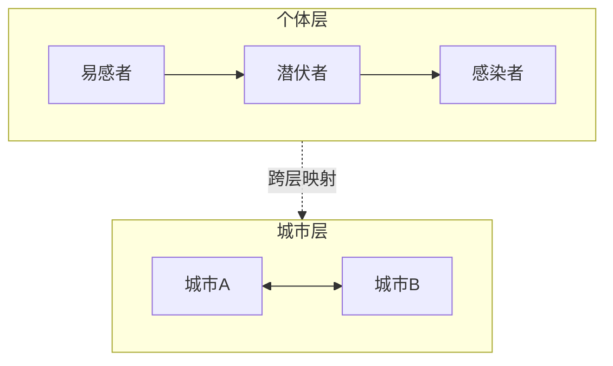

# 多重网络/多层网络构建（Multiplex/Multi-layer Network）

如果只用一张图描述传染病传播，你能同时刻画“个体接触感染”和“城市间交通流动”吗？显然不能，因为这两类交互遵循完全不同的规则。这正是引入多层网络的动机：==当系统包含异质交互关系时，必须用多层结构解耦建模==。

## 什么是多层网络

多层网络（Multi-layer Network）是由多个层（Layer）组成的复合系统，每层代表一种特定类型的交互或尺度。以考题中的流行病模型为例，它显式构建了至少两层：底层是个体状态转移层，顶层是城市交通网络层。层内节点遵循该层专属动力学规则，层间通过耦合机制传递信息或实体。

> [!IMPORTANT]
> 核心定义：多层网络不是简单的图叠加，而是==异构规则的分层封装与跨层耦合==。

## 为什么需要它

单层网络假设所有连边同质，但现实系统中“人与人接触”和“城与城连通”的概率机制、时间尺度、状态空间均不同。若强行合并，要么丢失微观随机性，要么忽略宏观拓扑约束。多层模型允许各层独立建模再耦合，既保留细节又支持模块化扩展——正如考题所述，可从国家层向下细化至村庄，无需重构整体框架。

## 如何构建与计算

构建分三步：① 定义各层节点集与层内动力学；② 建立层间映射（如个体归属城市）；③ 设计跨层触发机制。考题中，个体是否移动由所在城市的移动概率决定（层2→层1），而感染概率 $P_{interact}$ 仅依赖本区域内感染者比例（层1内部）：

$$
P_{\text{interact}} = \frac{\text{区域内某类感染人数}}{\text{区域总人数}}
$$

> [!TIP]
> 解题口诀：==层内自治算概率，跨层触发看映射==。先确认状态转移是否需外部事件激活，再定位触发源在哪一层。

## 与相近概念的区别

| 概念 | 核心特征 | 适用场景 |
| :--- | :--- | :--- |
| 多层网络 | 异质层+跨层耦合 | 多尺度/多类型交互 |
| 多重图 | 同节点集+多边类型 | 同类实体多种关系 |
| 超图 | 超边连接多节点 | 群组高阶交互 |

> [!NOTE]
> 多重图（Multiplex）是多层网络的特例：各层共享完全相同的节点集。考题中个体层与城市层节点不同，属于一般多层网络，而非多重图。

## 常见误区与正确示例

> [!WARNING]
> 切勿将跨层影响当作层内参数！例如，不能把“城市移动概率”直接乘入感染公式 $P_{\text{interact}}$，二者触发逻辑独立。

**正确计算流程**：  
1. 对每个个体，先根据所属城市的移动概率判断是否迁移（层2→层1触发）；  
2. 无论是否迁移，在当前所在区域内计算 $P_{\text{interact}}$；  
3. 仅当交互被触发后，才按状态转移表执行概率跳转。  

此顺序确保了==跨层事件仅作为开关，不污染层内动力学参数==，符合考题“triggered before probability calculation”的设计原则。
