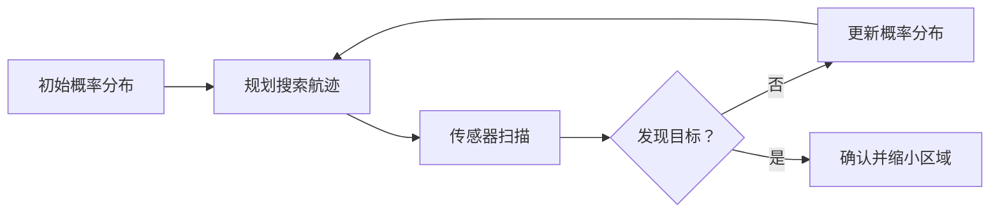
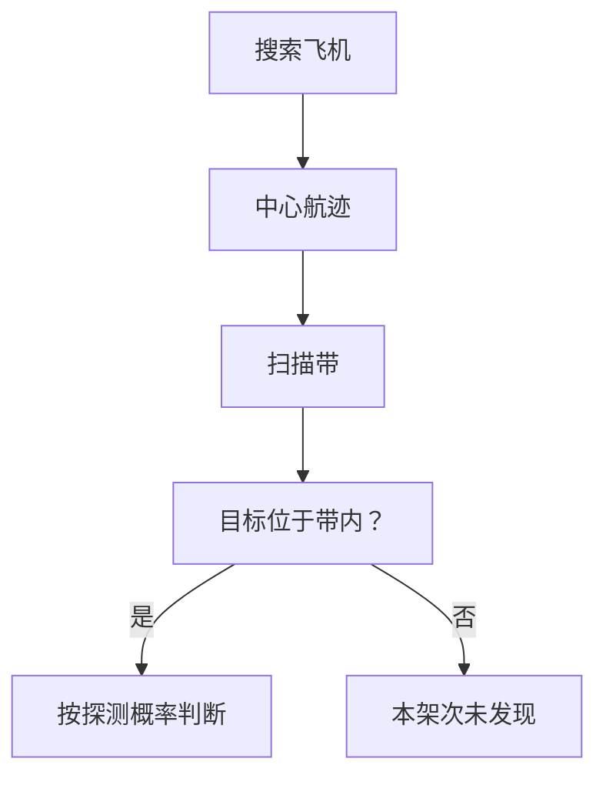

# 发现不确定性模型（Uncertainty Model）与传感器视野

## 它是什么

“发现不确定性模型”描述的是：**目标位置未知，而且传感器只能发现视野范围内的目标**。搜索时必须同时回答三个问题：

1. 目标最可能在哪里？——用先验/后验概率表示；
2. 传感器能看到多大范围？——由视野半径决定；
3. 怎样安排航迹，才能尽快覆盖高概率区域？——用搜索策略优化。

在飞机失联问题中，坠机位置的不确定性是“发现不确定性”；海面、天气、能见度和搜索设备造成的漏检，则是“探测不确定性”。二者共同决定目标能否被发现。

## 为什么需要

如果把整个搜索区等分后逐格搜索，会忽略一个事实：==失事目标通常不会在区域内均匀分布==。飞机可能沿航线坠毁，受风、海流和事故类型影响，坠机点会集中在若干区域。

因此，模型要先建立离散概率网格，再让搜索路径尽量经过高概率网格。贝叶斯更新还能把每次“未发现”的信息反馈给下一段搜索：搜索过的低概率区域会降低目标概率，尚未充分搜索的区域则相对上升。

## 先验概率网格

把搜索区域划分为面积为 $A$ 的网格，第 $i$ 个网格的先验概率记为 $p_i$。最简单的均匀模型为

$$
p_i=\frac{1}{N},\qquad \sum_{i=1}^{N}p_i=1.
$$

也可根据航线距离、事故率、风向等因素设置非均匀先验。离散网格便于计算机模拟，也能直接计算搜索覆盖率和发现概率。

## 传感器视野

传感器视野半径为 $r$ 时，航迹两侧的有效扫描带宽度约为 $2r$。当目标与航迹的横向距离不超过 $r$ 时，才可能被探测。

需要注意：==视野范围不等于必然发现==。能见度、天气、目标反射特性以及设备性能都会降低单次探测概率。因此，模型中应把 $r$、能见度和探测概率分开处理。

## 怎样做搜索模型

设搜索飞机速度为 $v_s$，每个时间步长为 $\Delta t$，则两相邻航迹点距离为

$$
\ell=v_s\Delta t.
$$

例如，$v_s=400\ \mathrm{mph}$、$\Delta t=3\ \mathrm{min}$，则

$$
\ell=400\times\frac{3}{60}=20\ \mathrm{mi}.
$$

若传感器视野半径为 $r=10\ \mathrm{mi}$，相邻扫描带宽度可达 $20\ \mathrm{mi}$，正好连续覆盖；若航迹发生弯曲或偏移，则需额外考虑漏扫区域。

常见搜索策略包括：方形往复、矩形往复、螺旋方形和八边形扇区。评价指标主要有：

- 首次发现目标的期望时间；
- 整个区域被搜索的最迟完成时间；
- 各时刻累计发现概率；
- 对速度、风、能见度和传感器视野的敏感性。

## 概率如何更新

设某一时刻目标位于网格 $i$ 的概率为 $q_i$。若已知搜索了网格 $j$ 且没有发现目标，可按条件概率更新：

$$
P(\text{目标在 }i\mid\text{未发现})
=
\frac{P(\text{未发现}\mid \text{目标在 }i)P(\text{目标在 }i)}
{P(\text{未发现})}.
$$

若该网格被完整搜索且单点漏检概率为 $1-\lambda$，则未发现概率与 $\lambda$ 有关。若采用“网格被发现则一定发现”的理想化模型，搜索过的网格概率可直接降为零。

## 一个算对了的例子

采用课件中的 P-8 Poseidon：速度 $400\ \mathrm{mph}$，传感器视野半径 $10\ \mathrm{mi}$，每 $3$ 分钟重新选择方向。

每步航程为

$$
400\times\frac{3}{60}=20\ \mathrm{mi}.
$$

若搜索区域宽 $L=100\ \mathrm{mi}$，飞机从一侧进入，则单条横向航迹在边界附近可能被限制在“中心线两侧各 $r$”的有效区域内。若飞机水平飞出区域，题目给出的修正思想是将方向向量指向区域横向中心：

$$
\vec S_{i+1}
=
\vec S_i+v_s\Delta t\,
\operatorname{Norm}\left[
\left\langle
\frac{L+2r}{2}-S_{ix},0
\right\rangle
\right].
$$

这里 $L+2r=120\ \mathrm{mi}$，目标横向中心为 $60\ \mathrm{mi}$。归一化后乘以航程 $20\ \mathrm{mi}$，即可得到下一航点。该处理使飞机不会因飞出边界而停止覆盖有效区域。

## 相近概念的区别

| 概念 | 含义 | 主要作用 |
|---|---|---|
| 先验概率模型 | 搜索前目标位置的概率分布 | 回答“哪里更可能有目标” |
| 传感器视野 | 航迹两侧可被扫描的有效范围 | 回答“哪里能被看见” |
| 探测概率 | 目标进入视野后被识别的可能性 | 回答“看见后能否确认” |
| 搜索策略 | 航迹的空间安排 | 回答“先搜哪里、怎样搜” |
| 贝叶斯更新 | 利用未发现等新信息修正位置概率 | 回答“搜完后应转向哪里” |

## 常见坑

- [!WARNING]
  不要把 $r$ 当成搜索带总宽度；总宽度通常为 $2r$。
- [!WARNING]
  不要把“未发现”理解为“目标一定不在已搜区域”；低探测概率下仍可能漏检。
- [!CAUTION]
  不要忽略飞机飞出搜索区后的回转，否则最后几行网格可能长期无法覆盖。
- [!TIP]
  敏感性分析应分别改变飞机速度、飞机高度、风速、能见度、视野半径和搜索飞机数量，并保持其他条件不变。比较首次发现时间与区域搜索完成时间，才能判断参数影响方向。
