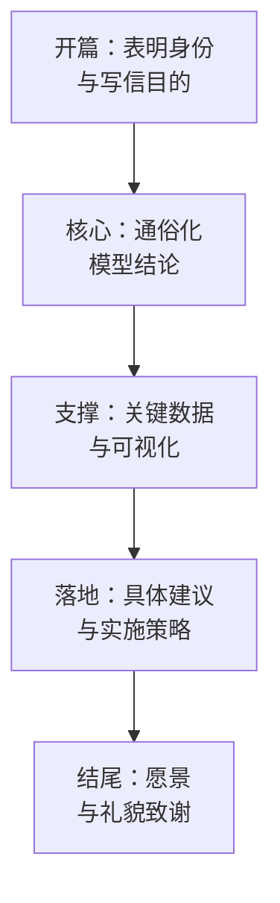
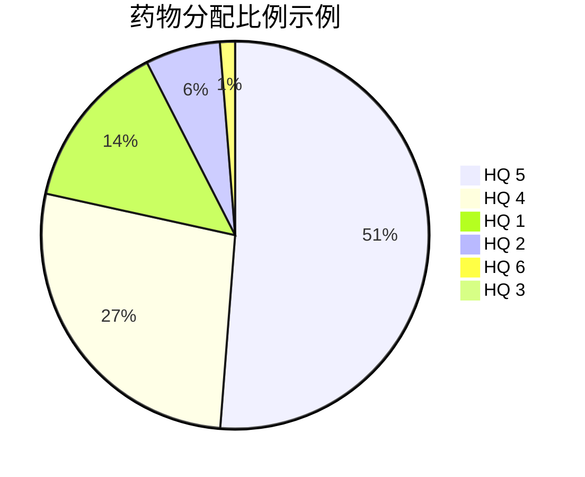

# 非技术性文稿撰写（如致世界医学会的信函、新闻发布会声明）

## 非技术性文稿：定义与价值

在数学建模竞赛中，==非技术性文稿==指面向非专业受众（如政策制定者、公众、媒体）的沟通文档，常见形式为**致信（Letter）**或**新闻声明**。

> [!IMPORTANT]
> 核心目标是将复杂的模型结论转化为**可执行的决策建议**，而非展示推导过程。评委通过此类文稿考察团队的**科学传播能力**与**社会责任感**。

## 写作结构与关键要素

不同于学术论文的“摘要-模型-求解”结构，非技术性文稿需遵循“背景-结论-建议”的逻辑闭环。

1.  **开篇（Hook）**：简明扼要地说明写信背景及团队身份。避免冗长的客套，直接切入痛点。
2.  **核心结论（Key Findings）**：==剔除公式与算法细节==，用自然语言描述模型预测的趋势或最优解。例如，不说“SEIR模型参数 $\beta=0.3$”，而说“病毒传播速度将在两周后达到峰值”。
3.  **数据支撑（Evidence）**：引用关键图表或数据表，但需配合文字解读，确保读者能看懂图表含义。
4.  **行动建议（Recommendations）**：基于模型结果提出具体、可操作的建议（如物资分配比例、时间节点）。

## 与学术论文的区别

| 维度 | 学术论文 (Paper) | 非技术性文稿 (Letter/Statement) |
| :--- | :--- | :--- |
| **受众** | 领域专家、评委 | 政府官员、公众、媒体 |
| **语言** | 严谨、术语密集、被动语态 | 平实、清晰、主动语态、有感染力 |
| **重点** | 模型构建、假设检验、误差分析 | 结论意义、实际应用、社会效益 |
| **格式** | 严格遵循 LaTeX/Word 模板 | 商务信函或新闻稿格式 |

> [!WARNING]
> 常见误区是直接将论文摘要翻译或复制粘贴。非技术性文稿中**严禁出现未解释的数学符号**（如 $\sum, \int$）和复杂公式。

## 实战案例解析：埃博拉药物配送信

以《致世界医学会的信》为例，分析其高分逻辑：

1.  **情感共鸣**：开篇表达对新药研发的兴奋（"thrilled"），建立积极基调。
2.  **模型通俗化**：
    *   原文："We improved the traditional epidemic model... simulated the growing trend..."
    *   解析：仅提及“改进传统模型”和“模拟趋势”，未展示微分方程，但强调了结果与WHO数据的高度吻合（"correspond with... greatly"），建立了可信度。
3.  **数据可视化与表格**：
    *   使用地图展示6个总部位置，用表格列出经纬度及分配比例。
    *   ==关键技巧==：表格数据直接对应决策（如 Headquarters 5 分配 50.83% 药物），让读者一目了然。

4.  **具体建议**：列出了制造速度（106.2 unit/day）、引入时间、药效等四个关键因素，并给出了定性判断（"The earlier... the better"）。

> [!TIP]
> 写作口诀：**身份亮得早，公式全抛掉，图表要说话，建议可落地。**

## 常见陷阱

*   **语气不当**：过于傲慢（教导对方）或过于卑微。应保持**专业且合作**的态度（"We hope... can help you decide"）。
*   **逻辑跳跃**：直接给出建议却未说明依据。需确保每条建议都能在前文找到模型结果的支撑。
*   **篇幅失控**：非技术性文稿通常较短（1-2页），切忌啰嗦。
