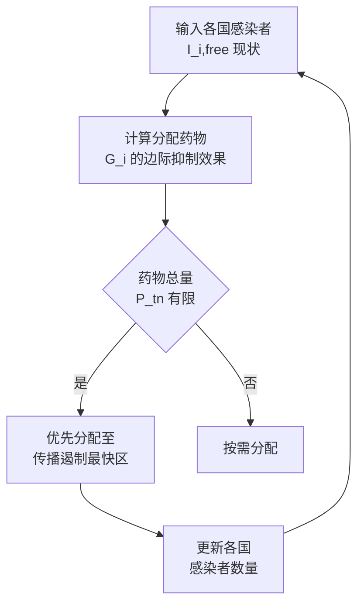

# 非线性规划模型（药物配送阶段划分）

## 药物配送阶段划分与非线性规划模型

在物流配送与疫情防控等场景中，资源往往是逐步到位的。这就引出一个问题：**当资源极度紧缺时，我们该如何分配，才能让有限的资源发挥最大的作用？**

### 为什么需要阶段划分？

想象一下，疫区急需药物，但工厂每天的产量远远跟不上需求。如果此时还想着“多救几个人”，可能反而错过了控制疫情扩散的关键窗口期。所以，必须根据 **资源充足程度** 把问题拆成不同阶段，每个阶段设定不同的核心目标。

- **药物严重短缺阶段**：库存/产能远低于需求。此时目标不是单纯救死扶伤，而是 **掐断传播链**。
- **药物相对充足阶段**：药物产量爬坡后，覆盖了大部分需求。此时才有余力去精细化降低死亡率。

这就是“阶段划分”的建模逻辑——==不同约束下，目标函数必须动态调整==。

### 短缺阶段的非线性规划模型

在药物短缺的第一阶段（例如题目中的前 150 天），核心矛盾是 **感染源仍在自由活动**。模型的目标因此设定为：最小化各国非隔离感染者的总数。

**非线性规划模型构建：**

- **决策变量**：$ G_i(t) $，即 t 时刻分配给第 i 个国家的药物数量。
- **优化目标**：
  $$ \text{Min} \sum_{i=1}^k I_{i, \text{free}} $$
  其中 $ I_{i, \text{free}} $ 代表未得到治疗、仍在传播病毒的自由感染人数。
- **关键约束**：
  $$ \sum_{i=1}^k G_i(t) = P_{t_n} $$
  所有国家的分配量之和，必须刚好等于当前可用的药物总产量 $ P_{t_n} $。

> [!IMPORTANT]
> 虽然目标函数看起来是各国自由感染人数的线性求和，但 **自由感染人数本身是药物分配量的复杂函数**（药物越多 → 被隔离/治愈的人越多 → 感染人数下降）。因此，$ I_{i, \text{free}} $ 对 $ G_i $ 的依赖关系是非线性的，这是一个典型的 **非线性规划** 问题。

### 模型求解的直观逻辑

模型是怎么工作的？可以想象一个“优先级清单”：

1. 统计各国当前的自由感染者基数。
2. 计算“每多分一盒药，能减少多少自由感染者”。这类似于边际收益。
3. 药物优先流向 **边际收益最高** 的国家，迅速压制其新增感染。
4. 随着药量增加，该国的边际收益会递减（该治的都治了），此时模型会自动把药转向下一个国家。

### 与相对充足阶段的区别

| 对比维度 | 药物短缺阶段 | 药物相对充足阶段 |
| :--- | :--- | :--- |
| **时间特征** | 前期（如第 150 天前） | 后期（产量爬坡完成后） |
| **核心矛盾** | 药物总量远小于总需求 | 药物供给基本覆盖 |
| **建模目标** | ==最小化自由感染者==（控扩散） | 最小化死亡人数（精细化救治） |
| **模型类型** | 有时可转化为非线性规划或最优化 | 可转为多目标优化 |

### 常见误区

[!WARNING]
很多同学会一上来就以“最小化死亡人数”为目标。在药物严重短缺的早期，如果全部分配给重症患者，新感染的“自由人”会呈指数级爆发，最终导致 **总死亡人数更高**。阶段性策略必须服从整体最优。

[!TIP]
判断是线性还是非线性规划，不要只看目标函数里有没有平方项。要问自己：**决策变量和它带来的效果之间，是简单的比例关系，还是通过微分方程/传染动力学间接影响的？** 在本题中，因为牵涉到传染病动力学中的 $SIR$ 模型耦合，它直接就是一个非线性规划。
