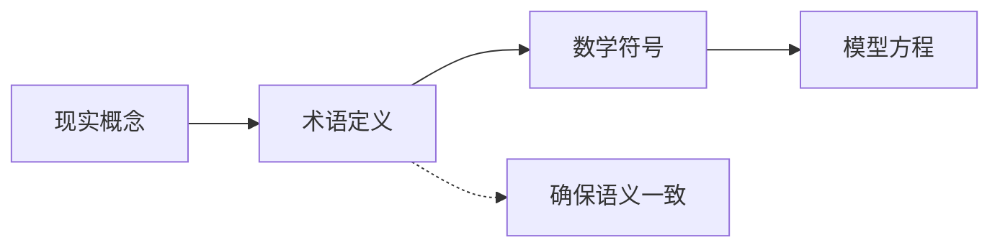

# 符号说明与术语定义（Nomenclature / Symbols and Definitions）

符号说明与术语定义是数学建模论文的“字典”与“契约”。它不仅是排版要求，更是==消除歧义、建立模型可信度==的核心环节。试想，如果阅卷老师读到公式 $R_0$ 时不确定它代表“基本再生数”还是“初始半径”，你的模型逻辑再精妙也会大打折扣。因此，这一节必须在正文开始前，为所有变量和专有名词确立唯一、明确的解释。

## 核心构成要素

一个规范的符号说明通常包含三个维度：符号、含义、单位/备注。对于复杂模型（如传染病或搜索优化），还需单独设立“术语定义”板块。

| 要素 | 作用 | 优秀范例（埃博拉模型） | 常见错误 |
| :--- | :--- | :--- | :--- |
| 符号 | 数学表达载体 | $\beta_I, \beta_H, \beta_C$ | 用 $a,b,c$ 等无语义字母 |
| 描述 | 物理/现实含义 | 院外/院内/尸体传播率 | 仅写“参数”“系数” |
| 下标 | 区分类别状态 | $I$: Infectious, $H$: Hospital | 下标含义未在表中注明 |
| 术语 | 界定业务概念 | “暴露个体”“接触者追踪” | 直接使用未定义的缩写 |

> [!IMPORTANT]
> 符号必须遵循“见名知意”原则。例如在埃博拉 SEIHCR 模型中，使用 $S, E, I, H, C, R$ 分别对应 Susceptible, Exposed, Infectious, Hospitalized, Corpse, Removed，比使用 $x_1$ 到 $x_6$ 更能体现模型的内在逻辑。

## 术语定义的必要性

当模型涉及特定领域知识时，仅靠符号表不够。比如“暴露个体”在医学上有严格判定标准（如21天内有疫区旅行史或接触史），这直接决定了模型中 $E(t)$ 仓室的流入条件。若不加定义，读者可能将其与“潜伏期”混淆。

> [!TIP]
> 术语定义应引用权威来源（如WHO指南、航空搜救手册），并标注参考文献编号。这能显著提升论文的专业性与可复现性。

## 避坑指南与规范检查

- **先定义后使用**：所有符号必须在首次出现前列入表中，正文中不得突然引入未声明变量。
- **避免符号冲突**：同一符号不能在不同章节表示不同含义。若需复用，必须加下标区分（如 $\gamma_I$ 与 $\gamma_H$）。
- **单位统一**：时间单位（天/小时）、距离单位（公里/海里）必须在表中明确，防止量纲错误。
- **动态更新**：建模过程中新增的符号应及时补入表中，终稿前务必全文核对。

> [!WARNING]
> 切勿将“假设”与“符号说明”混为一谈。假设是对现实的简化（如“忽略空气阻力”），而符号说明是对语言的约定。两者虽常相邻放置，但功能截然不同。

## 实战示例解析

以2015年MCM特等奖论文《如何根除埃博拉》为例，其符号表不仅列出了 $R_0, N, S(t)$ 等基础变量，还细致区分了 $(\beta_I, \beta_H, \beta_C)$ 三种传播率和 $(\gamma_I, \gamma_H)$ 两种康复时间。这种精细化定义使得后续微分方程组（4.3）中的每一项都有明确现实对应，避免了“参数堆砌”的嫌疑。同时，文中对“接触者追踪”给出了操作性定义（21天监测+隔离循环），使抽象的 $\kappa, \pi_E$ 等参数有了落地依据。这就是==符号与术语服务于模型解释力==的典范。
