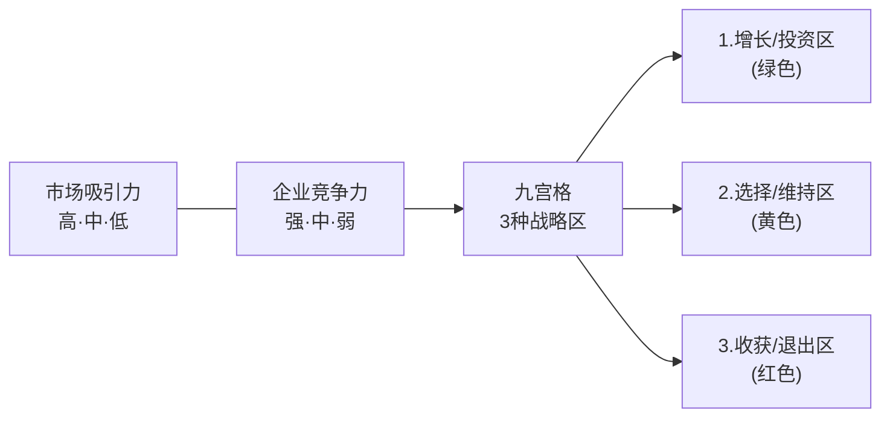

# GE-Matrix 用于可持续性评分
当我们需要从“企业自身竞争力”和“市场吸引力”两个维度评价多个业务单元（或方案、产品线）时，仅凭直觉排序很容易顾此失彼。GE-Matrix（通用电气矩阵，又称麦肯锡矩阵）把这两维各分为三个等级，构成一个 $3\times3$ 的九宫格，==让每个业务单元落在具体的格子中，从而获得明确的战略定位与可持续性评分==。

### 一个引子：两个问题就抓住了关键

判断某个业务该“投入”还是“退出”，不妨先问两个问题：
1. 这个市场本身有前途吗？（市场吸引力）
2. 我们在里面打得赢吗？（企业竞争力）

这两个维度的乘积分级，正是 GE-Matrix 的核心思路。相比仅用“相对市场份额”和“市场增长率”两个数字画圈圈大小的 BCG 矩阵，GE-Matrix 的综合评价维度更丰富，也更能适应可持续性分析中对环境、社会、治理等软指标的考量。

### GE-Matrix 的结构

矩阵横轴通常为**企业竞争力**（强、中、弱），纵轴为**市场吸引力**（高、中、低）。两轴各三等分后交叠出九个格子，归为三类战略：

| 战略区 | 位置特征 | 建议动作 |
|:---:|:---|:---|
| 增长/投资区 | 左上三格（高吸引力＋强/中竞争力） | 优先资源配置，积极增长 |
| 选择/维持区 | 对角线中部 | 选择性投入，维持现状或谨慎扩张 |
| 收获/退出区 | 右下三格（低吸引力＋弱/中竞争力） | 逐步收获现金流，准备退出 |

> [!IMPORTANT]
> GE-Matrix 的核心思想：==根据两个综合评价维度的得分，将评价对象映射到战略区域，区分投资优先级与资源分配方向==。

### 怎么做：评分与落位

评价过程通常分四步：

1. **选定评价维度与子指标**
   - 市场吸引力：市场规模、增长率、利润率、环境规制的友好度、社会接受度等。
   - 企业竞争力：技术能力、品牌、成本优势、绿色供应链管理能力等。
2. **确定指标权重与打分标准**（例如每个指标 $1\sim5$ 分，加权求和）。
3. **计算综合得分并归一化到“高、中、低”/“强、中、弱”**。
4. **在九宫格内定位**，按区域给出可持续性策略建议。

### 一个算对了的例子

某校办科技园评估三个技术转化项目 $A,B,C$，从“可持续性市场吸引力”与“企业绿色竞争力”两维打分（以下数据已加权合成）：

| 项目 | 市场吸引力得分 | 企业竞争力得分 |
|:---:|:---:|:---:|
| A | 4.2（高） | 3.8（强） |
| B | 2.5（低） | 3.2（中） |
| C | 3.6（中） | 2.1（弱） |

- 项目 $A$：高—强 → 落在**增长/投资区** → 建议：优先投入资源，作为可持续业务的标杆。
- 项目 $B$：低—中 → 落在**收获/退出区** → 建议：控制投入，逐步将收益回收，准备替代方案。
- 项目 $C$：中—弱 → 落在**选择/维持区**偏右下的“谨慎位置” → 建议：有限投资，着重提升绿色竞争力后再观察。

> [!WARNING]
> 许多同学在确定“强弱高低”时，直接拿原始分去切分，忽略了**必须先归一化或按行业水平设定阈值**。例如市场吸引力满分 5 时，$4.0$ 以上才算“高”，$2.5\sim4.0$ 算“中”。阈值不经校准，落格结论会失真。

### 与 BCG 矩阵的对比

| 对比点 | BCG 矩阵 | GE-Matrix |
|:---|:---|:---|
| 维度 | 相对市场份额、市场增长率 | 多指标综合的企业竞争力、市场吸引力 |
| 结果 | 4 个象限（明星、金牛、问题、瘦狗） | $3\times3$ 九宫格，3 个战略区 |
| 适用场景 | 简单、快速筛选 | 多因素综合评价，尤其适合可持续性评分 |

> [!TIP]
> 记忆口诀：GE 九宫，“强中弱”遇“高中低”，左上优先投，右下谨慎收。

### 常见坑

- **把“可持续性”简单塞进一个指标**：应将它分解到市场吸引力（如绿色消费趋势）和竞争力（如低碳工艺）两类维度中分别量化。
- **忽略时间轴**：GE-Matrix 给出的是某一时刻的战略快照，对技术进步快的领域，需配合技术路线图做动态预测。
- **合成评分时草率取平均**：必须使用加权求和，且权重应通过专家评判或层次分析法确定，否则==无法反映各指标的真实重要性差异==。

GE-Matrix 的核心优势在于它的灵活性与综合性，这让它在可持续性评价中既能量化环境与社会的软指标，又能给出决策者一看就懂的九宫格定位，真正做到“用数据定战略”。
