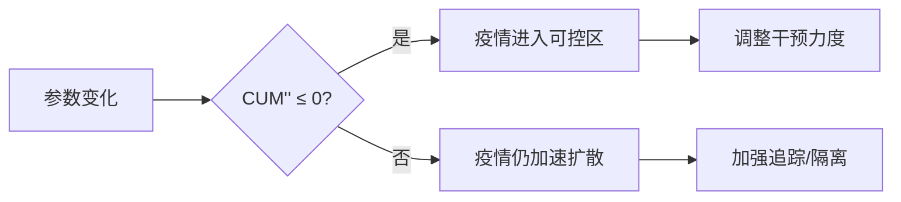

# 关键参数区域与临界条件分析（埃博拉何时能被根除）

## 什么是关键参数区域与临界条件

在埃博拉动力学模型中，我们不仅关心“最终感染人数”，更关心“疫情何时出现拐点”。==关键参数区域==指使疫情从失控转为可控的参数取值范围；==临界条件==则是这一转变发生的数学边界。Valdez等人的研究指出，单纯限制人口流动效果有限，真正决定根除时间的是干预措施的==强度与时机==。

> [!IMPORTANT]
> 核心定义：疫情受控的临界条件是累计病例数 $CUM$ 的二阶导数归零且一阶导非零。
> $$ CUM'' = 0, \quad CUM' \neq 0 $$
> 这标志着新增病例增速达到峰值后开始下降，是判断干预是否有效的“金标准”。

## 为什么需要分析临界条件

如果只模拟最终规模，可能错过最佳干预窗口。通过分析 $\kappa$（接触追踪强度）和 $\alpha$（识别隔离率）等参数对 $CUM''$ 的影响，可以回答两个实战问题：

1.  **阈值在哪里？** 当 $\alpha$ 较小时，若 $\kappa=0$，疫情将失控；只有 $\kappa$ 足够大才能压制传播。
2.  **哪个措施最优先？** 灵敏度分析显示，提高医院化率和降低院内/葬礼传播率，比单纯减少流动更能快速使 $CUM'' \leq 0$。

## 如何确定关键参数与临界点

以 Valdez 模型为例，操作步骤如下：

1.  **选定决策变量**：通常选 $\kappa$、$\alpha$、治愈周期 $1/\gamma_H$、院内病死率 $\delta_H$。
2.  **计算导数符号**：对给定参数组合求解微分方程，监测 $CUM''(t)$ 首次过零点的时间 $t^*$。
3.  **绘制参数平面**：在 $(\kappa, \alpha)$ 平面上画出 $t^* < T_{target}$ 的区域，即为“安全操作区”。

> [!TIP]
> 解题技巧：当题目问“最有效干预”时，优先寻找使 $CUM''$ 最快变负的参数。文献结论表明：==早期迅速干预+提高住院率+降低院内传播== 是最优组合。

## 与相近概念的区别

| 概念 | 关注对象 | 数学特征 | 应用场景 |
| :--- | :--- | :--- | :--- |
| 基本再生数 $R_0$ | 初始传播潜力 | $R_0=1$ 为阈值 | 评估疫情暴发风险 |
| 关键参数区域 | 干预后的动态转折 | $CUM''=0$ 曲面 | 制定实时防控策略 |
| 最终规模 | 累积感染总量 | $t\to\infty$ 极限值 | 评估医疗资源需求 |

> [!WARNING]
> 易错坑：不要将 $R_0<1$ 等同于 $CUM''\leq 0$。$R_0$ 反映的是无干预下的固有属性，而临界条件分析必须基于==含时变干预参数的实际模型==。即使 $R_0>1$，强干预仍可使 $CUM''$ 提前归零。

## 算对了的例子：Valdez模型简答题

**题干**：Valdez等人提出的模型发现，为了控制埃博拉疫情，最有效的干预措施是什么？

**解析思路**：
-   排除干扰项：“减少人口流动性”在模型中对地理范围控制效果微弱。
-   定位关键参数：$\kappa$ 增大时，累计病例增长速率递减；$\alpha$ 过小则需更大 $\kappa$ 补偿。
-   提取结论：==迅速且早期的干预==最关键，具体为增加医院化率、降低医院及葬礼期间传播率。

> [!CAUTION]
> 高危误区：答题时切勿只写“加强防控”等空泛表述。必须明确写出“提高 $\kappa$ 和 $\alpha$”“降低 $\beta_H, \beta_c$”等==具体参数方向==，并关联到 $CUM''\leq 0$ 这一临界判据，否则不得满分。
