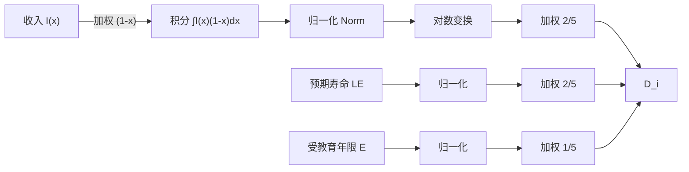

# 人类发展指数 HDI 的局限性与社会经济调整指数的构建

## 从 HDI 到社会经济调整指数

人类发展指数（HDI）是衡量国家综合发展水平的经典指标，常被视为人均 GDP 的“升级版”。传统 HDI 由三个维度合成：健康（预期寿命）、教育（平均与预期受教育年限）和经济（人均国民总收入）。

### 传统 HDI 的核心缺陷

HDI 的经济维度使用 **人均 GDP 或人均 GNI**，这本质上是“平均水平”。它回答了“平均每人有多少钱”，但回避了一个关键问题：

> 这些钱在不同人群之间是如何分配的？

如果一个国家极少数人掌握绝大多数财富，人均 GDP 依然可以很高，但这显然不代表普通民众的经济福祉。==传统 HDI 忽略收入分配状况，导致指标可能产生严重误导。==

> [!WARNING]
> 收入分配越不均，人均 GDP 作为经济福祉衡量指标的失真程度就越大。

### 为什么要构建调整指数

为了弥补 HDI 的缺陷，需要构建一种能反映收入不平等的社会经济调整指数。调整后指数的设计目标很明确：让相同平均收入下、分配更不公平的国家的得分更低。

这一调整通常通过引入收入分布信息并减少对高收入群体的权重来实现。

### 调整指数的构建方法

首先定义几个基础变量：

- $I(x)$：购买力（以当地商品衡量的收入），$x \in (0,1)$ 表示收入分布百分位。
- $LE$：平均预期寿命。
- $E$：平均受教育年限。

**关键创新在于加权机制**：对每个百分位 $x$ 对应的购买力 $I(x)$，乘以权重 $(1-x)$，然后对所有 $x$ 求和。

这意味着什么呢？收入越低的百分位（$x$ 越小），其购买力被赋予的权重 $(1-x)$ 越大；而最高收入者的权重趋近于零。这种设计直接抑制了高收入群体对综合指标的贡献。

最终，国家 $i$ 的调整后经济发展函数 $D_i$ 定义为：

$$
D_i = \frac{2}{5} \log \text{Norm}\left( \int I(x)(1-x)dx \right) + \frac{2}{5} \text{Norm}(LE) + \frac{1}{5} \text{Norm}(E)
$$

其中 $\text{Norm}$ 表示基于全球最大最小值的数据归一化。

> [!IMPORTANT]
> 教育维度权重仅为 $1/5$，低于健康与收入的 $2/5$。理由有二：受教育年限对社会经济发展的边际影响相对较小；且受教育年限与预期寿命、收入已存在较强相关性，赋予过高权重会造成信息重叠。

### 一个算例思路

假设有 A、B 两个国家，它们的预期寿命和受教育年限完全相等，归一化后的收入维度也完全相等——但这是未经调整的数值。

- 国家 A 收入分配极度不均：$I(0.2)=100$，$I(0.8)=5000$
- 国家 B 收入分配相对均匀：$I(0.2)=500$，$I(0.8)=2500$

两者人均 GDP 可能相差无几，但国家 B 低收入群体的购买力远高于国家 A。由于调整指数中低百分位的购买力被乘以更高的权重 $(1-x)$，==国家 B 的调整后收入维度得分将显著高于国家 A==。这套指数成功区分了平均收入相同但分配结构不同的两种情况。

### 与标准 HDI 的区别对比

| 维度 | 标准 HDI | 社会经济调整指数 |
|------|----------|------------------|
| 经济指标 | 人均 GNI（未调整） | 购买力积分 × 不平等权重 |
| 收入分配 | 不考虑 | 核心调整变量 |
| 教育权重 | 与健康基本持平 | 降低至 1/5 |
| 目标 | 衡量平均发展水平 | 衡量经分配调整的福祉 |

> [!TIP]
> 记忆权重分配的口诀：**“健康收入各占四，教育只占二”**（即 $2/5, 2/5, 1/5$）。教育权重低的原因是它已在健康和收入中“间接体现”了。

### 常见的坑

**误将“归一化后的值”当作原始值解读**。$\text{Norm}$ 操作将各指标映射到 $[0,1]$ 区间（基于全球极值），这使得不同量纲的指标可比，但也让数值失去绝对物理含义。解读时应关注国家间的相对排序，而非 $D_i = 0.7$ 的绝对含义。

**忽略对数变换的作用**。收入维度做了对数变换，这会压缩高收入段的差异、拉伸低收入段的差异——这与不平等权重设计的内在逻辑是协调一致的。
