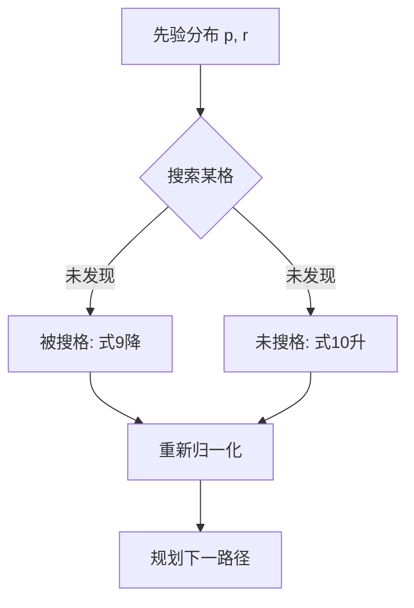

# 后验概率更新与搜索路径规划

> [!IMPORTANT]
> 后验概率更新是贝叶斯搜索理论的核心：当搜救飞机扫过某区域却未发现目标时，==该区域的概率不会归零==，而是按探测率衰减；同时未搜索区域的概率必须按比例上升，以保证全图概率之和恒为 1。

## 为什么需要更新

假设你正在搜寻失联航班，已把海面划分为离散网格并算出初始（先验）概率 $p$。如果一架搜索机飞过某个格子却没看到残骸，能直接说“这格子里肯定没有”吗？

显然不能。受能见度、传感器性能限制，即使飞机真在那里也可能被漏掉。因此我们需要一个机制，用“搜了但没找到”这个新证据去==修正整张概率地图==。

## 怎么做：两条更新公式

设 $q$ 为探测概率（即飞机在格内且被发现的概率），它取决于横向搜索范围 $W$、行驶距离 $z$ 和格子面积 $A$。在随机搜索假设下，增量步长 $h$ 的探测贡献为 $g(h)=\frac{Wh}{A}$。

**被搜索过的格子**（概率下降）：

$$
p' = \frac{p(1-q)}{(1-p)+p(1-q)} \tag{9}
$$

- 分子 $p(1-q)$：飞机在格内但没被发现的可能性。
- 分母 $(1-p)+p(1-q)$：所有“没找到”情形的总概率，起归一化作用。

**未被搜索的格子**（概率上升）：

$$
r' = \frac{r}{1-pq} \tag{10}
$$

其中 $r$ 是该格的先验概率，$p$ 是被搜索格子的先验概率。分母 $1-pq$ 表示“本轮搜索未发现目标”的全局概率，用它做除数让其余格子的概率等比放大。

> [!TIP]
> 记忆口诀：**搜过打折，没搜放大，分母兜底保总和**。

## 与相近概念的区别

| 对比维度 | 朴素排除法 | 贝叶斯后验更新 |
| :--- | :--- | :--- |
| 搜后未发现 | 概率直接置 0 | 乘以 $(1-q)$ 衰减 |
| 其他区域 | 概率不变 | 除以 $1-pq$ 上升 |
| 概率守恒 | 不守恒 | ==严格归一化为 1== |

> [!WARNING]
> 常见坑：只对被搜索格子用式 (9) 减小概率，却忘记对未搜索格子用式 (10) 增大，导致全图概率之和小于 1，后续路径规划将完全失效。

## 算对了的例子

设某格先验概率 $p=0.4$，探测概率 $q=0.5$；另一未搜索格先验概率 $r=0.3$。

**Step 1：更新被搜索格**

$$
p' = \frac{0.4 \times (1-0.5)}{(1-0.4) + 0.4 \times (1-0.5)} = \frac{0.2}{0.6+0.2} = 0.25
$$

**Step 2：更新未搜索格**

$$
r' = \frac{0.3}{1 - 0.4 \times 0.5} = \frac{0.3}{0.8} = 0.375
$$

**Step 3：验证归一化**

若全图仅这两个格子，原总和 $0.4+0.3=0.7$（说明还有 0.3 分布在别处）。更新后两格总和变为 $0.25+0.375=0.625$，恰好等于原总和乘以全局未发现概率 $0.7 \times \frac{0.8}{0.7} \approx 0.8$ 的比例关系——所有格子同步更新后，总和必回到 1。

> [!NOTE]
> 实际建模中，探测概率 $q$ 由搜索路径决定。课件中的方形、螺旋形、八角扇形等搜索模式，本质就是改变 $W$ 和 $z$ 的空间分布，从而影响各格的 $q$ 值，最终引导后验概率峰值向最优搜索方向转移。
