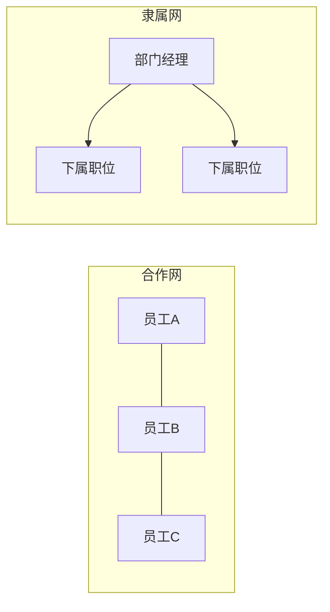
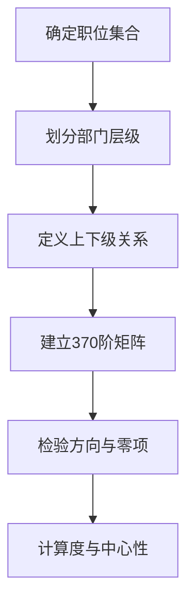

# 静态合作网络与隶属关系网络（Affiliation Network）

## 什么是静态合作网络与隶属关系网络

在组织的人力资本模型中，网络用于描述职位之间的结构关系。课件将组织内部的“职位”作为节点，并分别抽取两类关系：

- **合作网络（cooperative network）**：同一部门内的成员为了完成共同任务而形成合作关系。若假定同部门任意两成员均可合作，则该部门对应一个完全图。
- **隶属关系网络（affiliation network）**：描述部门经理与下属职位之间的领导、被领导关系，是一种典型的==有向网络==。

“静态”表示网络在一个特定时刻反映组织结构，节点数、职位归属及关系在建模期间固定；它不是人员永远不变的含义，而是把某一时间截面的组织结构作为动态人力资本模型的基础。

> [!IMPORTANT]
> 静态网络的核心是“固定结构、动态状态”：职位及关系固定，人员流动、绩效和流失状态随时间更新。

## 为什么要分别建立两张网络

一个组织中，合作与隶属同时存在，但作用机制不同。合作网络反映任务协作和信息共享，隶属网络反映权力影响与人员流动。二者若混在一张图里，很难判断某个影响来自同事合作还是上下级关系。

因此，课件借鉴网络叠加思想，将两类关系==抽象为相互独立的网络==：

| 对比项 | 合作网络 | 隶属关系网络 |
|---|---|---|
| 边来源 | 同部门合作 | 上下级隶属 |
| 边方向 | 通常无向 | 有向 |
| 边权 | 可表示合作强度 | 无强度差异时取1 |
| 主要用途 | 信息流、协同效率 | 权力、影响、流失传播 |

例如，中层经理流失可能沿隶属边向下级岗位传播，而合作网络则用于分析经理离开后该部门协作是否受阻。

## 怎么建立隶属关系网络

设组织共有 $N$ 个职位，构造邻接矩阵 $A\in\{-1,0,1\}^{N\times N}$。对任意职位 $i,j$：

$$
a_{ij}=
\begin{cases}
1, & i\text{ 对 }j\text{ 有领导、隶属关系},\\
-1, & j\text{ 对 }i\text{ 有领导、隶属关系},\\
0, & i,j\text{ 无直接隶属关系}.
\end{cases}
$$

> [!IMPORTANT]
> 必须先固定“源职位指向目标职位”的方向约定；若只画没有箭头的网络图，矩阵中 $1$ 与 $-1$ 的含义就容易混乱。

本题可取 $N=370$，得到一个 $370\times370$ 的矩阵。节点度可用来观察职位在组织结构中的连接程度：

$$
d_i=\sum_{j=1}^{370}|a_{ij}|.
$$

课件以节点半径映射度值：度越大，说明该职位与更多职位存在直接或间接的结构联系，通常具有较高的结构重要性。但度高不等于控制力强，还应结合有向入度、出度及路径分析。

## 一个算对了的例子

假设组织仅有四个职位：经理 $M$、职员 $X$、职员 $Y$、经理 $N$。隶属关系为

$$
M\to X,\quad M\to Y,\quad N\to Y.
$$

按“源指向目标记 $1$，反向记 $-1$”的规则，矩阵为

$$
A=
\begin{bmatrix}
0&1&1&0\\
-1&0&0&0\\
-1&0&0&1\\
0&0&-1&0
\end{bmatrix}.
$$

例如 $a_{13}=1$，表示经理 $M$ 指向职员 $Y$；$a_{31}=-1$ 表示反向关系。若将 $Y$ 替换到另一个部门，合作边再单独加入合作网络，不能混入上述隶属矩阵。

> [!WARNING]
> 常见错误是把“部门之间的经理关系”画成所有跨部门职位之间的边。课件为简化模型，只保留部门经理之间的隶属关系；这属于建模假设，不等同于真实企业全部汇报关系。

> [!TIP]
> 建模时应明确：节点是“职位”还是“自然人”。本题静态网络以职位为节点；人员离职意味着某职位由他人填补，职位节点通常保留，而人员属性发生更新。
