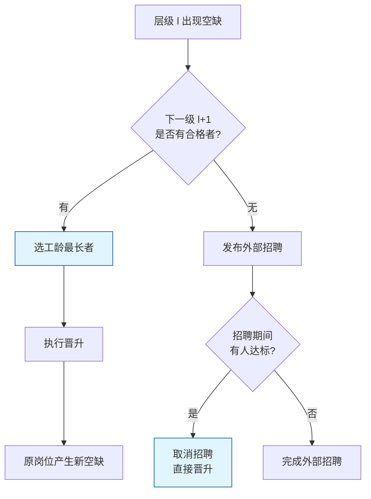

# 晋升事件（Promotion Event）算法

# 晋升事件（Promotion Event）算法

在复杂系统仿真中，静态网络无法反映组织随时间的动态演化。**晋升事件**是驱动人力资本网络演化的核心机制之一，它与离职（Churn）和招聘（Recruitment）共同构成了组织流动的闭环。

## 它是什么与为什么需要

晋升不仅是职位的变动，更是网络拓扑结构的重组。当高层出现空缺时，若仅靠外部招聘，成本高且磨合期长；而内部晋升能保留隐性知识。
==核心逻辑==：HR 经理在信息不完全（不知员工能力与离职概率）的情况下，基于**公平性**和**成本效益**做出决策。

> [!IMPORTANT]
> 核心策略：**经验导向（Experience Oriented）**。优先提拔低一级中工龄最长的合格员工，而非随机选择或基于绩效（因假设 HR 不看年报）。

## 算法执行流程

当层级 $l$ ($l < 6$) 出现空缺时，算法按以下逻辑运行：

1. **检查资格**：扫描层级 $l+1$ 的员工，筛选满足经验阈值的人员。
2. **择优晋升**：若有多个合格者，选择**工作年限（Working Experience）最长**的一位。
3. **递归触发**：被晋升者的原岗位变为新空缺，可能触发下一轮晋升或招聘。
4. **招聘回退**：若无合格者，则启动外部招聘；若招聘途中有人达标，优先内部晋升以节省成本。

## 特殊约束与改进

在实际建模（如 ICM 案例）中，需考虑管理策略的调整：

| 场景 | 常规算法 | 改进后算法（无中层外聘） |
| :--- | :--- | :--- |
| **中级员工离职** | 直接离开，产生空缺 | ==必须留任== 直到低级员工可晋升 |
| **离职倾向影响** | 无额外影响 | 效率 $\varepsilon$ 降至 2% |
| **招聘对象** | 各级别均可外聘 | 仅招聘**低级员工** |

> [!WARNING]
> **常见坑**：忽略“连锁反应”。晋升一个人会产生一个新的低级空缺，这个空缺可能需要通过招聘填补，而不是无限向上追溯。算法必须有终止条件（如最低层级只招不升）。

## 算例演示

假设 Level 3 有一个空缺，Level 4 有两名员工：
- 员工 A：工龄 3 年，符合资格。
- 员工 B：工龄 5 年，符合资格。

**步骤 1**：HR 比较工龄，$5 > 3$，选择员工 B。
**步骤 2**：员工 B 晋升至 Level 3。
**步骤 3**：Level 4 产生新空缺。
**步骤 4**：检查 Level 5。若 Level 5 无人符合资格，则对 Level 4 的空缺启动**外部招聘**。

若此时规定“禁止中层外聘”，则 Level 4 的空缺必须等待 Level 5 有人晋升，或强制 Level 4 现有人员（即使有离职倾向）暂时留任，直到系统通过招聘低级员工并逐级培养填补空缺。

> [!TIP]
> **解题技巧**：在代码实现时，建议使用队列或优先队列（Priority Queue）存储各层级员工，关键字为“工龄”，以确保 $O(1)$ 或 $O(\log n)$ 快速找到最资深员工。
