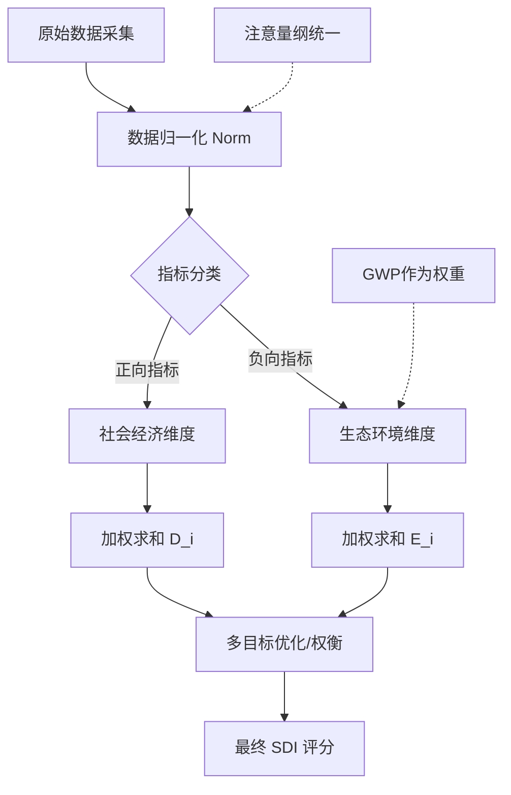

# 可持续发展指数 SDI 的构建与指标体系结构

# 可持续发展指数 SDI 的构建与指标体系结构

可持续发展指数（SDI）旨在量化国家或地区在**经济发展**、**社会福祉**与**生态环境**三者间的平衡状态。不同于单一维度的 GDP 或 HDI，SDI 是一个多指标综合评价模型，核心在于如何处理量纲不一、权重各异且存在矛盾关系的指标。

## 为什么需要 SDI？

单纯追求经济增长往往以牺牲环境为代价。例如，2015年美赛D题指出，传统人类发展指数（HDI）未充分考虑收入不平等与环境成本。SDI 通过引入==生态惩罚项==和==社会调整项==，更真实地反映“高质量”发展水平。

## 指标体系构建流程

构建 SDI 通常遵循“数据标准化 -> 加权聚合 -> 矛盾权衡”的逻辑。

### 1. 数据归一化
由于污染物排放量（吨）与预期寿命（年）量纲不同，必须映射到 $[0, 1]$ 区间。常用最小-最大规范化：
$$
\mathrm{Norm}(x) = \frac{x - x_{\min}}{x_{\max} - x_{\min}}
$$

### 2. 生态影响指数 $E_i$ 的构建
环境污染不能简单相加，需根据危害程度加权。以全球变暖潜势（GWP）为例，将不同污染物转化为 $CO_2$ 当量：

$$
Pollution = \sum_{p} A_p \cdot W_p
$$

其中 $A_p$ 为人均排放量，$W_p$ 为基于 IPCC 标准的 GWP 权重（如 $CH_4$ 的 $W=28$）。最终 $E_i$ 通常定义为归一化后的污染与非再生能源消耗的综合值，**数值越低代表环境越差**。

> [!IMPORTANT]
> **权重选取依据**：权重 $W_p$ 不应主观臆断，应引用权威标准（如 IPCC 100-year GWP），确保模型的物理意义和可比性。

### 3. 社会经济调整指数 $D_i$ 的构建
为弥补 HDI 缺陷，可引入收入分布权重。对收入百分位 $x \in (0,1)$，赋予低收入群体更高权重 $(1-x)$：

$$
D _ {i} = \frac {2}{5} \log \mathrm{Norm} \left( \int I (x) (1 - x) dx \right) + \frac {2}{5} \mathrm{Norm} (L E) + \frac {1}{5} \mathrm{Norm} (E)
$$

## 常见误区与辨析

| 维度 | 传统 HDI/GDP | 可持续发展指数 SDI |
| :--- | :--- | :--- |
| **环境考量** | 几乎忽略 | ==核心组成部分== ($E_i$) |
| **公平性** | 仅看平均值 | 考虑分布不均 (积分加权) |
| **指标关系** | 线性叠加 | 往往存在非线性权衡 |

> [!WARNING]
> **易错点**：在处理 $E_i$ 时，注意方向性。若 $E_i$ 定义为“环境影响”，则高值代表高污染；若定义为“生态质量”，则需取反（如 $1 - E_i$）。务必在论文中明确定义方向，避免逻辑倒置。

## 实例演示

假设某国数据如下：
- 人均 $CO_2$ 排放 10 吨 ($W=1$)，$CH_4$ 排放 0.5 吨 ($W=28$)。
- 归一化后非再生能源使用率为 0.6。

计算污染总值：$10 \times 1 + 0.5 \times 28 = 24$。
若全球最大污染值为 100，则归一化污染值为 $0.24$。
结合能源数据（假设等权）：$E_{raw} = (0.24 + 0.6)/2 = 0.42$。
若定义 $E_i = 1 - E_{raw}$，则该国生态得分为 $0.58$。此过程体现了从原始数据到无量纲指数的完整转换。
