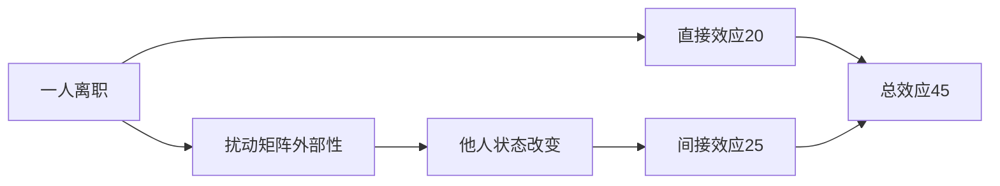

# 直接和间接控制矩阵及扰动矩阵（外部效应分析）

## 什么是直接、间接控制与扰动矩阵

在组织行为或多主体系统模拟中，我们常要分析“某人/某因素变化”带来的影响。最直接的影响叫**直接效应**（Direct Effect），比如一个员工离职直接损失其产出的 20 单位；但周围人看到别人辞职也可能消极怠工，这种由人际关系、外部环境引发的连锁反应叫**间接效应**（Indirect Effect），常通过**扰动矩阵**（或外部效应矩阵 / externality matrix）刻画，反映“外部性”如何传导。

> [!IMPORTANT]
> 核心结论：==直接效应是自身损失，间接效应是他人受扰动后的连带损失==；总效应=直接+间接，且间接常大于直接。

## 为什么需要分开算

如果只看总生产力下降，会以为是“离职人数×单人产出”，忽略了**士气传染、协作断裂**这类外部效应。课件里说：总组织生产力每月约 2000–2500 单位，一人离职造成 20 直接 + 25 间接 ≈ 45 单位，占总生产力约 2%。所以必须把两者拆开，才能评估政策（如补贴、沟通机制）到底是削弱直接还是间接部分。

## 怎么做：从矩阵到模拟平均

设离职人数状态为向量 $x$，间接扰动用矩阵 $E$（元素 $e$ 为外部性强度）表达邻近/关联权重，间接效应可写成：
$$
\text{Indirect} = \alpha \, x^T E x
$$
其中 $\alpha$ 反映“个人如何看待他人辞职”。做多次模拟（如 50 次取平均），就能稳定得到：直接≈20、间接≈25，且比率稳定。

> [!TIP]
> 记忆技巧：直接是“我自己没了”，间接是“别人被我带崩了”；$e<0$ 负外部性要大税/约束，$e>0$ 正外部性可补贴。

## 和相近概念的区别

| 概念 | 含义 | 是否含外部性 |
|---|---|---|
| 直接效应 | 离职者自身生产力损失 | 否 |
| 间接效应 | 他人受扰动后连锁损失 | 是（扰动矩阵） |
| 总生产力 | 组织月度总产出 2000–2500 | 基准分母 |

## 常见的坑

> [!WARNING]
> 别把间接效应塞进直接里；也别忽略 $\alpha$ 和外部性符号——$e$ 从负变正，最优社会效用会加速上升。

## 算对了的小例子

由模拟：总生产力取上限 2500，一人离职直接 20、间接 25，总成本 45，占比 $45/2500 = 1.8\% \approx 2\%$；比率 $25/20=1.25>1$，与考题答案一致。可见**间接效应通常大于直接效应**，管理重点应在削弱外部负扰动。
