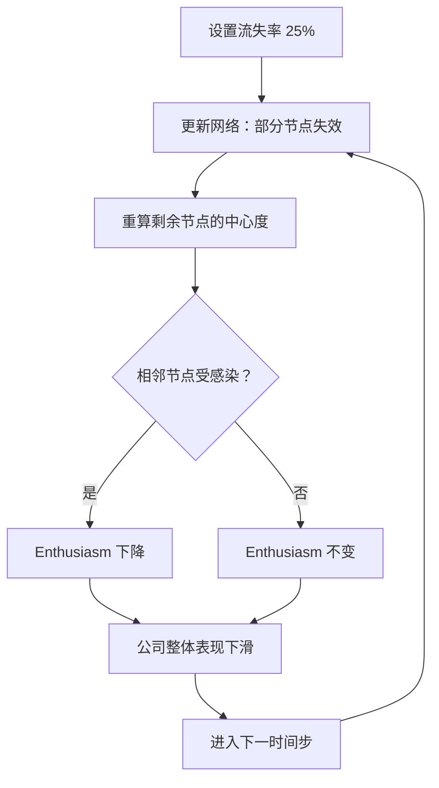

# 员工流失意向评估（Turnover Contagion、中心度、前员工影响）

## 员工流失意向评估

### 它是什么

员工流失意向评估并不只是预测“谁要走”。在 ICM 公司的网络模型里，它研究的是 **==离职行为如何像传染病一样在同事关系网中扩散==**（Turnover Contagion），以及单个员工在人际网络中的位置如何决定其受感染的风险与对组织的破坏力。

简单来说，一名员工离职，不只是空出一个工位——他敲碎了网络的一个节点，整张网的应力都会重新分布。

### 为什么需要

ICM 面临的问题很有代表性：流失率从某个阈值开始，会触发正向反馈式的加速下滑。一个人离开 → 他原本的协作关系断裂 → 身边同事的工作效率下降、热情降低 → 同事本身的流失意向升高 → 更多人离开。

如果不建模这种“间接效应”，就容易只看到直接的生产力损失，而低估了公司整体表现（Company Performance）持续恶化的速度。复习题中模拟了 25% 与 35% 流失率下的结果，正是为了量化这种间接破坏。

### 怎么做

核心逻辑有三个部分：

| 概念 | 含义 | 在 ICM 模型中的作用 |
| :--- | :--- | :--- |
| **中心度（Centrality）** | 衡量一个节点在网络中的“重要性” | 高中心度的员工离职，会同时拉断多条协作关系，导致更多人的 Enthusiasm 同步下降 |
| **流失传染（Turnover Contagion）** | 离职行为沿连边传播的过程 | 某员工离职后，相邻节点的 churn rate 参数会上升，即感染了“离职意向” |
| **前员工影响** | 离职人员仍然通过曾经的关系间接干扰在岗员工 | 模型计算间接效应时，把前员工的“拖拽”也折算进当前员工的 Working Efficiency 下降里 |

`yaml:front-matter`
`title: 员工流失意向评估`
`requires: [数学建模/复杂网络基础]`
```

#### 模拟流程



### 和相近概念的区别

> [!NOTE]
> **流失传染 vs. 普通人员流失预测**
> 传统的人力资源分析通常关注个体属性（薪水、工龄、绩效）与离职概率的关系。而网络模型关注的是 ==**结构性风险**==：即使每个个体属性看起来都很健康，但只要某个高中心度的关键人意外离职，整个网络的绩效就可能被连锁反应打穿。

### 常见的坑

> [!WARNING]
> **低估间接效应的平滑性**
> 复习题材料里特别提到：“company performance is continues in adjacent month, there is obvious fluctuation at the beginning and gradually becomes stable.” 初期的剧烈波动容易被当成模型震荡而忽略，但事实上那是公司最脆弱的时刻。如果对策只在稳定期才生效，可能已经晚了。

> [!CAUTION]
> **把“中心度”等同于“管理层级”**
> 网络中的高中心度节点不一定是经理。他可能是一位与多个部门协作的一线技术专家。仅停止中层外部招聘（如 2.4.3 节假设），而忽视非管理岗但高中心度的节点，会从错误的方向修改模型。

### 一个算对了的例子

取 ICM 的 25% 流失率场景：

- 假设初始总绩效为 $190\sigma$，在岗人数 100 人，平均 Enthusiasm $=1.0$。
- 模型迭代 100 个月后，在岗率稳定在 $75\%$ 左右，即剩余约 $75$ 人。
- 但最终公司总绩效不是简单的 $190\sigma \times 0.75 = 142.5\sigma$，而是 **$179\sigma$**。

这个差距说明：==存活下来的员工仍然保持了相对较高的效率==（Enthusiasm $=0.87$），公司并没有被等比摧毁。这就是直接损失与间接传染效应共同作用后的净结果。

当流失率升至 $35\%$ 时，在岗率降至 $67\%$，最终绩效仅为 $153\sigma$，且 Enthusiasm 进一步跌至 $0.81$。对比两个场景就能清晰读出：==新增的 10 个百分点流失率，不仅带走了更多人，还传染出更高的士气损失==。
