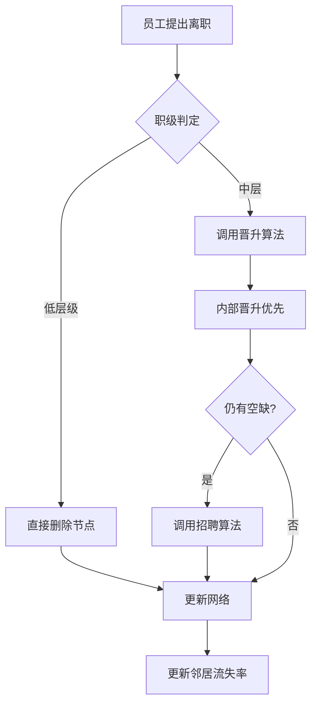

# 离职事件（Demission/Turnover Event）定义与算法

## 离职事件的定义与算法

### 为什么需要离职事件

在团队科学的动态网络模型中，网络不是静态的。员工离职、晋升、招聘共同驱动组织内部的人员流动与网络演化。其中，==离职事件是网络演化的核心驱动力之一==：一个节点的移除不仅改变网络结构，还会通过“涟漪效应”影响相邻节点的状态——这正是复杂系统仿真需要刻画的关键机制。

先想一想：如果只把离职理解为“删掉一个节点”，有什么问题？

问题在于真实组织中存在两类连锁反应：

1. **职位空缺的传递**：中层离职往往需要下级晋升或外部招聘来填补，形成逐层递补。
2. **情绪与留任意愿的传染**：某员工离职会降低邻近员工的工作热情，提高其流失概率。

因此，离职事件不能只定义为“节点删除”，而必须定义为一个**带触发条件的演化算法**。

### 离职算法的定义

设在时刻 $t$ 的网络中，员工集合为 $V_t$，节点 $v_i$ 的职级为 $L(v_i) \in \{\text{low}, \text{middle}, \text{high}\}$。离职算法按如下规则执行：

算法的数学描述如下：

**离职判定**：对每个节点 $v_i$，设其流失概率为 $p_i(t)$。若 $p_i(t)$ 超过阈值或随机抽样触发，则 $v_i$ 进入离职流程。

**级联填补**：

- 若 $L(v_i) = \text{low}$，则直接从 $V_t$ 中移除 $v_i$；
- 若 $L(v_i) = \text{middle}$，则优先从低层级员工中晋升一人填补该职位；若无法内部填补，再调用招聘算法从外部引入新节点。

**邻居效应**：节点 $v_i$ 离职后，对其所有邻居 $v_j \in \mathcal{N}(v_i)$，更新其流失率：

$$
p_j(t+\Delta t) = p_j(t) + \lambda \cdot w_{ij}
$$

其中 $w_{ij}$ 为 $v_i$ 与 $v_j$ 的连接紧密度，$\lambda$ 为传播系数。

> [!IMPORTANT]
> 离职事件的核心不是“删除节点”，而是**删除后触发的填补链与邻居状态更新**。职级条件是算法分支的关键。

### 与其他演化事件的区别

| 事件类型 | 触发条件 | 对网络的操作 | 级联效应 |
|---|---|---|---|
| 离职事件 | 流失率超阈值 | 删除节点 + 触发填补 | 影响邻居流失率 |
| 晋升事件 | 上级职位空缺 | 节点属性变更、边重连 | 触发下级晋升链 |
| 招聘事件 | 内部无法填补 | 新增外部节点 | 有时间延迟（到岗向量） |

晋升与离职的关键区别在于：==晋升改变的是节点的属性（职级）与连边权重，不删除节点==；离职则直接移除节点，并可能引发晋升和招聘的连锁调用。

### 一个算例

设某部门有 5 名员工：$A$（中层）、$B_1, B_2$（低层）、$C$（中层）、$D$（低层）。邻接关系为 $A \leftrightarrow B_1, B_2$；$C \leftrightarrow D$；$A \leftrightarrow C$。

假设 $A$ 的流失率 $p_A(t)$ 超过阈值，触发离职：

1. $A$ 为中层，不能直接删除——调用晋升算法；
2. 晋升算法从 $B_1, B_2$ 中择优晋升 $B_1$ 接替 $A$ 的职位；
3. $B_1$ 原职位空缺，由于 $B_1$ 原为低层，直接删除原节点并调用招聘算法补入外部新员工 $E$；
4. 更新邻居状态：$C$ 是 $A$ 的邻居，设 $\lambda = 0.1$，$w_{AC} = 0.6$，则
   $$
   p_C(t+\Delta t) = p_C(t) + 0.1 \times 0.6 = p_C(t) + 0.06
   $$

最终网络节点从 $\{A, B_1, B_2, C, D\}$ 变为 $\{B_1, B_2, C, D, E\}$，且 $C$ 的流失率上升了 $0.06$。

> [!WARNING]
> “邻居”指的是网络中与该节点有直接连边的节点，而不是物理工位相邻。计算流失率传播时必须用网络邻接关系，不能用空间距离。

### 常见误区

- **误区一**：把离职概率设为常数。实际上离职概率随时间与邻居状态动态变化，是仿真中的**状态变量**而非固定参数。
- **误区二**：所有职级离职后都直接删除。中层离职必须先走晋升填补流程，否则会造成组织层级断裂。
- **误区三**：忽略离职的时间延迟效应。招聘补入存在到岗时间向量，网络修复不是瞬时的。

> [!TIP]
> 在 O/M 论文中描述离职算法时，建议分三层写：**触发条件 → 分支流程 → 邻居状态更新**，这样评审能快速抓住算法的完整逻辑链。
