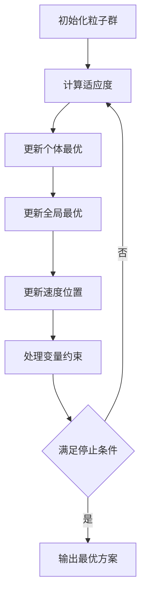

# 粒子群优化算法（PSO, Particle Swarm Optimization）

粒子群优化算法（PSO）把每个候选解看成搜索空间中的一只“鸟”，用一群粒子的协作来逼近最优解。它特别适合==目标函数复杂、不可导、只能代入计算==的问题，例如赞比亚可持续发展模型：先固定环境权重 $\alpha$，以
$$
S=\frac{D+\alpha E}{1+\alpha}
$$
为可持续性指标，再寻找 20 年投资分配，使最终 $S$ 最大。

## 粒子怎样搜索

设第 $i$ 个粒子的位置为 $\boldsymbol x_i$，每个分量对应一项决策变量，如某类项目某年的投资额；速度 $\boldsymbol v_i$ 决定下一步搜索方向。粒子记录自身历史最优位置 $\boldsymbol p_i$，整个群体记录全局最优位置 $\boldsymbol g$。典型更新公式为
$$
\boldsymbol v_i^{t+1}
=\omega\boldsymbol v_i^t
+c_1r_1(\boldsymbol p_i^t-\boldsymbol x_i^t)
+c_2r_2(\boldsymbol g^t-\boldsymbol x_i^t),
$$
$$
\boldsymbol x_i^{t+1}=\boldsymbol x_i^t+\boldsymbol v_i^{t+1}.
$$
其中 $\omega$ 控制惯性，$c_1,c_2$ 分别控制个体经验与群体经验，$r_1,r_2$ 是 $[0,1]$ 上的随机数。三项可记为“==惯性向前、回顾自己、学习最优==”。

## 怎样用于建模题

先把“投资方案”编码成向量，再明确目标与约束。若每年投入为 $x_{t,k}$，则常见约束包括
$$
x_{t,k}\ge 0,\qquad \sum_k x_{t,k}=B_t,
$$
其中 $B_t$ 是第 $t$ 年预算。适应度可取迭代函数图运行 20 年后的 $S$，也可加入贫困、污染等惩罚项。每次评价一个粒子，都要完整执行一次 20 年模拟，而不能只比较某一年指标。

例如某粒子给出“教育、医疗、清洁能源”的年度投入，模型算得 $D=0.72,E=0.48$。若 $\alpha=2$，则
$$
S=\frac{0.72+2\times0.48}{3}=0.56.
$$
另一个方案算得 $S=0.53$，在其余条件相同且只最大化 $S$ 时，前者更优；随后据此更新 $\boldsymbol p_i$ 和 $\boldsymbol g$。注意，$0.56$ 只是该方案的评价值，并不证明它已是全局最优。

## 与相近算法的区别

| 方法 | 搜索依据 | 更适合的情形 | 主要局限 |
|---|---|---|---|
| PSO | 粒子速度与群体经验 | 连续变量、黑箱目标 | 可能早熟，约束需另处理 |
| 遗传算法 | 选择、交叉、变异 | 连续或离散编码 | 算子与参数较多 |
| Nelder–Mead | 单纯形几何变化 | 低维无约束连续问题 | 高维及复杂约束下较弱 |
| Powell | 沿搜索方向迭代 | 不可导连续优化 | 也可能陷入局部最优 |

PSO 与元胞自动机不要混淆：==PSO 优化“投多少钱”，元胞自动机可模拟“投向哪里”==；前者搜索决策，后者按局部规则演化空间状态。

> [!WARNING]
> 粒子数、迭代次数增加不等于必然找到全局最优。应报告参数、随机种子或多次独立运行结果，并检查预算约束、收敛曲线及对 $\alpha$ 的敏感性。

> [!TIP]
> 论文中写清“变量编码—适应度—约束处理—参数—停止条件—最优方案”，比只写“使用 PSO 求得最优”更完整。
